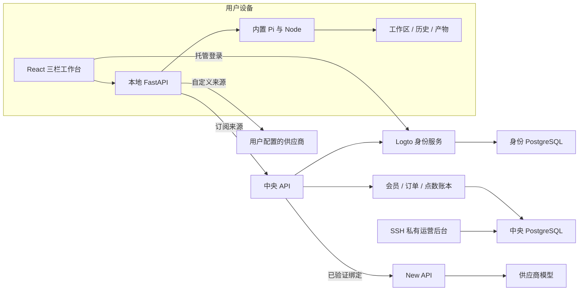

# 01 · 架构与交付现状

适用日期：2026-11-05。服务运行状态与钱包余额需按当次巡检结果确定。

## 1. 产品目标

Easel 是以对话驱动的内容创作工作台。用户在本机管理对话、工作区、技能与产物，默认使用随软件打包的 Pi Agent。模型来源保留两条路径：

- **自定义接口：** 用户配置自己的供应商地址、密钥与模型，费用由其供应商账号承担。
- **中央订阅：** 用户通过 Logto 登录，使用中央发布并授权的模型与功能，由共享钱包预留和结算点数；用户无需逐个配置中央供应商密钥。

同一账号体系面向后续多个产品。共享会员和钱包并不意味着任一产品可读取其他产品文件、会话或任务；权限仍要绑定用户、租户、产品、钱包与具体执行上下文。第二个真实产品尚未完成接入。

## 2. 总体结构

图中浏览器托管登录最终通过本地桥与中央会话完成产品认证；中央供应商密钥不交给浏览器。Console 为独立管理 BFF，有独立身份应用、权限校验和数据库角色，不等同普通产品页面。

## 3. 组件与责任

| 组件 | 责任 | 主要源码位置（仓库相对路径） |
| --- | --- | --- |
| 工作台 | 三栏导航、对话列表、内容展示、草稿、模型／推理选择、用户卡片、五主题 | `web/frontend/` |
| 本地服务 | 同源 API、工作区、历史、下载、Agent 生命周期与中央桥 | `web/app.py`、`easel/platform/` |
| Pi | 文本和工具循环；由 Easel 限制工作区、工具确认与任务归属 | `runtime/pi/worker.mjs`、`easel/harnesses/pi*.py` |
| 技能 | 内容生产、媒体适配、发布等；每项技能有独立依赖和外部权限 | `skills/builtin/`、`skills/shared/` |
| 中央 API | 产品认证、会员权益、模型目录、执行准入、预留、结算与恢复 | `services/platform/src/platform_service/` |
| 私有 Console | 用户／套餐／钱包／模型／订单／核算队列／审计的受权管理 | `services/platform/frontend/`、`console_app.py` |
| Logto | 注册、登录、认证协议与身份数据库；不负责最终消费账本 | 独立部署；项目配置见 `services/platform/README.md` |
| New API | 供应商渠道、业务令牌、模型路由与特定插件协议 | `integrations/newapi/` |
| 备份与恢复 | 私有加密捕获、文件清单、媒体与数据库隔离恢复验证 | `media_backup_b2/`、`media_backup_b3/`、`media_maintenance/` |
| 桌面交付 | 固定来源、运行环境、库存、包哈希与升级保全 | `packaging/pi/`、`scripts/packaging/` |

中央业务库、Logto 身份库与 New API 数据库属于不同的权威范围。网关额度不直接等于中央点数；网关不能替代会员、共享钱包、产品隔离或最终结算。

## 4. 一次订阅对话怎样运行

1. 用户从头像入口发起新登录，在 Logto 页面本人完成认证。
2. 中央根据精确身份映射恢复原用户、租户和钱包，本地私有会话保存必要凭据。
3. 工作台加载当前账号的中央模型目录，用户在输入框右下角选择模型。推理档位仅依据接口已声明能力显示；没有能力声明时保持默认。
4. 本地桥创建有归属的 invocation／operation，申请短期任务授权。中央校验功能、点数、执行并发与待核算限制，冻结模型绑定和费率并预留预算。
5. 中央经 New API 发送已验证的模型协议并流式转发。Pi 如收到工具调用，在本机执行获准工具，再发起下一次模型操作。
6. 中央先持久化可信终态和用量，再结算点数、释放预留余量。本地展示最终输出并保存产物。
7. 断流或应答未知时，用户查询原操作；查询不会重新请求模型或重做工具。

同一次 Agent 对话可能包含多次模型操作。费用由每次已接受操作的冻结合同决定，不能将一次对话简单视为一次供应商请求。

## 5. 身份、权限与数据

身份以精确 `(issuer, subject)` 绑定，不能按相同邮箱或用户名自动合并。更换域名／issuer 属于身份迁移，不是单纯修改前端地址。产品账号不自动获得管理员权限；独立管理员需先登录产生申请，再由运营者批准准确申请编号。

数据库至少分开迁移 owner、API runtime 和 Console runtime。常驻服务不持有 owner，Console 不持有供应商业务密钥和支付私钥。管理角色还区分 admin、operator、viewer。启动时检查实际数据库权限；不能仅靠角色名称证明隔离。

| 数据 | 所在层 | 维护原则 |
| --- | --- | --- |
| 对话、草稿、附件、用户自定义接口 | 用户设备工作区／本地私有配置 | 升级前按实际路径保护；不能假定都在仓库 |
| 账号密码哈希与身份应用密钥 | Logto 身份库／私有配置 | 登录用户与管理员应用分离；迁移验证身份连续性 |
| 会员、订单、钱包、预留、账本与审计 | 中央业务库 | 资金变化必须有受信来源、幂等键及审计 |
| 供应商 Key 与网关业务令牌 | 服务器私有配置／New API | 不进入桌面包、浏览器、普通日志或交付文档 |
| 中央媒体文件与引用 | 私有媒体存储及业务库 | 同时保护文件、归属、状态与 GC／写入窗口 |

## 6. 点数和异常终态

1 点为 1,000,000 微点。内部使用整数或有理数费率，API 用十进制字符串表示微点，避免浮点账差。实际计费依据发布的不可变合同，不在前端硬编码。

| 情况 | 资金含义 | 恢复规则 |
| --- | --- | --- |
| 任务未实际派发 | 按合同释放未使用预算 | 先核实是否确实未发送 |
| 带可信用量终态 | 结算实际扣点并释放余量 | 财务提交失败只恢复原结算 |
| 已派发但费用未知 | `pending_reconciliation`，保留预留，actual 可能为 NULL | 查询原请求、收集可信证据；不自动重派 |
| 经独立批准平台承担 | 客户收费为零，保留实际用量未知事实与审计 | 只适用准确获批任务，不扩展到其他记录 |

执行并发与待核算数量采用分开的限制；历史方案为执行并发 1、待核算最多 3，实际仍以生效权益和运行策略为准。待核算上限触发时，改 UI 或重启服务不能解决原资金事实。

## 7. 交付成熟度

| 模块 | 现状 | 剩余门槛 |
| --- | --- | --- |
| 三栏 UI、主题、模型选择与用户卡片 | 有源码、多轮测试与历史工作台验收 | 新包激活与完整目标设备验收 |
| Pi 内置运行环境 | macOS 预览包已包含 Python、Node、Pi | 签名、公证、净机和正式发行 |
| 中央账号、会员、钱包、私有后台 | 已有部署和真实登录、扣点记录 | 第二真实产品、完整商业运营验收 |
| 文本和两款图片 | 有历史真实模型／工具／产物／扣点证据 | 新模型需逐一验收，不扩大成全部模型兼容 |
| 微信与支付宝 | 后端与隔离验证已开发 | 商户配置、正式套餐条款、真实收款和退款 |
| M2/M3/M4 及 AV | 候选能力与组件验证 | 来源闭包、运行权限、真实供应商与资金终态 |
| B1/B2/B3 | 文件归档、备份捕获和多项隔离组件已推进 | 全新数据库／角色／配置／媒体／应用完整恢复 |
| 多节点与云端 Agent | 有边界设计 | 实现、故障演练、容量与一致性验收 |

## 8. 原始资料

- [项目交付总账](../../superpowers/plans/2026-10-27-delivery-completion.md)
- [中央服务](../../../services/platform/README.md)、[Console](../../../services/platform/CONSOLE.md)、[支付](../../../services/platform/PAYMENTS.md)
- [三机部署记录](../../../services/platform/deploy/SPLIT-DEPLOYMENT-20261024.md)
- [v36 构建及未激活说明](../../validation/2026-10-31-workbench-v36-delivery.md)
