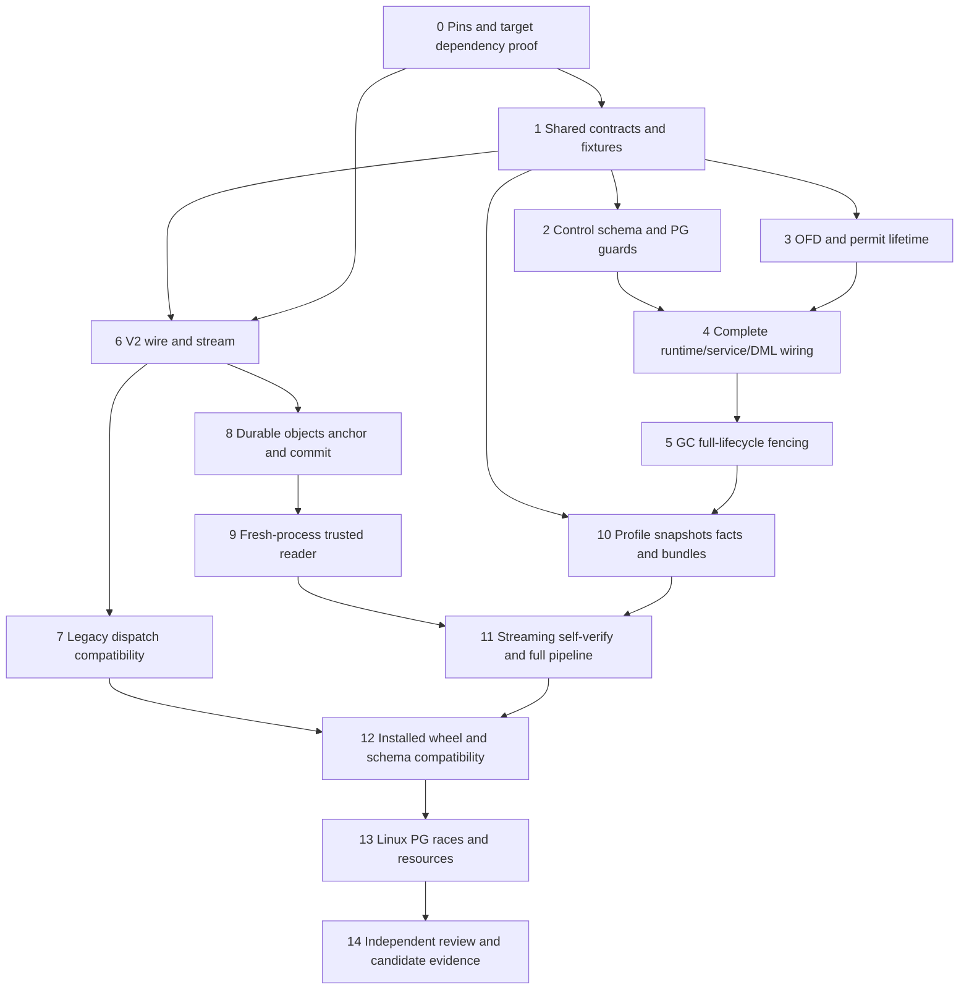

# B2 Controlled Capture and Authenticated Backup Implementation Plan

> **For agentic workers:** REQUIRED SUB-SKILL at execution time: use `subagent-driven-development` or `executing-plans` task by task. Root adopted this task map after the human approved R3 local development and isolation on 2026-10-30. Implementation evidence is tracked task by task below. Checkboxes remain unchecked. Root assigns exclusive ownership before any source edits.

**Goal:** Deliver the whole approved B2 route A as a local, isolated candidate: durable media maintenance control and complete operation permits, one-host physical barrier, a genuine snapshot-bound generic capture producer, authenticated v2 stream, independent durable recovery anchor, compatibility adapter, durable reread/self-verify, and an installable package with isolated evidence.

**Architecture:** A dedicated `easel_backup_control` schema and a root-owned control inode jointly fence every media mutation for the whole operation lifetime. A new generic producer supplies the unchanged B1 content contract; the v2 archive/context objects are authenticated, durably reread, bound by an independently anchored commit, and read in a fresh process. Runtime media guards live in the installable application package; import-only capture/crypto orchestration never activates production maintenance or a scheduler.

**Tech Stack:** Existing Python 3.12 platform service, psycopg/PostgreSQL, standard-library descriptor IO, Linux flock plus thread-safe OFD reference ownership, existing cryptography RSA, candidate PyNaCl **1.6.2** and its exact reviewed wheels. Actual target wheel/API/libsodium evidence is an implementation gate, not a fact established by this map.

## Authority, ownership and current evidence

- Human has explicitly approved local development and isolation for the **same R3** design. The design's preserved historical header still says awaiting approval; it does not revoke that new human instruction. No new human approval question is needed for this same scope.
- Authority pin: `docs/superpowers/specs/2026-10-30-media-backup-b2-design.md`, **24,487 bytes**, SHA-256 `f9614a317705fd25663bd942e847759910a8d1c4fcf9c9a70e9107b8d8603cff`. No format-only reduction: sections 3–8 are all required.
- This task only reads public source and writes `/private/tmp/easel-media-backup-b2-implementation-map-20261030.md`. No product/docs/test edits, imports of product modules, tests, runtime, DB, private configuration, keys, ciphertext, network or SSH occurred. `.codegraph/` is absent. The memory quick search returned no relevant B2 entry; current source and approved design control this map.
- Root is concurrently finishing status repair and owned-PG email work. **No B2 implementation starts until root assigns file ownership.** In particular do not edit shared `app.py`, `db.py`, `credits.py`, test conftest or dependency lock concurrently. A lack of free agent slots is not permission to overlap files.
- No automatic commit/push/merge. No production CLI, entry-point activation, real maintenance, service stop/start, model toggles, real DB/key/config access, timer, migration, wallet repair or provider request. B3/full restore, AV, real legacy ciphertext, Linux production/systemd, off-host anchor transfer, multi-host storage, stress, and whole-machine recovery remain independent gates.

## Implementation progress (2026-10-30; component evidence only)

- T0 local dependency gate accepted: pinned PyNaCl 1.6.2 wheels, source-attributed native version/provenance and actual macOS arm64/Linux amd64 functional probes. Direct native version API is unavailable; no SLSA build or reproducibility claim. Root acceptance is `outputs/_run/b2-development-20261030/dependency-acceptance.safe.json`.
- Crypto T1/T6/T7 component: 156 new cases plus 219 unchanged B1 cases passed; independent review found no blocking issue. Fixed synthetic v2 vector is an application-format regression, not an external standard vector. Legacy synthetic compatibility does not prove real historical ciphertext restore.
- T2/T3 maintenance component: four independent SQL/fork defects and a later public-permit RLock entry omission were fixed. Final author component suite61 passed; independent prior58 and exact original last probe also passed, with root two-file delta/14-pin review. This is the accepted historical component baseline. T4/T5 is now adding actual runtime wiring, GC ownership and per-generation source/control/FS/namespace attestations; its new SQL/API source is not covered by the old baseline counts.
- T8/T9 durable/anchor/reader component: author445 combined cases passed (70 new,156 crypto,219 B1). Independent review found constructor-cancellation FD leaks; root corrected three ownership boundaries and independent81-case re-review closed the finding. Fresh-process and33MiB synthetic file evidence remains distinct from a real snapshot producer/installed wheel.
- T10 has real central exported-snapshot tests, direct owned-PG credential/catalog/keeper probes, and an actual isolated Logto1.45.0 schema (79 tables/8 enums). Independent catalog/role/keeper/remote-tool findings were fixed at component level. Latest full dump/schema/Logto source acceptance remains pending because Docker's local API is not responding; older nine-case dump results do not prove the latest source.
- T11 now implements the full import-only orchestration and bounded content verifier. Root34 component cases plus five unchanged independent deadline/key probes passed together39/0; SQL/raw capture/coverage are explicitly isolated in those orchestration fixtures. Parent deadlines retain actual live-thread EX refs; lost commit and window receipts are separate outcomes. Independent review remains in progress and real integrated capture/coverage is still required.
- T12 preparation has10 targeted cases and actual installed-prefix B1/v2 roundtrips for local001–020 and exact-f50-based001–016 overlays. The latter is explicitly guardless/incomplete until a reviewed frozen-release runtime delta and actual001–016 PG/runtime evidence exist. Both wheels are interim, not the integrated candidate.
- 2026-10-31 update: controlled Docker recovery and old-test cleanup were explicitly approved and completed; do not repeat the old pending question. T4/T5 SQL fixes and legacy fixture coverage fixes are independently closed. Current-source legacy30 has580PASS0skip, producer72PASS, sourcewhole6PASS, actual outside-checkout installed current020 whole6PASS and frozen016 whole4PASS;379publicsource/test hashes stable. Two candidatewheels and17safe evidence files are in outputs/_run/b2-wheel-candidate-20261031/. See docs/validation/2026-10-31-media-backup-b2-runtime-integration.md for exact scopes and retained environment failures. T12 local installed-profile evidence is now materially stronger; fullLinux/T13/T14 and allproductionB3 gates remain open. Publicmigrations/B1/R3 stayfrozen; no production service/timer/key/data/model action.

### 2026-10-31 T13 actual execution preparation

The frozen r2 harness contains18 scripts/21 selections and retains all42 checklist IDs; independent static readiness passed only for that fixed source. Root actually prepared full020 with1721 exact public Python entries,307 excluded known cache files,34 wheels and18 scripts (59,281,965B; payload505410bde0335123c998c115e36823830f661aca042a3d15d10001b6dc4784bb). The first bounded offline installer exited1/noOOM before receipt creation; no image commit, PG/business or provider start occurred. Read-only archive headers from that exact stopped container show `/opt`, `/usr/local` and its site-packages owned501:0/0755, violating the root-without-DAC write prerequisite. Preserve r2/context/container/logs as a failure. A new r3 public-tar transport normalizes explicit numeric ownership to0:0 while retaining cap-drop ALL and private/public modes; it requires finite host RED/GREEN, independent delta review and actual target ownership before another installer start. No Linux install/native/app-UID/T13 pass is claimed. See the current runtime integration report and outputs/_run/b2-development-20261030/t13-r2-actual-preparation-20261031/.

## Global constraints inherited by every task

1. State: `OPEN → DRAINING → CAPTURING → VERIFYING → RECOVERING → OPEN`; uncertainty to `NEEDS_REVIEW`. Every transition is owner+window+epoch+expected-state CAS. Expiry never automatically OPENs, drops permits or re-enables models.
2. Drain budget **30 seconds**; combined capture/verify budget **120 seconds**. Deadline includes blocked IO, children, crypto finalization, durable reread and postconditions. No success after timeout. Query the exact original intent/window on lost receipt; never create a new nonce and retry blindly.
3. Control schema has its own checksum migration ledger. Public migrations **001–020 stay byte-identical**. Do not call generic `Database.migrate()` to install control schema or silently install 017–020. Missing/incompatible control schema fails closed for media mutation.
4. Runtime only reads safe status and calls restricted permit functions; no direct control-table writes, OPEN/takeover or owner privileges. Fixed SECURITY DEFINER search_path, schema/table/function ACLs, and direct-DML counterexamples must be proven on owned PG.
5. Opaque server-issued **256-bit** permit token; only digest stored. Bind epoch, kind, exact subject/object/attempt, worker generation and state. No HTTP/JSON capability or boolean GUC shortcut. OPEN issues new permits; DRAINING only permits an already admitted same-attempt continuation. A continuation cannot create a new generation or replace upstream identity.
6. Permit and same-inode shared OFD capability last through all DB/physical/finally work. Each actual thread/process action has a live reference. Parent cancellation cannot release the last reference while a thread still runs; an unstarted child cannot begin after permit closing/invalidation. Process death/FD closure does not delete its DB permit. Only exact permit/epoch closure after stable business state and zero physical references retires a completed transient permit; unknown stays reviewable.
7. Controller holds same-inode exclusive capability throughout capture, crypto finalization, self-verify and source postconditions. Root chain, dev/ino, owner/mode, mount namespace, filesystem, host/boot/process-start and worker generations are fixed and rechecked. Same path/different inode is failure. No multi-host/NFS/SMB/unknown writer assumption.
8. Permit acquisition is outside existing business locks; retain quota advisory lock and wallet→invocation→job→reservation→work ordering. Controller never holds wallet/job locks while waiting for drain. No DB transaction locks held across provider network/decode operations.
9. New v2 magic `EASELBS\x02`; new writer never writes v1. Exact approved header/AAD/frame/FINAL syntax, size/count budgets and strict parser rules are mandatory. Fixed crypto chunk **1,048,576** bytes; decoder hides ciphertext fileno; empty plaintext EOF means FINAL+all hashes/counts+ciphertext EOF1 already passed.
10. Archive plaintext is exact B1 physical size ≤32 GiB. Context is exact canonical plan **1 byte to 32 MiB**, no 1MiB minimum, no padding. Cipher budgets: archive `32GiB+2MiB+8192`, context `32MiB+65536`. Header ≤8192; FINAL ≤4096; commit ≤16384. Bounds precede allocation; no plaintext archive whole-bytes buffering.
11. Seven fixed B1 logical files remain; source facts are raw canonical bytes inside the `source_facts` field of the `config/central` bundle plus digest, not a digest-only substitute. The hash dependency graph is acyclic. Actual per-sequence parameter/owner/association/last_value/is_called is identical before, in actual dump, and after; normal text sequence movement fails capture rather than altering setval or old F2 rules.
12. Fixed object names `archive.easelbs2`, `context.easelbs2`, `COMMITTED.json`. Two cipher objects durable + self-verified → independent root-private anchor durable → atomic **no-clobber** commit publication → directory/ancestor fsync. No exists-then-overwrite rename, untrusted anchor-from-same-package, automatic cleanup or success from a partial group.
13. Private new jobdir 0700; exclusive ordinary nlink1 0600 files. File fsync, same-inode reopen/fstat and all new directory entries' durability include jobdir, backup root and newly created ancestors. Partial/unknown stages remain private and unaccepted; never delivered to application/PG.
14. B1 and frozen F1/F2/mixed sources and old failure results remain unchanged. Current 001–016 production compatibility and local 001–020 coverage are separate; packaging B2 cannot enable M2/M3/Incho by accident.

## Independent source review: concrete reuse boundaries

| Public source | Current exact contract / independently read finding | B2 consequence |
| --- | --- | --- |
| `services/platform/scripts/media_backup/closure.py:80–98` | `write_archive(plan, media_fd, file_fds, sink, *, owner, limits=Limits())`; `_HashSink` hashes only accepted plaintext count; B1 only ends USTAR | Keep source frozen. V2 encoder implements `write(raw)->accepted_plaintext_count`; caller invokes explicit crypto `finish` only after B1 success. Never use B1 receipt as crypto success. |
| `closure.py:135–196`, `ustar.py:235–247` | `restore_archive(source,parent_fd,name,expected_plan,*,limits)` writes private stage; `TarReader.finish()` performs final `read(1)` and requires empty | V2 EOF is an authentication barrier. Auth failure raises before B1 private-stage receipt. Decoder omits/raises UnsupportedOperation for fileno. Failure stage stays private. |
| `contract.py:21–53,191–259` | Exact seven files, normalized plan/registry, tightening-only Limits; `physical_size` exact upfront length; `encode_manifest` canonical UTF-8 | Do not invent new B1 fields or switch its canonicalization to ASCII. V2 public header/FINAL/commit use their separate canonical ASCII rules; context body remains exact B1 canonical bytes. |
| B1 `files.py`, tests `test_media_backup_*` | Borrowed FD ownership, strict flat source inventory, tombstones/absence, nlink/metadata and observed drift rejection; B1 no DB/crypto/scheduler | Supply a real capture window; do not treat source before/after file checks as a concurrency barrier. Preserve all five existing B1 modules and five B1 suites. |
| `media_runtime.py:50–90,192–219,232–405,413–440` | uploads/tasks/worker/voice recovery/financial/GC are different lifetimes; run_once does not depend on model enabled; close cancels parent tasks | Gate the full runtime operation family, not just submit or tasks set. Register every lifespan generation, and wait actual child references rather than parent cancellation. |
| `media/storage.py:97–131` plus `media_runtime.py:413–426` | prepare/claim have no storage advisory lock; runtime unlinks first then finish_gc checks token; deleted retains historical gc_token | New claim→revalidate→unlink→finish transaction/permit fence is required. Historical deleted token alone is not active GC. Do not erase unknowns to let capture pass. |
| `media/artifacts.py:53–76,78–172`, `media/worker.py:28–66` | mkdir, put, part promotion, unlink/discard and finally cleanup can occur below HTTP/service | Require internal physical capability at each syscall path, including low-level direct calls. Worker direct syscalls cannot bypass store policy. |
| `media/core.py:174–198,200–220` | media reserve is tagged `operation='media'`; existing wallet/invocation/job/reservation order; reserve occurs before job row insert | Guard media finance at trusted transaction boundary and by reservation operation/lineage; don't rely only on an already-inserted media_jobs row or block unrelated text finance. |
| `app.py:40–71`, `db.py:66–113` | each API lifespan starts worker; generic migrator scans all numbered public SQL | Generation registration includes every API process. Dedicated control installer is import-only, does not reuse generic migrate. |
| Frozen `legacy-sealed-transfer.py` | SHA `7dd81fbc97d60c782fe2d2c43d81e37fc0b4ea926504e66309a43abc144ad7d6`; magic EASELST/v1, RSA-OAEP-SHA256+A256GCM, 32MiB whole bytes; exact `unseal(private_pem,envelope,expected_transfer_id,expected_kind,expected_target)` | Keep v1 source pin, independent historical expected context and cap. Magic dispatch only, no auth fallback. V1 does not become a streaming 32GiB reader. |
| Frozen `legacy-backup.py:248–266` | SHA `d330bccf0c71f9c4d808411ba48d87c217048dde0763023e4e9ca0cb45bb14a1`; `verify_payload(payload,expected_manifest)` checks old members/manifest/PGDMP; inner differs from B1 | Adapter performs unseal then this frozen payload check, never main/collect/crypto/save or real DB restore. No converting old manifest into B1 plan. |
| `pyproject.toml:23–28` | wheel currently only `src/platform_service`, frontend+Pillow license force-includes; B1 scripts absent | Installable B2 must explicitly carry byte-pinned B1 and frozen legacy resources, SQL, dependencies and licenses, then verify actual wheel outside dev sys.path. |
| `tests/conftest.py:14–39,43–65` | test DSN must literal loopback + easel_s1_test prefix; default db fixture calls all migrate and teardown owns its schema | B2 control privilege/profile tests need their own owned fresh DB/roles fixture; don't reuse db fixture for 001–016 compatibility or touch root's email DB/process. |

No legacy crypto, product module, DB or test was executed during this review. The R3 source pin, old helper pins and actual B1 APIs above are current-byte facts; prior research/wheel metadata is a candidate, not installed target proof.

## Exact file map and proposed stable interfaces

These are new names agreed by this candidate for execution handoff, not existing APIs. Root may split implementation workers along these ownership groups only after accepting these names; if a name changes, update both consumers and producers before parallel edits.

**Runtime barrier group R:** create `services/platform/src/platform_service/media_maintenance/{__init__.py,contracts.py,schema.py,control.py,filesystem.py,permits.py}` and `media_maintenance/sql/001_media_backup_control.sql`; dedicated namespace `easel_backup_control`. No script/entry point. Modify existing media modules listed under T4/T5 only after root ownership assignment.

**Backup group B:** create `services/platform/src/platform_service/media_backup_b2/{__init__.py,contracts.py,wire.py,stream.py,legacy.py,durable.py,anchor.py,reader.py,profiles.py,bundles.py,capture.py,source_facts.py,self_verify.py,pipeline.py}`. Keep these import-only. Frozen legacy bytes become resources `media_backup_b2/legacy_sources/{sealed_transfer.py,encrypted_backup.py}` with the two exact pins, invoked only via narrow adapter functions. B1 authority remains `services/platform/scripts/media_backup/`; wheel explicitly maps it to top-level `media_backup/` so installed B2 imports the same unchanged modules.

**Tests group Q:** individual files named in T0–T14; new `services/platform/tests/media_backup_b2_fixture.py` contains synthetic source/data/fault primitives, and `b2_owned_pg.py` owns a fresh DB/roles environment. Do not turn existing real/fixture results into new synthetic success.

```python
# media_maintenance/contracts.py — immutable bindings, no raw token in repr/JSON
WindowBinding(window_id: str, owner_nonce: bytes, epoch: int,
              host_id: str, boot_id: str, process_start: str,
              control_dev: int, control_ino: int, source_dev: int, source_ino: int,
              generation_digest: str, deadline_ns: int)
WorkerIdentity(worker_id: str, generation: str, host_id: str,
               boot_id: str, process_start: str)
OperationBinding(kind: str, subject_id: str, attempt_id: str | None,
                 worker: WorkerIdentity, upstream_identity_sha256: str | None)
# Opaque non-serializable classes: MediaPermit, PhysicalRef, ExclusiveWindow, GcFence.
# Their constructors are private; no caller-supplied bool or JSON manufactures one.

# control.py / permits.py
async def install_control_schema(owner_connection, expected_profile) -> str: ...
async def register_worker(control, identity: WorkerIdentity) -> None: ...
async def admit_operation(control, locks, binding: OperationBinding) -> MediaPermit: ...
async def assert_transaction_permit(connection, permit: MediaPermit,
                                    binding: OperationBinding) -> None: ...
async def begin_window(controller, original_state, *, drain_seconds=30,
                       capture_verify_seconds=120) -> WindowBinding: ...
async def acquire_window_exclusive(controller, binding: WindowBinding) -> ExclusiveWindow: ...
async def transition(controller, binding, *, expected_state, next_state, result) -> None: ...
async def close_permit(control, permit, *, stable_business_digest: str) -> None: ...
# MediaPermit.retain_physical(binding)->PhysicalRef; close_requested prevents new
# refs. Every actual ref independently releases; last release closes shared OFD.

# media_backup_b2/contracts.py
ExpectedV2(backup_id: str, kind: str, target: str, recipient_sha256: str,
           plaintext_length: int, plan_sha256: str, registry_sha256: str)
CapturedSource(plan: dict, media_fd: int, fixed_fds: dict[str,int],
               owner: tuple[int,int], source_facts_sha256: str,
               window: WindowBinding)  # caller owns all FDs; no secret repr
CommitRef(backup_id: str, target: str, commit_sha256: str,
          plan_sha256: str, registry_sha256: str)
# RootAnchorIntent is an independently trusted opaque selector, not archive JSON.

# stream.py
V2Encoder(public_pem, expected: ExpectedV2, cipher_sink)
V2Encoder.write(raw) -> int
V2Encoder.finish(b1_receipt: dict) -> dict  # explicit; close never adds FINAL
V2Decoder(private_pem, cipher_source, expected: ExpectedV2)
V2Decoder.read(size: int) -> bytes  # only authenticated bounded plaintext

# capture.py / source_facts.py
async def capture_source(profile, exclusive: ExclusiveWindow, owned_inputs,
                         child_runner) -> CapturedSource: ...
def encode_source_facts(raw_rows, dump_roles, original_config_items,
                        snapshot_binding, sequence_observations) -> bytes: ...
# original source_facts bytes live in config/central; no self/plan/archive/cipher hash.

# durable.py / anchor.py / reader.py / self_verify.py / pipeline.py
def create_private_job(trusted_backup_root_fd, backup_id) -> object: ...
def publish_anchor(trusted_anchor_root_fd, intent, commit_bytes) -> CommitRef: ...
def publish_commit_no_clobber(job, commit_bytes) -> CommitRef: ...
def read_committed(root_anchor_intent, backup_job_fd, private_pem) -> tuple[dict, object]: ...
def verify_archive_content(decoder, expected_plan) -> dict: ...
async def build_backup(controller, profile, owned_inputs, public_pem,
                       backup_root_fd, anchor_root_fd, *, private_pem,
                       backup_id, target, child_runner, root_policy) -> dict: ...
```

Execution seam clarification: central `SourceProfile.name` and control profile names are exactly `public_001_016` / `local_001_020`; no fuzzy aliasing. The caller supplies an original backup UUID and explicit synthetic verification private key for local acceptance, matching the frozen V2 decoder API. The pipeline never discovers a real key/DSN. `OwnedInputs` starts without a binding, performs read-only preflight, then binds the actual EX and the controller's original phase deadline; it never resets that budget. Independent real production key custody/restore remains B3.

`...` in this interface block denotes protocol signatures, not implementation work omitted from task steps. Implementations must enforce the named pre/postconditions below before their task is complete. All new public failures use a fixed sanitized `B2Error(code='invalid_backup')`; internal private audit reason enums can distinguish failed/unknown without dumping rows, paths, keys, SQL or config bytes. Do not catch cancellation into success.

## Dependency map and ownership handoff



T2 and T3 may develop independently after T1; T6 can run alongside R once T0/T1 contracts are fixed. T10's pure bundle/facts parsers may run in parallel, but actual capture waits for T5. T4/T5 are one integration ownership group because they edit runtime/storage/worker. Only one worker edits `pyproject.toml`/`uv.lock`; runtime and capture teams consume the pinned interfaces and don't edit each other's shared modules. Root's current email PG and status work remain outside these groups.

## Task 0: Freeze inputs and prove the exact dependency candidate

**Files:** Modify only when ownership assigned: `services/platform/pyproject.toml`, `services/platform/uv.lock`; create `services/platform/licenses/PyNaCl-1.6.2-LICENSE.txt`, `services/platform/licenses/libsodium-LICENSE.txt`, `services/platform/tests/test_media_backup_b2_dependencies.py`. Record safe wheel receipts under a newly owned B2 evidence directory; no real key/config.

**Consumes:** approved R3 and current dependency manifests. **Produces:** exact PyNaCl 1.6.2 wheel hashes/tags/license/loaded libsodium/API/constants proof, reproducible platform closure. Linux candidate SHA `c8a231e36ec2cab018c4ad4358c386e36eede0319a0c41fed24f840b1dac59f6`; macOS universal2 candidate SHA `c949ea47e4206af7c8f604b8278093b674f7c79ed0d4719cc836902bf4517465`; existing lock cffi 2.1.1/cryptography 50.0.2 retained unless an explicitly explained dependency resolution requires change.

- [ ] Recheck every pinned public input and byte-identical B1/F1/F2/001–020 baselines; reject unexpected drift before code.
- [ ] In execution phase obtain current official binding docs using ctx7 per AGENTS (library first, at most three commands per distinct question), and verify actual wheel bytes/tags/licenses/native source/security provenance. This planning turn deliberately did not do network/documentation fetch or install.
- [ ] RED cases: wrong wheel SHA/tag/architecture, missing license, different package version, missing secretstream push/pull/final APIs or wrong expected key/header/ABYTES constants cannot produce a ready receipt.
- [ ] Install only into the task's disposable environment, measure actual binding/constants/libsodium version, pin the resolved artifact. Do not infer a target wheel's API from repository main or PyPI metadata alone.
- [ ] Gate: both local candidate and intended Linux candidate have honest evidence; if only one platform runs, mark the other unverified, not passed. No algorithm change or fallback.

## Task 1: Contracts, strict parsers and synthetic fault fixtures

**Create:** R/B `contracts.py`, B `wire.py`, Q `media_backup_b2_fixture.py`; tests `test_media_backup_b2_contract.py`, `test_media_backup_b2_wire.py`.

**Consumes:** T0 constants, R3 exact fields/budgets, unchanged B1 canonical API. **Produces:** immutable binding types above, exact ASCII header/FINAL/commit encoders/decoders and sanitized error; fixture byte/FD/clock/short-IO/fault controls used by later tasks.

- [ ] RED header/FINAL/commit duplicate, extra, missing, non-ASCII, noncanonical bytes, float/NaN, bool-as-int, UUID non-v4/noncanonical, base64 whitespace/noncanonical/length, RSA bound/recipient digest, wrong kind/target/epoch/count/size; lengths rejected before body allocation.
- [ ] Implement exact R3 header ten keys and FINAL five keys, exact commit eight keys with only fixed archive/context objects; public parsers never accept host paths, SQL, permissions instructions or arbitrary filenames.
- [ ] Distinguish B1 UTF-8 plan canonicalization from envelope ASCII canonicalization. Test an actual legal small B1 plan below 1MiB; accept its exact context bytes with no padding; reject zero plaintext/context, oversized values and extra bytes.
- [ ] Provide deterministic synchronization points and injectable fsync/open/link/read/write/DB-keeper loss. These fixtures model the actual APIs, not a second implementation of the safety algorithm.
- [ ] Run only pure tests with `rtk proxy .venv/bin/python -B -m pytest --noconftest services/platform/tests/test_media_backup_b2_contract.py services/platform/tests/test_media_backup_b2_wire.py -q`; first observe intended RED then GREEN, retaining both logs.

## Task 2: Dedicated schema, state CAS, privileged API and DML guard

**Create:** R `schema.py`, `control.py`, `sql/001_media_backup_control.sql`; Q `b2_owned_pg.py`, `test_media_maintenance_pg.py`, `test_media_maintenance_privileges.py`, `test_media_maintenance_dml.py`.

**Consumes:** T1 bindings/profile identifiers. **Produces:** `install_control_schema`, worker registry, exact CAS transitions, append-only owner/action audit, digest-only active permits and restricted assertion functions. The installer has no CLI/automatic app migration.

- [ ] RED on fresh owned PG for absent schema, wrong checksum/search_path, runtime direct UPDATE/DELETE/TRUNCATE/owner takeover/OPEN, function shadowing, invalid token/hash/epoch/kind/object/attempt/generation, arbitrary GUC flag, privilege escalation and audit deletion. Unknown/unexpired residual permit never disappears because clock advances.
- [ ] Use separate owner/controller/runtime roles and grants. Controller state/intent/result audit only owner; runtime restricted functions plus safe non-token view. CAS result persisted before returning; repeat same intent only observes prior result, stale expected-state fails.
- [ ] Add control-owned triggers/functions for exact media tables in profiles: 014 models/states/blocked-bindings/invocations/task_tokens/jobs/provider attempts/associations/terminal evidence/receipts/assets/artifacts/voices; 015 storage policy/budgets/blobs; 016 media HTTP refs; local extended profile additionally 017 voice steps/observations/proofs, 018 work/observations/sources, 019 protocol facts. Install through dedicated migration with checksum and qualified identifiers; never edit the public SQL files.
- [ ] Guard media finance transactions involving `credit_reservations(operation='media')`, its holds/lots/journals/entries via real reservation/transaction binding; reserve occurs before job insertion, so a new reservation cannot bypass guard by lacking a job row. Preserve original immutable ledger checks. Ordinary unrelated text transactions remain allowed; schema installer must prove exact coverage, not blanket-pause all finance.
- [ ] No raw secret token stored; `assert_transaction_permit` revalidates real stored capability for every relevant DML. Any transaction-local context is only a carrier for verified opaque token binding, never authority from a client-set boolean.
- [ ] Dedicated test fixture owns a **fresh** loopback database with `easel_s1_test` prefix and separate roles; it does not reuse root email DB/process or normal `db` fixture's all-migration behavior. Profile 001–016 applies only that fixed prefix into its new DB; local extended profile separately applies 001–020. Explicit missing/unknown table/schema fails coverage.
- [ ] Gate: real isolated PG negative privilege and direct SQL cases pass; no `Database.migrate()` production path touched, all public migration SHA unchanged.

## Task 3: Shared OFD/physical reference lifetime and exclusive window

**Create:** R `filesystem.py`, `permits.py`; tests `test_media_maintenance_lifetime.py`, `test_media_maintenance_flock.py`, `test_media_maintenance_crashes.py`.

**Consumes:** T1 bindings and T2 permit backend. **Produces:** opaque MediaPermit/PhysicalRef/ExclusiveWindow, same-OFD thread-safe refcount, exact inode/namespace/filesystem identities, cancellation-safe join and closed-on-uncertainty controller behavior.

- [ ] RED multi-process shared-vs-exclusive; same-path inode replacement; unsafe parent/root owner/mode; symlink/nonregular control inode; foreign host/namespace/NFS/SMB/unknown filesystem; new worker generation after preflight.
- [ ] Acquire shared storage capability before issuing OPEN permit, both before business row locks. If drain wins issuance, release share without starting work. If process dies after permit issue, residual permit stays unknown even after OS drops FD; if it dies before issuance, share release alone cannot fabricate business completion.
- [ ] Implement one open-file-description per controlled inode per process with locked refcount. Each actual thread action retains independently. Set close_requested before parent cancel/close; queued but unstarted child rechecks and refuses; active child keeps FD until finally exits. No premature parent-finally unlock.
- [ ] RED parent cancelled while thread is blocked between stage→write, hash→discard or promote→cleanup: controller exclusive must remain unavailable until actual child exits. RED failed/cancelled thread join, DB loss, fstat drift and controller crash never auto-OPEN or delete permit.
- [ ] Controller waits permits and physical refs without wallet/job locks; obtains exclusive then rechecks registry/generation/inode/root before CAPTURING CAS. Deadline uses monotonic clock + original source/boot identity; restart cannot silently adopt a stale monotonic deadline.
- [ ] Gate: actual local multiprocess behavior plus intended Linux semantics run separately; macOS flock results do not claim Linux/PG/systemd proof. Preserve process-failure/unknown records.

## Task 4: Complete runtime/service/low-level wiring

**Modify (one assigned integration owner):** `media_runtime.py`, `media_web.py`, `media/core.py`, `media/storage.py`, `media/artifacts.py`, `media/async_store.py`, `media/worker.py`, `media/audio_execution.py`, `media/voice_execution.py`, `media/voices.py`, `app.py`; `credits.py` only if required by exact media transaction binding and assigned by root. No new permit fields in external HTTP bodies.

**Tests:** create `test_media_maintenance_runtime.py`, `test_media_maintenance_entrypoints.py`, `test_media_maintenance_async.py`, `test_media_maintenance_voice.py`; extend existing media tests through trusted fixture factories without an implicit allow-if-no-control bypass.

**Consumes:** T2/T3. **Produces:** complete admission/continuation/physical coverage registry consumed by controller preflight and T10.

- [ ] Enumerate and parameterize all source methods in the coverage table below. Direct low-level calls with absent/forged/expired/wrong-attempt capability reject even when HTTP is bypassed. Missing control schema fails closed; no feature flag that restores unguarded writes in the final candidate.
- [ ] Register every API lifespan/worker generation before mutation; close unregisters only after all actual children settled. Abnormal death remains unacknowledged. `run_once` gets its own permission and does not infer pause from model enabled.
- [ ] Keep upload permit across decode→stage→write→register→discard/finally; admitted job across mint/admit/task registration/dispatch/provider callbacks/evidence/financial close and every physical child. Tie nested calls to the same operation/attempt; do not acquire a fresh permit between stage and write.
- [ ] Async enqueue/poll/defer/heartbeat/retrieve/part promotion/attach/settlement share explicit operation lineage and a live owner permit. DRAINING may continue the already admitted same-attempt operation using its retained opaque capability; it may not claim new work, reconstruct a token from DB digest, mint a generation, or replace upstream ID. Lost in-memory ownership after process death stays unknown, not silently re-admitted during drain.
- [ ] Gate voice begin/stage/header/observation/finish/register-ready/recovery POST continuation as well as audio paths. A GET observation that can generate a new POST stage is mutation, not a read exemption.
- [ ] Every mkdir/link/unlink/write/part/finally path obtains its own PhysicalRef only after current DB permission verification. Observed DB validation loss prevents new physical starts; an already running child retains its share until actual exit.
- [ ] Regression: ordinary text/reads unchanged; wallet/scope/quota/expiry/actual/pending guards remain. Existing media tests migrate to explicit synthetic trusted permits, never automatically authorize None. Root owns conftest/shared fixture edits.

**Required coverage inventory:** runtime `mint/upload_asset/submit/_execute/run_once/run_forever/close`; service `publish/set_enabled/mint/admit/dispatch/heartbeat/record_provider_attempt/record_provider_association/record_protocol_facts/record_http_response_reference/record_terminal_evidence/pending/finish_from_evidence/cancel/recover_financial/register_asset/register_artifact/register_voice`; storage `_reserve_storage_budget/_release_storage_budget/_stage_storage/stage_blob/_attach_storage/prepare_gc/claim_gc/finish_gc`; async `enqueue/recover_associations/claim/seed/heartbeat/owned/defer/observe/stage_source/attach_source/expire/prepare_settlement/done`; worker `_write_source/_promote_partial/execute/_execute_claim`; audio `store_input/finish_audio`; voice `stage/enroll/finish/recover/_bounded__recover_job` plus `VoiceStages.begin/observe/record_headers` and `OwnedVoices.register_ready`; artifacts `check_capacity/_directory(create=True)/put_image/put_image_async/_put_verified/discard/delete_exact` and cleanup. Read helpers that never mutate remain outside permit requirement.

## Task 5: GC exact ownership before unlink, not after

**Modify:** `media/storage.py`, `media/artifacts.py`, `media_runtime.py` under T4 owner. **Create tests:** `test_media_maintenance_gc.py`.

**Consumes:** T4 and GcFence opaque contract. **Produces:** `StorageLifecycle.gc_delete_owned(store, claim, *, permit)` spanning verification/unlink/finish, and only fence-authorized store deletion.

- [ ] RED old claimant loses/overruns lease or token changes before unlink; no file deletion. Recheck state=`gc_pending`, exact token, DB clock lease and immutable blob metadata under row ownership immediately before physical call. Hold row ownership through unlink+finish; preserve storage advisory lock order.
- [ ] Outstanding/unknown GC permit for the exact key/claim prevents another worker reassigning it even if a DB session dies and its transient row lock disappears. Claim query and low-level DML guard enforce this durable condition; TTL alone cannot make an in-progress physical child stale-and-reclaimable.
- [ ] Store `delete_exact` requires GcFence minted by this transaction/permit and a PhysicalRef; direct arbitrary metadata is insufficient. Keep exact key/part integrity checks and cleanup semantics. `_directory(create=True)` cannot create an unguarded root during delete.
- [ ] Inject unlink-success/commit-unknown: retain unknown/pending evidence, no fake deleted, token clearing or capture success. Completed deleted history with a retained old token is not counted active GC; active criteria include state/live-or-unknown claim/permit, not all nonempty tokens.
- [ ] Gate: concurrent claim→unlink race and DB loss cases on owned PG plus physical child refs. Existing `test_media_storage.py`, `test_media_artifacts.py`, `test_media_async_worker.py` semantic regressions remain green without removing assertions.

## Task 6: V2 authenticated streaming encoder/decoder

**Create:** B `stream.py`; tests `test_media_backup_b2_stream.py`, `test_media_backup_b2_vectors.py`, `test_media_backup_b2_stream_io.py`.

**Consumes:** T0/T1. **Produces:** V2Encoder/V2Decoder, explicit final receipt, exact R3 frame sequence/AAD binding and one-chunk crypto buffers.

- [ ] RED known vectors and cross-implementation reader/writer interoperability with synthetic RSA3072+; verify exact OAEP label new 8-byte magic, independent random 32-byte key per object, recipient SPKI hash and stream header 24 bytes.
- [ ] Encode header then each record `u64be(seq)||u32be(cipher_len)||cipher`. AAD exactly domain `b'easel-b2-record-v2\x00'` + raw SHA256 of complete magic/size/header prefix + original raw sequence/length bytes. No JSON/hex substitution.
- [ ] MESSAGE blocks exactly 1MiB except final data block; zero data frames refused. FINAL is separate exact canonical JSON; FINAL sequence=data_records, ceil actual expected count. TAG_PUSH/REKEY/extra FINAL/record/trailing rejected; cumulative ciphertext includes all framing.
- [ ] Encoder.write reports accepted plaintext count even under short downstream writes; caches at most one plaintext block. `finish(b1_receipt)` validates actual plaintext length/SHA and independent plan/registry before writing FINAL. close/error/cancel never finishes or publishes automatically.
- [ ] Decoder validates lengths before allocation, authenticates each block before returning bytes, holds at most one decrypted block, and does not expose ciphertext fileno. At tar's EOF probe, verify FINAL, actual plaintext hash/length/count/plan/registry and exact ciphertext EOF1 before returning empty bytes.
- [ ] Negative matrix flips every header/prefix/seq/cipher/tag/final field, truncates every boundary, appends zero/nonzero/records, wrong RSA/AAD/context, repeats/omits frame and supplies short/no-progress/bool IO. Empty logical B1 archive is valid; raw zero plaintext and zero data frame are not. Small context plan below 1MiB is valid with exact bytes.
- [ ] Gate >32MiB actual local roundtrip and fixed upper-budget boundary tests with synthetic keys, bounded memory; no real key or legacy archive, no fallback algorithm/retry.

## Task 7: Legacy bounded compatibility and explicit dispatch

**Create:** B `legacy.py`, `legacy_sources` exact resources; test `test_media_backup_b2_legacy.py`.

**Consumes:** T6 magic dispatch and two frozen source pins. **Produces:** `verify_legacy(private_pem,envelope,expected_transfer_id,expected_kind,expected_target,expected_manifest)->None` with v1 byte cap; new writes remain v2.

- [ ] Read/hash exact frozen resources before loading, no path from archive. Validate helper/program imports have no top-level private IO and use a neutral module name; invoke only `unseal` then `verify_payload`. Do not call legacy `main/collect/crypto/save` or follow its fixed deployment paths.
- [ ] Synthetic v1 RSA roundtrip with independent expected context and old expected_manifest; exact 32MiB limit retained. Wrong context, corrupt auth, 33MiB, changed helper bytes and wrong inner manifest reject. Unknown magic refuses; v1/v2 auth failure never tries the other decoder.
- [ ] Prove old inner is not fed to B1 `restore_archive`. No generic old DB restore claim or conversion; real old ciphertext/historical expected_manifest/key pairing remains B3/private acceptance.

## Task 8: Durable object publication, independent anchor and commit

**Create:** B `durable.py`, `anchor.py`; tests `test_media_backup_b2_durable.py`, `test_media_backup_b2_anchor.py`.

**Consumes:** T6 finished cipher receipts and T1 commit parser. **Produces:** private job handles, same-inode durable reopening, root-private immutable anchor, atomic no-clobber COMMITTED publication, exact original-result lookup.

- [ ] RED unsafe/symlink/hardlink/wrong-owner/mode roots/files, name collision, short write/no progress, disk full, fsync/open/close failure, object replacement between hash and reread, ancestor replacement and unsupported no-clobber primitive.
- [ ] All fixed objects created exclusive 0600 in new 0700 jobdir; no caller-chosen basename. Write loops, fsync, close, reopen regular nlink1 same fstat identity; directory durability includes the jobdir name in backup root and every new ancestor, not just file content.
- [ ] Publish two complete immutable objects only after final-auth/content/source checks. Build exact canonical commit bytes in private temp; derive its SHA, then create root-private 0600 per-backup anchor under 0700 independently trusted ledger, exclusive/no overwrite and fsync entire new directory chain.
- [ ] Only after anchor durable, publish already fsynced commit via supported atomic no-clobber naming operation. Prefer a verified regular-file hardlink-from-exclusive-temp plus unlink-temp where filesystem/platform meets all invariants; if semantics unavailable refuse. Do not use exists+overwriting rename. fsync jobdir/backup root/ancestors after publication.
- [ ] Faults after anchor but before commit preserve uncommitted anchor and reject reader; after commit naming/fsync/receipt uncertainty query same window/exact files, no new backup_id/nonce or deletion. Keep old backups.
- [ ] Gate: failure injection for every fsync/naming/receipt boundary proves no false success and audit intent/result ordering; no cleanup policy or production timer.

## Task 9: Fresh-process reader with independently trusted expected plan

**Create:** B `reader.py`; tests `test_media_backup_b2_reader.py`, `test_media_backup_b2_fresh_process.py`.

**Consumes:** T8 root anchor/commit, T6 context decoder, unchanged B1 plan parser. **Produces:** trustworthy expected_plan only after full context authentication, then archive decoder bound to it.

- [ ] New process has only trusted RootAnchorIntent, independent root ledger, two cipher objects and synthetic restore key; no producer memory, plaintext plan sidecar or archive-first manifest shortcut.
- [ ] Verify exact canonical commit SHA/backup_id/target from anchor first. Bound ciphertext length/SHA and stable FD identity before using each object; fixed context kind/backup_id/target/recipient/plan/registry come from trusted context, not header.
- [ ] Completely authenticate context FINAL/EOF before parsing B1 canonical plan. Recompute plan and complete normalized registry hashes and match commit/FINAL. Only then construct central-archive ExpectedV2 with `physical_size(expected_plan)`.
- [ ] Reject missing/mismatched/co-located untrusted anchor, swapped archive/context, independently re-sealed public-key payload without anchor change, altered commit, trailing ciphertext and producer-memory dependency. No source identity claim from RSA sealing alone.
- [ ] Gate fresh-process success and counterexamples, including small context (<1MiB), no PG restore/application publication, failed private data remains unaccepted.

## Task 10: Real generic capture, raw facts and acyclic config bundles

**Create:** B `profiles.py`, `bundles.py`, `source_facts.py`, `capture.py`; tests `test_media_backup_b2_profiles.py`, `test_media_backup_b2_bundles.py`, `test_media_backup_b2_source_facts.py`, `test_media_backup_b2_capture_pg.py`, `test_media_backup_b2_sequences.py`.

**Consumes:** T5 full coverage/exclusive window and T1 plan contracts. **Produces:** CapturedSource with genuine central exported snapshot dump/facts, independent Logto snapshot, seven fixed FDs, raw relationship closure and actual source postconditions.

- [ ] Define explicit source profiles: exact public 001–016 target and separately local 001–020. Fixed schema/migration/roles inventory and required tables per profile; unknown schema/omitted relation rejects. Do not import/alter frozen F1/F2 or call their schema-only producer as a data dump.
- [ ] Preflight all writer generations/privileges, host/boot/start, namespace, source/control inode chain, filesystem, TTL earliest expiry, private directory and capacity for simultaneous dumps + private configs + encrypted archive/context + selfverify IO/stage needs + margin. No unknown writer or late generation allowed.
- [ ] While exclusive, central keeper opens read-only exported snapshot. Full central data dump, raw registry/relationship/scope/job/invocation/reservation facts use that same snapshot; identity uses separate read-only keeper and is explicitly not cross-DB atomic. Bound all child argv/IO/deadlines, no shell, verify tool version/profile first. Terminate owned subprocess groups or retain actual live refs before releasing exclusive.
- [ ] Extract every sequence's parameters/owner/association/last_value/is_called from actual dump using controlled matching tool/parser. Compare before, dump and final after byte-canonical inventories exactly; do not substitute a snapshot SELECT. A normal text-driven shared identity sequence increment rejects the backup. If proven only such movement and every protected source/side effect known, same owner failure recovery CAS may restore original control; otherwise NEEDS_REVIEW.
- [ ] Sample roles/memberships/owner/ACL canonical inventory plus roles export before/during/after, require equality independent of MVCC. Open original config items through trusted fixed allowlist FDs and check dev/ino/ctime/mode/owner/bytes SHA before/after. Capture original bytes and permissions into versioned central/identity/media bundles; never honor host restore paths/chown from bundle.
- [ ] Build raw canonical source_facts from raw registry/relations/financial association, four DB+roles file SHA, original config item SHA/permissions, snapshot/schema/worker/sequence evidence. Store raw `source_facts` AND its SHA inside config/central; facts omit self SHA, central-bundle SHA, plan/archive/cipher SHA. Include new maintenance config in central bundle.
- [ ] Then hash seven actual fixed files, derive normalized B1 plan, `snapshots.source_sha256=SHA256(raw facts)`, registry digest via B1. Artifact operation=`job:<id>`, asset operation=`invocation:<id>`; no key-prefix ownership. Attached present; staged-missing only with exact complete independent evidence; deleted/purged absent. Reject active/uncertain GC, unknown part/orphan, omitted registry, false scope/billing/attempt and dump/facts snapshot mismatch.
- [ ] Source postconditions compare protected media projection/physical files and fixed identities, not later unrelated live wallet activity as a whole. Snapshot makes the captured dump internally consistent; it does not prove latest live text balance equals it. Never change TTL/actual/pin/pending to force success.
- [ ] Gate requires actual isolated PG dumps/snapshot mismatch counterexamples and real config FD drift fixtures. Pure fake dump headers do not complete producer delivery.

**Acyclic order:** four actual DB/roles bytes + original config items + raw row observations → raw source_facts → three config bundles → seven fixed file metadata + normalized registry → B1 canonical plan → archive stream/context plaintext → cipher hashes → commit bytes/SHA → independent anchor → commit publication. No later hash feeds back into facts/plan.

## Task 11: Streaming durable self-verify and complete controller pipeline

**Create:** B `self_verify.py`, `pipeline.py`; tests `test_media_backup_b2_self_verify.py`, `test_media_backup_b2_pipeline.py`, `test_media_backup_b2_recovery.py`.

**Consumes:** T9 and T10, all runtime/control guards. **Produces:** complete B2 local backup result with separate persisted-commit and maintenance-window outcomes; sanitized receipt only after all required checks.

- [ ] Pipeline: read-only preflight → DRAINING intent → 30s drain → exclusive+generation/inode recheck → CAPTURING → real capture/source facts/plan → B1 write_archive into V2Encoder → explicit finish → context with independent random stream key → VERIFYING durable reread of both actual cipher files → full content/facts/context validation → source final postconditions → durable anchor/commit → RECOVERING same owner CAS → original permitted state only if proven.
- [ ] Selfverify uses a new decoder over reopened actual ciphertext. Reuse unchanged B1 strict contract/TarReader raw USTAR member checks and bounded discard sink (no whole archive or unconditional full plaintext restore). Check first manifest against independent plan, every member name/order/length/hash/padding/footer, final-auth EOF and overall archive SHA.
- [ ] Read bounded config bundle members and re-encode source_facts canonical bytes; verify stored facts digest equals B1 snapshots.source_sha256. Verify all four DB/roles SHA and every original config item SHA/permissions against actual archived members/bundle bytes; a hash-only facts placeholder rejects.
- [ ] Check owner/epoch/deadline/keeper/generations/exclusive/inode throughout phases, before publication and before recovery. Deadline/DB loss/controller crash or surviving child leaves no new success and no unconditional finally OPEN. If a commit already durably exists but receipt/recovery fails, preserve it and report/query exact persisted result plus unknown window separately; do not delete or fabricate global success.
- [ ] Failures release exclusive only once actual children stopped or still hold appropriate live references and persistent control remains closed; controller process death dropping OS lock does not reopen admissions. Recover only original owner/epoch/source identity with proven no incomplete side effects. Unknown goes NEEDS_REVIEW.
- [ ] Gate: end-to-end isolated actual capture→two encrypted objects→fresh-process plan bootstrap→stream selfverify→safe same-owner recovery, plus lost receipt queries and every phase fault. This is not B3 fresh database/ACL restore.

## Task 12: Installed wheel, provenance and production-profile compatibility

**Modify (single package owner):** `services/platform/pyproject.toml`, `services/platform/uv.lock`; add license resources and tests `test_media_backup_b2_packaging.py`, `test_media_backup_b2_backport.py`. No setup entry point/CLI/timer.

**Consumes:** T7/T11 and T0 pinned dependency proof. **Produces:** installable candidate wheel with closed exact inventory and a 001–016 backport/compatibility report independent of 001–020 local coverage.

- [ ] Explicitly include unchanged `scripts/media_backup/` as wheel `media_backup/`, new `platform_service/media_maintenance/` + SQL, new `platform_service/media_backup_b2/` + exact legacy sources, dependency/native provenance and PyNaCl/libsodium licenses. Existing frontend/Pillow force-includes remain. Verify build backend packaging syntax before edits rather than assuming it.
- [ ] RED actual installed wheel lacking B1/SQL/legacy/crypto/license or shadowing them from repo sys.path. Install into private disposable prefix and run public imports/fixture roundtrip from outside checkout; no dev-only sys.path concession as completion.
- [ ] Exact current production release source/backport must be supplied/verified at execution handoff; this planning turn did not read deployment/private release. Package profile must prove 001–016 works without enabling/installing 017–020 or importing unsupported M2/M3/Incho runtime behavior. Local full tree candidate success alone is insufficient.
- [ ] Gate SHA-bound safe source/wheel inventories, dependency hashes and backport semantics; installation is local candidate only, no production package switch/migration.

## Task 13: Independent owned Linux/PG races, resource and fault acceptance

**Tests:** `test_media_backup_b2_linux.py`, `test_media_backup_b2_resources.py`, and the T2–T11 suites. Produce small exact safe logs/manifests, preserve first failure and each retry identity. No real provider/production DB/key/config.

- [ ] Run full generation/privilege/direct-DML negative matrix on an independently owned PG environment; check source public migrations stay byte-identical and old wallet/scope/quota/expiry/pending invariants remain. Use explicit loopback DSN fixture; never inherit arbitrary production DSN/service from environment.
- [ ] Linux actual multiprocess/OFD semantics and lock inode replacement; stage→write, claim→unlink, hash→discard, promote/finally barriers with parent cancellation while thread continues; unstarted child refuses; owner deadline, DB/keeper loss, controller death, worker generation and residual permit all fail safely.
- [ ] Actual local disk >32MiB multi-block archive/context roundtrip with synthetic RSA; measure maximum read/write/buffer, tracemalloc AND process RSS separately, simultaneous disk copies/capacity, short IO/fsync errors and finite EOF. Maximum accepted format is not a claim host can store 32GiB; document measured size, sparse-vs-real bytes and OS cache limits.
- [ ] Cross-implementation v2 vectors and target wheel run, legacy synthetic compatibility; no decoder fallback. Fresh process no producer memory and independently stored root anchor mandatory.
- [ ] No proof substitution: macOS ≠ Linux/PG, fixture ≠ producer actual dump, content restore stage ≠ fresh DB/ACL restore, OS FD release ≠ OPEN, wheel metadata ≠ loaded native implementation, v2 success ≠ old real ciphertext restored.

## Task 14: Two-stage independent review and exact candidate handoff

**Create when implemented:** `docs/platform/media-backup-b2.md` and a root-owned validation report; do not edit frozen prior reports. Candidate plan stays /private/tmp until root chooses documentation ownership.

- [ ] Spec review traces each R3 constraint to an implementation/test/public input; reject a format-only or crypto-only delivery that leaves live mutation holes. Quality review inspects all syscall/DML paths and lifetime/failure ownership, not just happy-path wrappers.
- [ ] Run targeted tests once per relevant change; broaden full platform regression only at integrated boundary or when failures/drift justify it. Existing B1 five-suite command and legacy guard tests run with pins unchanged. All RED/GREEN/failed fault runs preserved separately.
- [ ] Handoff exact source SQL/migration/contract/legacy/dependency/wheel manifests and safe result counts tied to inputs; never print plan/source facts/keys/config into public logs. List candidate's actual 001–016 vs local 001–020 evidence, installed imports, actual PG dumps, Linux semantics, >32MiB/resource measurement and fresh-process anchor chain.
- [ ] Explicit final status: B2 local/isolation candidate complete only if all whole-pipeline gates pass; otherwise list implemented and unverified gates without calling entire B2 done. No production CLI/timer/activation, B3 real fresh restore, true old ciphertext or multi-host/offsite claim.

## Execution commands and test selection (future only)

All commands below are templates for root's assigned worker environment and **were not run by this planning task**. They use RTK and avoid real DSNs/keys on command lines. Root must first provide the newly owned local test environment; no test may read an arbitrary existing DSN file.

```text
# Pure contract/IO/crypto and B1 isolation; exact named tests, no DB conftest.
rtk proxy .venv/bin/python -B -m pytest --noconftest services/platform/tests/test_media_backup_b2_contract.py services/platform/tests/test_media_backup_b2_wire.py services/platform/tests/test_media_backup_b2_stream.py services/platform/tests/test_media_backup_b2_stream_io.py services/platform/tests/test_media_backup_b2_vectors.py services/platform/tests/test_media_backup_b2_legacy.py -q

# Owned-PG fixtures only, after explicit task-local provisioning and safe roles.
rtk proxy .venv/bin/python -B -m pytest services/platform/tests/test_media_maintenance_pg.py services/platform/tests/test_media_maintenance_privileges.py services/platform/tests/test_media_maintenance_dml.py services/platform/tests/test_media_maintenance_gc.py services/platform/tests/test_media_backup_b2_capture_pg.py services/platform/tests/test_media_backup_b2_sequences.py -q

# Preserve B1 regression and exact source pins.
rtk proxy .venv/bin/python -B -m pytest --noconftest services/platform/tests/test_media_backup_contract.py services/platform/tests/test_media_backup_ustar.py services/platform/tests/test_media_backup_files.py services/platform/tests/test_media_backup_closure.py services/platform/tests/test_media_backup_resources.py -q
```

Each task first adds the named behavioral RED cases, records intended failure cause, implements the narrow contract, then runs its named GREEN cases and required existing regression. No weakened assertions, auto-approve fixture, skipped real DB gate or mirror-of-implementation string test can substitute. T0 environment determines exact interpreter/native tooling, recorded in the later receipt; this map does not pretend the root venv already contains PyNaCl.

## Spec self-review / coverage ledger

| R3 requirement | Delivering tasks / review gate |
| --- | --- |
| Section 1 B1/legacy/current mutation gaps | Independent source table; T4/T5/T6/T7 |
| Section 2 route A full local candidate, no multi-host claim | T2–T5/T10–T14, source/namespace/FS refusal |
| Section 3 dedicated schema/CAS/audit/opaque permits/ACL | T1/T2 direct SQL negative cases |
| Section 3 OFD thread cancellation/continuation/actual refs | T3/T4, actual Linux T13 |
| Section 3 all service/audio/voice/worker/physical/GC/finance | Explicit T4 inventory, T5 durable GC claim fence |
| Section 4 read-only snapshot, seven files, raw source facts, exact ownership | T10, independent T11 archived bundle validation |
| Section 4 roles/config outside MVCC, sequence strict stability, no live wallet false drift | T10/T11 actual dump and postcondition counterexamples |
| Section 4 30/120 budgets, loss/crash/unknown/recovery CAS | T3/T11/T13, no finally OPEN |
| Section 5 exact wire/AAD/count/budgets/final EOF/one buffer | T1/T6/T9/T11 vectors and tamper/IO matrix |
| Section 6 PyNaCl target wheel/API/license and legacy frozen cap | T0/T7/T12, no real old ciphertext claim |
| Section 6 R3 small context and independent durable anchor bootstrap | T1/T8/T9 fresh process, no plaintext plan sidecar |
| Section 7 fsync ancestors/no-clobber/receipt loss and content reread | T8/T11, each persistence boundary injected |
| Section 7 installed code/SQL/dependency closure and 001–016 backport | T12/T14 actual wheel/outside-checkout and profile proof |
| Section 8 full local/isolation acceptance, honest remaining gates | T13/T14; original failed evidence retained |
| Section 9 new human approval already given; no new question | Authority section, root ownership gate only |

No approved subsystem is dropped or declared complete by this map. There is no new question for the human; root can assign T0/T1 ownership and then the dependency-ready streams. All runtime/crypto/DB/source fields and proposed function names used by consumers are defined in the interface/task sections. No production execution payload or private-source requirement is hidden in a parser task.

## Fixed public input SHA-256

These hashes identify files actually read or inspected as explicit public source context. They do not certify all related code or runtime state. The R3 file and all listed inputs are rechecked before report write; any drift aborts this plan snapshot. Public migration files are hashed as an immutable baseline, not executed.

| Public input | SHA-256 |
| --- | --- |
| `docs/superpowers/specs/2026-10-30-media-backup-b2-design.md` | `f9614a317705fd25663bd942e847759910a8d1c4fcf9c9a70e9107b8d8603cff` |
| `docs/platform/media-backup-b1.md` | `e5cc596530a20af5d7a2230f4dac11c3b146e361ce7ab5b2082ff930ef16877d` |
| `services/platform/scripts/media_backup/__init__.py` | `8cd13cf4a8259fba68ee6f648d8b78c61029936c742a2ee9b79503bb612806e2` |
| `services/platform/scripts/media_backup/contract.py` | `98670e130bbc76ac602f6d638234aa9b210d9c65964fb7748908a735e90e5df2` |
| `services/platform/scripts/media_backup/closure.py` | `7c71ab156330efa86c42e038ac7c5127bbcdc57d0efe85059ec59ca1d6c2682e` |
| `services/platform/scripts/media_backup/files.py` | `c35298ec15528d50ed96c29bb9a0a43776b06684fb73d65238f7363a9c7aef20` |
| `services/platform/scripts/media_backup/ustar.py` | `96bea9aeb5c98ca7d439fba19941dc05d112834d200063628e2800258a548f6c` |
| `services/platform/src/platform_service/media_runtime.py` | `cf8d95336e5c2e0b7fa1f19aa055b0030d5c8238733a2ddc9b51c995bc9a4334` |
| `services/platform/src/platform_service/media_web.py` | `18cfe74e1b39bab159baf1ee495bd4e831317280e847b2d88a73ae1b287d9bba` |
| `services/platform/src/platform_service/media/core.py` | `78f755ac6bf9e205eb7a6b5f599c367e68d6ed3f662fc7938eb7887fda591104` |
| `services/platform/src/platform_service/media/storage.py` | `e747922e90d0fb08169a693706ac74d78bf6a160b902248aac280ee8c0b783b1` |
| `services/platform/src/platform_service/media/artifacts.py` | `2e7dfa3e236227b617323ce538ea3444adbd8d7a986e22157aa44eb709cb4ad4` |
| `services/platform/src/platform_service/media/async_store.py` | `110b441d6f305a4faea702fdc6f743a8803bdc91e54660901711a28bdb158a0d` |
| `services/platform/src/platform_service/media/worker.py` | `1ddb1b4511b46a8a85bf70f8e203de546331570b5a83e890a6c1c06dc3c401b6` |
| `services/platform/src/platform_service/media/audio_execution.py` | `a62d59aba4e15eb5df2c3a96940bf82a5bb3fb9f85271f19bf502f6c0e255ddc` |
| `services/platform/src/platform_service/media/voice_execution.py` | `3d420cb32e7b824287fbb7ce3b4b7f93ccbd357d05f27d00e7ae1d2584d7edb5` |
| `services/platform/src/platform_service/media/voices.py` | `4429b68093c47aa06fb8e4b318b46b6c1efb5d5f2110f9a8d0f4724f9c282d0c` |
| `services/platform/src/platform_service/app.py` | `3b8dde45af17583ef67b8a167d53dfdf75ad6761056225add33ddfc0e5b36991` |
| `services/platform/src/platform_service/db.py` | `0e36967df9835b2ca8a4992fee3bc7e36c2e6813fbf08676aee65e3e684bf025` |
| `services/platform/src/platform_service/credits.py` | `89b64c9fd6e0d6fd0eada33acf59cf5bfc15255f04e2ac07a6c74db8e2bc11cb` |
| `services/platform/pyproject.toml` | `b2877df06dd7704d856edc317d976a8915e386992a670ceba2276215713f6ffb` |
| `services/platform/uv.lock` | `0b78348fadf3ed4caddbf88b18bf3b749ed6f9666e76d8edb01623dd378417c6` |
| `services/platform/tests/conftest.py` | `bb44b0757f7e3182ba4df979aaec2efa822201e91009ccb04a8ad5b9bfdf4fc7` |
| `services/platform/tests/test_media_storage.py` | `2d5392b046a308f4cf985406cc7c81af3f3f32efbbe0eaee5b77d0c8fc7a3bba` |
| `services/platform/tests/test_media_backup_contract.py` | `ace76d907e3f5927f17848b8a4e33706e1b4937243577c021fd62a1ee9c56b67` |
| `services/platform/tests/test_media_backup_ustar.py` | `fea548ebd23cb2c40e2b0031a5a1e975a2411768811e626a58d18f0e1cf95003` |
| `services/platform/tests/test_media_backup_files.py` | `5789704e4d1e72d249399ff5738482688adacd6f3f96c4b3f63265a9a34fc467` |
| `services/platform/tests/test_media_backup_closure.py` | `7bee1e190a0b7d2ab84ecc0222b363563cd020fbced5356d860c405c0ab51813` |
| `services/platform/tests/test_media_backup_resources.py` | `f5a6e2f4aea98d634cee9b146734844be07147defd4fa1425b08f67b08782137` |
| `services/platform/scripts/media_restore_freeze.py` | `3fff42e415989cf8c6d8004b34ac0ff2990a6472247ce581ece33dee99541f6e` |
| `services/platform/scripts/media_restore_capture.py` | `fc3fa9cbdaa751c8efeb7ddb5a40c69efa0b7a3a7675c4b3f7832210577ed261` |
| `services/platform/scripts/media_restore_window.py` | `5e100195b83ce186833522112c09ce007f6b46ecdc5c81a2a269c2fd569b1287` |
| `services/platform/scripts/capture_mixed_media_restore_plan.py` | `c5ee12bd34b5b48a09b002382bfc9c1762a8cd6d32aa4d343d6709840b931d36` |
| `outputs/_run/media-backup-b2-preparation-20261030/evidence/references/legacy-sealed-transfer.py` | `7dd81fbc97d60c782fe2d2c43d81e37fc0b4ea926504e66309a43abc144ad7d6` |
| `outputs/_run/media-backup-b2-preparation-20261030/evidence/references/legacy-backup.py` | `d330bccf0c71f9c4d808411ba48d87c217048dde0763023e4e9ca0cb45bb14a1` |
| `outputs/_run/media-backup-b2-preparation-20261030/evidence/reviews/window-r3.md` | `8901fe8a31996161cfa1e1ee1a676dc0507c7b361bd7460c64077d6ef2197b6f` |
| `outputs/_run/media-backup-b2-preparation-20261030/evidence/reviews/crypto-r2.md` | `b58b13bdd0c79ffdd7d4b1194fbf6341e7e27ef30273440a43d300320c602a33` |
| `services/platform/src/platform_service/migrations/001_foundation.sql` | `fe094e0e4614e66f4047a5e8068d41e05a7d9d2b95a2cc01d81e1250654a09d4` |
| `services/platform/src/platform_service/migrations/002_credits.sql` | `2484109d40ed6dafa15ccddd2e8b8ba5757f0694eda1d67eb9c8a5cc92e28111` |
| `services/platform/src/platform_service/migrations/003_identity.sql` | `094145faa90d553d11463619d0904de6559363246a6bcb78dd8c588a9502ee0b` |
| `services/platform/src/platform_service/migrations/004_integrity.sql` | `8a99679b37aca448330749ca6945484d47a80fa8f5b0c0c9c6f6d3d5e3377c61` |
| `services/platform/src/platform_service/migrations/005_payments.sql` | `5c1ff5d0f24293f75bed6d513d69ff30ee0acc85cf27d0ba258445ea56e2684e` |
| `services/platform/src/platform_service/migrations/006_execution.sql` | `7052415cf6aa837f43e9fecc53987d8c1db99e405ff312055f921c148b7e1bfa` |
| `services/platform/src/platform_service/migrations/007_internal_grants.sql` | `c10b9b6b11931b1025bd9f2552b0e5c1afbef49430f47d2240eb553bc0733e9a` |
| `services/platform/src/platform_service/migrations/008_console_auth.sql` | `cd8997b72407e760a87fbd0b78cc43a676014d3dc820b3c9c1c86b3a0e652195` |
| `services/platform/src/platform_service/migrations/009_console_operations.sql` | `f21d6f80fd590b3aee04f11d5579b27cb98d10ac64945ddfa252b354f5da445c` |
| `services/platform/src/platform_service/migrations/010_identity_continuity.sql` | `b71dcfa0861e4b8324bcf9ece66119efdb695d70d9094e590c2f6312e95da6e3` |
| `services/platform/src/platform_service/migrations/011_console_reconciliation.sql` | `ad3219dcfe496137a32493bd97e69519799f6cc221494ac54e8209bf7efef7d5` |
| `services/platform/src/platform_service/migrations/012_execution_writeoffs.sql` | `690580de82453616858b0af49d721b70781ebdfef3e0f16634b7a76ee191990d` |
| `services/platform/src/platform_service/migrations/013_execution_evidence.sql` | `a36c19e9121baa472dd3685e63cc134cf09b28cd28dfe0a391a015aa7601c0ab` |
| `services/platform/src/platform_service/migrations/014_media_execution.sql` | `7072464cd2d9735a22a7d74e455bdd6347b8b7eaa536d8a8c7f3a8e6736887ad` |
| `services/platform/src/platform_service/migrations/015_media_storage.sql` | `1b91064ff21b1a91abcf6aeea46e91b22253073239db51221563d4ea224de1cb` |
| `services/platform/src/platform_service/migrations/016_m1_image_enablement.sql` | `a5a1dcfdb90299ebd063b18377a900ad68e1338bb2137cba9a7010f9694d6cba` |
| `services/platform/src/platform_service/migrations/017_voice_stages.sql` | `c1292c5aa13f04e1ef72083766e6404e900fc37c1dbe43b88a2e9eedc76122e8` |
| `services/platform/src/platform_service/migrations/018_media_async_work.sql` | `6c7f2ce777064d8a747c6de4fac9b33b0e77792d3a82bbc1a5ab44bf4b1b8496` |
| `services/platform/src/platform_service/migrations/019_media_voice_runtime.sql` | `f52ba0c5d4c83f3f39b802de93c1d00667d46458f3d6b20b1d09c7735291ef66` |
| `services/platform/src/platform_service/migrations/020_media_incho_runtime.sql` | `3b6577460d1f5bd7a12db243fc74adf82dcd211a5ec33ce0e8ce7ec0adc5e0f5` |


## 实施澄清：完整业务源与维护控制历史快照

在真实链路中，合法的 CAPTURING→VERIFYING CAS 必须写不可变审计并推进 easel_backup_control.audit_id_seq。当前实现同时把该序列纳入“所有源序列必须前后完全相等”，会使合法链路自身必然失败。此处明确调整实现边界；不是声称原先笼统的全库措辞已自然排除了控制命名空间。已批准R3原文件与公共001–020、B1、F1/F2全部保持字节不变。

固定业务源为 public 的完整DDL及全部数据：两份 custom dump、同导出快照的完整DDL/COPY对照、所有 public 序列 before=dump=after 及最终观察完全不放宽，包括无关文本造成的 credit_entries 序列推进仍必须失败。

维护控制本身以 easel-maintenance-snapshot-v1 历史记录放入同一导出快照的中央 source_facts，经过现有中央bundle和v2认证，不新增B1文件：完整控制DDL、原始目录/owner/ACL（与已有完整relations的canonical SHA绑定）、七张固定控制表全部原始行（含版本、settings、原owner/window/epoch、全部active/inactive worker及attestation、permits和完整不可变audit前缀），以及实际控制序列定义与观测值。未知控制表/序列不得静默遗漏。该记录只作历史证据，不能自动恢复live token、OPEN状态或sequence；B3必须新建控制并做历史映射。

最终源后置检查仍绑定原 owner/window/epoch/binding、worker generation/domain、所有静态控制行及零active/unknown permit。审计前缀必须逐行不变，只允许本导入式pipeline固定的单条 VERIFYING CAS尾项（同原window/epoch，details严格等于 objects=durably_reopened）；控制序列仅可与这一个真实尾项恰好推进一步，未知nextval、其他动作、多条尾项、详情变化、前缀或静态表篡改全部拒绝。不能仅忽略控制序列或放任任意audit增长。

该澄清必须由实际PG正负例、完整pipeline和最终独立审查验收，当前不计为完成。

## 2026-10-31 空间恢复前的执行状态（保留历史）

Q1 恢复摘要 JSON 类型缺口已用实际 PostgreSQL RED／GREEN 修复，仅改 transition；当前 SQL 为 `6ce3762c4f63b81a659738faf7189ce86323cbb7961dd8abfb27708074638bba`。四项新增用例及完整维护回归 247 PASS／1 个原 collection skip 已独审关闭。两个新 wheel 与两个新 macOS 安装前缀的文件、来源、RECORD 核验也已独审通过，材料在 `outputs/_run/b2-development-20261030/q1-tiny-installed-20261031/`。此结论不覆盖新包 whole6／whole4 或 Linux。

R6 已采用新 wheel 与修订后的 PGDATA 元数据顺序；独立静态核验通过，报告在 `outputs/_run/b2-development-20261030/t13-r6-resource-adoption-review-20261031/`。没有运行新 R6 prepare／安装／PG／whole，原 Linux 失败证据保持。T13、T14 及完整 B2 保持开放；42 个检查 ID、21 个 case、媒体 family／GC／Logto Linux／32 并发限额的缺口没有缩减。完整任务继续等待已提出的至少 8 GB 可用空间或可写磁盘路径，当前约 2 GiB 仅完成小量证据归档。生产 B3 与其他交付门槛仍按总执行账单独验收。

## 2026-10-31 空间恢复后的早期执行状态（保留历史）

该时间点实测可用空间已恢复，采样为15,322,972,160B，原空间阻塞已解除，不再等待上面的历史问题。新Q1包的macOS whole6／whole4已实际10 PASS；R6两个Linux profile均已实际离线安装和whole PASS。full020原21个selector已分别在固定R6、最小R7-r2／R8 harness下取得原期限内exit0/noOOM；frozen016的storage／regression也实际通过。32/33额度和GC回执丢失的原结果已由root只读复制并独立重核。原失败、源清单、容器和数据卷继续保留。

Logto145 portable导出的两个前期失败均已保留；r3修正 custom stdout 参数后，唯一一次实际导出已通过，401,428B PGDMP 与24,121B压缩完整 facts 均已独立核对。25个专用卷的只读元数据统计与 f50 指定组件预算已完成并独审通过（298,110,976B<512MiB；不是全局 Docker 物理配额）。Logto145 Linux已完成新环境公开prepare，下一步为实际恢复与whole；六条非codec流程的集成源码已完成独立静态审阅，实际运行仍待验收。因此Logto Linux、完整async/audio/voice链和最终T14仍开放，完整T13／B2没有关闭。AV、生产B3和其他交付门槛仍在总执行账中。最新细项及证据边界见 [新Q1 Linux验证增量](../../validation/2026-10-31-media-backup-b2-linux-new-q1.md)。


## 2026-10-31 Logto恢复后、缺工具负例实测前的增量（历史）

固定Logto145合成基线的R6新运行已完成：pg_restore0、非super owner下严格fixture catalog适配、原19类catalog／角色／SCRAM／79表完整比较、full020 whole、12 blob／41,932,800B独立fresh B1文件恢复及源后置检查通过，容器exit0/noOOM／原1800s终态与发布期限接受。fresh B1数据库恢复仍为false，初次合成Logto夹具建库恢复为true；不构成生产B3。Root固定safe回执归档17份，清单SHA256 `51fccfe4fb9b418644632ceb6ed9d82ddb7473f47265a43072bb7eb9af4ca74f`。

原22函数／37节点媒体账本实际通过16个（13个使用产品最小权限、3个保留旧宽fixture），另有2个维护流程单独通过。最新慢请求阶段诊断新样本仍失败，已停；它实际observed expire1／claim0／GET0，不能作为请求取消路径或旧失败根因证明。原200ms等期限与原断言未改。missing-tools单节点已有R2／R3实际失败保留；R4代码冻结并通过B独立复审，Root已单独授权唯一新隔离实测，尚无实际通过回执，只允许原真实缺codec拒绝路径，不生成媒体或放开其他3failure；其余19个音视频节点仍待工具链验收。

完整T13／T14／B2继续开放。已获授权的本机隔离开发可以继续，生产B3、真实历史密文、AV4外部具体载荷、完整桌面签名／公证等仍按各自门槛执行；不重复过去已处理的磁盘问题。本轮没有生产服务／定时器、真实账号钱包、供应商模型、前端或Git合并操作。

九个已停止的冗余公共builder已按用户清理要求定向删除，原失败runtime、所有数据卷、提交镜像与证据保留。具体范围与实际空间采样见[清理记录](../../validation/2026-10-31-media-backup-b2-logto-family.md#本轮后续空间清理的准确范围)；历史批次的“资源全部保留”不表示这九个builder现仍存在。

## 2026-10-31 最新增量：缺工具负例实测通过

R4在新reviewed004首次实际运行并接受通过，原main／helper、真实最小角色、完整资金／Scope／mint／audit／closed-generation检查保留；7.103579920s、exit0／noOOM、原boot与1800s期限内接受。没有codec、模型或生产操作。原媒体节点现17／37（14个最小权限、3个旧宽fixture），剩20＝slow GET取消1＋AV19；额外维护2与Logto R6另计。SLOW原227断言仍失败且本轮不继续pool／guard／时钟实验，AV19仍缺完整受审工具链；AV4外部具体载荷未获新批准、未执行。完整T13／T14／B2／生产B3及其他交付门槛未关闭。回执及边界见[覆盖账本](../../validation/2026-10-31-media-backup-b2-family-coverage.md#r4缺少解码工具负例实际通过)。
