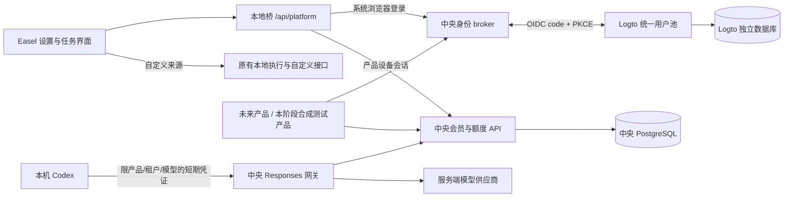

# Logto 统一身份、中央会员与共享额度设计

日期：2026-10-16。状态：接入与迁移设计；尚未实施。代码基线：`d110ea9`，分支：`codex/ui-redesign`。

本设计落实已确认的方案：多个产品共用账号、会员和额度，Easel 是首个接入产品，同时保留匿名可用的自定义接口模式。本次交付仅增加文档；不启动服务、不迁移数据库、不改动 7860、不合并主分支。

## 1. 产品结果与边界

用户在 Easel 点击“登录／注册”，由系统浏览器打开统一账号站。完成注册、邮箱验证或登录后回到 Easel，查看统一会员、Easel 可用功能、共享余额、按产品用量、设备与退出入口。未来另一产品接入同一身份体系，可利用浏览器中的统一账号会话完成 SSO；每个产品仍须独立取得自己的设备会话，不能复制 Easel 的 bearer。

会员决定“能用哪些产品、功能和模型”；额度决定“还能消耗多少”。有余额不代表有产品权限，有会员也不代表无限额度。套餐版本明确列出 `included_products`，新产品默认不被既有套餐自动包含。初期仅运营者授予带 `test_only=true` 标志的测试会员和测试额度，不展示虚构价格或已付款状态。

自定义模式保留原有供应商、模型、密钥、执行引擎和本地文件；无账号、平台不可达、订阅过期时仍可按原有条件使用。订阅请求失败只报告错误，不自动改用用户自定义密钥。切换服务来源由用户明确操作，运行中任务拒绝切换。

本阶段计划范围为统一身份、个人账户及最小团队隔离、测试会员、文本共享额度、Easel 本地 Codex 接入、迁移演练。真实收款、正式价格、云端任务执行、媒体计费和 Windows 私有凭证支持分别设独立验收门槛，不借本计划声称已支持。

## 2. 现有实现与迁移依据

| 当前实现 | 已有能力 | 新系统中的位置 |
| --- | --- | --- |
| `easel_platform/store.py`、`auth.py` | SQLite 账号、scrypt 密码、设备、轮换会话、测试 plans/grants | 迁移输入及限时旧认证适配器；保留旧主键和审计证据 |
| `easel_platform/ledger.py`、`gateway.py` | 文本 Responses 预留、实耗结算、待核算、任务 token | 保留协议与安全行为；新请求改用中央事务账本 |
| `easel/platform/client.py`、`session.py`、`web.py` | 本地桥、0600 凭证、真实 loopback peer 限制 | 增加浏览器登录及 v2 客户端；浏览器仍不接触 bearer |
| `easel/service_contracts.py`、`easel/harnesses/runtime.py` | 接受任务时冻结来源、账号、服务地址；临时原生凭证 | 追加产品／租户／账务账户绑定，保持已有字段顺序兼容 |
| `PlatformAccountSettings.tsx`、`lib/api.ts` | 测试账号、权益、用量、设备界面 | 改为统一账号入口及分产品用量；自定义设置独立保留 |

当前账号的 `email_verified` 为 false。密码格式是 `scrypt$131072$8$1$<salt_hex>$<digest_hex>`，盐 16 字节、输出 32 字节。现有账本规则为 `token-v1`，并非付费共享积分账本。当前 SQLite 启动恢复依赖单服务实例，不能通过多进程共享这个文件直接获得多产品并发能力。

现有证据见 [账号验收](../../validation/2026-10-16-platform-accounts.md) 和 [开发平台说明](../../platform/README.md)。其中测试通过数量、原生模拟闭环均为历史基线；本次文档变更不重跑应用验收，也不将模拟模型结果标成真实付费模型验收。

## 3. 实施路线选择

| 路线 | 优点 | 代价／风险 | 决定 |
| --- | --- | --- | --- |
| 新中央服务＋旧接口适配＋分批账号绑定 | 可独立验证、保留历史、按账户切换；后续产品不依赖 Easel 包 | 过渡期维护两种会话与路由 | **采用**，每个账户同一时刻仅一个计费写入权威 |
| 原地替换认证和 SQLite 全表 | 初始目录变更少 | 同时影响登录、任务、额度，回滚易丢账 | 不采用 |
| 批量复制旧密码、一次性切换 Logto | 用户操作可能少 | 当前 scrypt 格式兼容性未证明、邮箱未验证、碰撞合并风险 | 不作为默认迁移路径 |

中央服务仍放当前仓库以便首产品联调，但使用独立 Python 包、依赖、数据库和部署目录；不把服务器或 Logto 装入 Easel 桌面发行包。先不拆新 Git 仓库，避免引入发布协调成本。

## 4. 架构与职责



- **Logto**：统一用户身份、登录体验、邮箱验证与找回、SSO、身份因素及组织身份。只通过公开协议／Management API 使用，不直接改 Logto 数据表。
- **中央服务**：稳定平台用户 ID、产品注册、成员权限、设备会话、会员版本、共享钱包、预留／结算、用量、审计和迁移。业务权限与钱包不能只放在 Logto custom data 或 ID token。
- **模型网关**：校验任务授权、选择服务端上游、记录可信计量、调用中央账本。Easel 现有协议检查和隐私过滤继续保留。
- **产品适配器**：展示账号与额度、请求任务授权、传递冻结的身份上下文。不能修改余额、确认支付或自报结算金额。

中央目录：`services/platform/`，独立包 `src/platform_service/`；原 `easel_platform` 保持现有命令和 v1 兼容行为到退出门槛完成。中央基线 Python 3.12、PostgreSQL 16，采用版本化 SQL 迁移及数据库事务。Logto PoC 基线 v1.45.0。实施时生成并提交各自依赖锁和容器镜像 digest；不使用浮动 `latest`。实际部署前必须对所选 Logto 镜像与 PostgreSQL 16 组合完成兼容演练，失败则停止部署并修订基线。

### 4.1 多租户和多产品的准确含义

生产环境一个 Logto 身份租户服务多个产品；开发／测试使用隔离身份环境。每个产品注册独立 OIDC web 客户端（机密只在中央 broker）、产品 ID、API audience 和允许能力。这里的产品不等于客户租户。

中央 `tenant` 表示个人空间或客户组织；`billing_account` 表示付款／共享额度主体。个人注册先创建唯一个人 tenant 和钱包。团队 tenant 对应一个 Logto organization，以其 `organization_id` 做外部映射；中央 `tenant_members` 决定业务角色，不能凭客户端传来的 organization_id 提权。首期实现 owner/admin/member 三种权限和最小成员撤销，不建设大型组织后台。

多个产品使用同一个 billing_account 时共享余额；同一人的个人钱包与团队钱包分离，只有显式选择且有权限的计费主体能消费。成员不可把团队余额转入个人账户。服务端从认证会话校验租户成员关系，再解析 billing_account；请求体中的用户／租户／钱包标识只作选择条件，不作授权依据。

## 5. 登录、会话与退出

### 5.1 采用中央 broker 固定回调和本机一次性交接

不让 Easel 保存 Logto 客户端机密。Logto 的 OIDC code 交换在中央服务器完成，回调为固定的 `https://accounts.platform.test/oidc/easel/callback`；`.test` 只是测试配置，真实域名属于部署配置。Easel 本地桥只接收平台交接码，私有文件仅保存平台设备会话。

流程采用两组独立的 PKCE 参数，命名上强制区分 `oidc_verifier` 与 `handoff_verifier`，不复用：

1. 用户从同源界面 POST `/api/platform/auth/start`。真实 loopback peer、同源及现有任务变更 guard 全部通过后，本地桥先绑定自己拥有的 `127.0.0.1` 随机端口，生成 256-bit `local_state` 和 `handoff_verifier`，仅保存在进程内，5 分钟过期。
2. 本地桥 POST 中央 `/v2/auth/transactions`，提交 `product_id=easel`、公开 `client_id`、精确 loopback callback URI、S256 handoff challenge 和 local_state。服务器只接受注册客户端、IP 字面量 `127.0.0.1`／`[::1]`、本流程固定 callback path `/platform-auth/callback`、合法端口；拒绝 localhost 别名、userinfo、fragment 和开放重定向。服务器绝不请求该 URI，避免 SSRF。
3. 浏览器打开返回的 authorization_url。中央设置 HttpOnly、Secure、SameSite=Lax 的相关性 cookie，生成服务端 OIDC state、nonce 和独立 oidc_verifier，转向 Logto 的托管登录。注册、邮箱验证、找回都在账号站完成。
4. Logto 返回中央固定回调。broker 检验 state、cookie、单次事务、签名／issuer／audience／有效期／nonce，并用 oidc_verifier 交换。未知 issuer、算法、aud、重复回调均拒绝；JWKS 刷新有超时／大小边界。不能把 ID token 当任意产品 API bearer。
5. 中央映射 `(issuer, sub)` 到平台用户，创建 60 秒、单次、服务端只存 hash 的 handoff code，绑定 product、client、local_state、challenge、回调 URI 和已验证身份。浏览器 302 到该事务的本机 URI，只携带 `code` 和 `state`。交接码属于一次性协议码，不是 access/refresh/task token；禁止记录完整查询串和 Referer 外发。
6. 本地 callback 匹配进程内事务后，由本地桥 POST `/v2/auth/redeem`，提交 code、state、handoff_verifier、product/client 和 callback URI。中央原子消费 code，创建产品专属平台会话；网络重试用同一 redemption_id，仅在相同私有证明下返回同一结果，不得重复创建设备。
7. 本地桥原子写入私有会话文件，关闭自己拥有的 listener，将浏览器重定向到启动流程时冻结的本地 UI 地址。界面只轮询 `/api/platform/status`，看见脱敏后的账号、产品、租户和会话状态。取消／超时／窗口关闭最终清理 listener、verifier、事务。

Logto 的 `/oidc/.../callback` 是中央浏览器协议入口；本地 `/platform-auth/callback` 是受 pending state 限制的单次入口。现有平台“拒绝任意 Origin”的规则仅为这些明确协议路由做严格例外，**不能全局放宽 Origin 或真实 peer 限制**。启动登录和切换身份仍拒绝运行中／已接受的任务；callback 写入前再次检查 guard，冲突时撤销新会话并提示重试。

### 5.2 会话生命周期

平台 access 15 分钟、refresh 最长 30 天，刷新轮换、重放撤销整个设备族。任务 token 最长 60 分钟，但每次上游请求重新检查产品、租户、设备、会员、预算和撤销 epoch。原生任务只能拿任务 token，不能拿 refresh 或 Logto 管理凭证。

本机“退出当前设备”撤销 Easel 设备会话；“退出全部平台设备”撤销该用户所有产品设备，要求新鲜认证；“退出统一账号浏览器会话”独立走 Logto logout，避免让用户误以为本地退出必然清除了系统浏览器的 SSO。退出产品不删除历史或自定义配置。

中央自身撤销即时生效。Logto 禁用／删除的同步采用有鉴别、幂等的事件收件箱，并以最长 5 分钟身份有效租约及定期 Management API 复核兜底；这是明确的外部撤销传播上限，不能声称 webhook 丢失时仍即时。租约到期无法复核则阻止新订阅请求，现有自定义不受影响。Logto 短时故障时，已有效的中央会话在租约内可继续；新登录失败显示重试，绝不发放离线额度。

## 6. 业务数据模型

所有时间为 UTC；公开业务API用ISO 8601，DB用带时区时间；私有认证协议及本机会话的expires_at沿用Unix秒整数以兼容刷新实现。金额、额度及版本不用浮点。所有业务变更有操作者和 correlation_id，审计日志不得有请求正文、密码、bearer、OAuth 码或邮箱等非必要个人信息。

| 表／聚合 | 核心字段与约束 |
| --- | --- |
| users / external_identities / legacy_accounts | 平台 user_id；`UNIQUE(issuer,subject)`；旧 account_id 经 legacy_accounts 唯一映射，旧历史主键不变，中央 user_id 可不同 |
| tenants / tenant_members | personal/organization、外部 org 映射、role、status、membership_epoch；个人 tenant 对 user 唯一 |
| billing_accounts / tenant_billing | 归属主体、币种 `platform-credit`、余额版本；每 tenant 唯一默认 billing_account |
| products / product_clients | product_id、audience、允许 callback 协议、能力与模型；客户端机密仅服务端加密保管 |
| device_sessions / session_tokens | user、product、tenant、设备、令牌 hash、refresh family、epoch、expires/revoked |
| membership_plan_versions / memberships | 不可变版本、included_products、功能、并发、周期；来源 test/payment/operator；无价格默示 |
| credit_lots | billing_account、来源、有效期、适用产品、test_only、issued/available/held/spent/expired；每 lot 保守恒等式 |
| reservations / reservation_allocations | 请求、actor、tenant、product、wallet、冻结 rate/model、分 lot 预留、deadline、状态；请求幂等唯一 |
| journal_transactions / journal_entries | 双向平衡的整数分录；每 transaction 的有符号合计为 0；不可原地改历史分录 |
| usage_events / rate_versions | 原始单位数量、可信上游 receipt/attempt、成本规则；`UNIQUE(provider,attempt_id,event_id)` |
| inbox / outbox / audit_events | 事件 ID 与来源唯一、去重、重试、死信；与业务写入同事务 |
| migration_runs / migration_items / identity_links | 源库指纹、规则版本、旧新 ID、检查点、状态、校验摘要；行级幂等 |

tenant_id、product_id、billing_account_id 在关键表中显式保留并用组合外键／约束保持一致。查询仓储必须要求认证后的 Scope，不提供可随意省略 tenant 的通用 select。Logto 权限与中央成员权限变更使用 outbox＋幂等投影，业务授权以中央状态为准，不等待 IdP 投影才撤销。

## 7. 共享额度规则

### 7.1 单位、费率与资格

展示单位为“平台额度”；内部 `1 credit = 1,000,000 microcredits`，SQL 使用 BIGINT，API 整数用十进制字符串避免 JavaScript 精度丢失。该精度不是人民币／美元汇率。模型原始 input/output token 等单位独立记录，未来媒体计量加新 rate 版本，不混加 tokens、图片数、秒数。

费率版本包含 product/model/metric、整数分子分母、rounding=ceiling。一次请求先对完整各项算有理数总和，再向上取整一次；该算法版本写入 reservation。准入要同时满足产品会员、成员角色、模型资格、钱包余额、用户／钱包／产品并发和网关输入输出上限。上游可用模型必须有可证明的保守计费上界，无上界或未知费率的模型不开放。

额度 lot 按 `expires_at NULLS LAST, issued_at, id` 消耗；仅挑选当前有资格、覆盖本产品的 lot。平台通用 lot 可以跨产品使用，Easel 专用／旧测试 lot 只能用于 Easel。测试环境钱包不与正式环境混用。

### 7.2 状态与事务

```text
reserved -> dispatched -> settled
     |             |
     v             v
 released     pending_reconciliation -> settled / reconciled_release
```

reserve 同事务锁定 billing_account，再以稳定顺序锁 lot，并执行额度／并发检查、lot available→held、平衡分录及 reservation 插入。并发限制的计数／行锁也在同事务；各产品不能各自缓存一份可花余额。PostgreSQL 事务提交后才调上游，事务内不进行网络请求。

settle 从网关可信 usage 计算实际扣费，held→spent，差额 held→available；差额对应 lot 已过期则进入 expired。会员或 lot 在已准入请求中到期，允许该请求在冻结 deadline 内完成，不能扩展到下一次模型调用。撤销设备或成员资格阻止后续调用；正在进行的上游尝试按已发生的真实用量结算，取消不等于零消耗。

未派发即可证明未消费时 release；已派发但断流、超时、无最终 usage、进程崩溃则保留 held 并标 pending，不猜零用量。多实例恢复通过 DB 租约和心跳认领，不能按“本进程刚启动”释放其他实例的请求。可信 usage 超出保守上界时禁止钱包负数或伪造部分结清：保留争议预留、记录 rate_bound_violation，停止该模型新准入，运营者用独立补偿／损失科目完成核算。

请求幂等命名空间：`(billing_account_id, product_id, operation, idempotency_key)`，同 key 不同 body_hash 返回 409。由本机接受任务生成 invocation_id、持久记录每一模型 round/attempt；显式重试复用相同操作键。有些原生重试不携带稳定键，中央不能仅按文本猜重复；必须验证原生 provider 接口是否能携带键，不能证明时明确按不同实际请求计量，并提供 attempt 追踪，不能承诺所有自动重试免重复计费。

## 8. API 合同与兼容

统一错误体：`{"error":{"code":"quota_exhausted","retryable":false,"correlation_id":"..."}}`。401 未认证、403 跨产品／租户或无权益、409 幂等冲突／任务运行中、429 并发限制、503 平台／身份／上游暂不可用。服务端上游错误正文禁止透传。

| API | 调用者／意义 |
| --- | --- |
| POST `/v2/auth/transactions`、GET `/v2/auth/authorize/{transaction_id}` | 无 bearer 的有界登录协议；速率限制、精确客户端验证 |
| GET `/oidc/{product_id}/callback`、POST `/v2/auth/redeem` | 中央 OIDC 回调及本机私有交接证明 |
| POST `/v2/auth/refresh`、POST `/v2/auth/logout` | 产品设备会话轮换／撤销 |
| GET `/v2/me`、GET `/v2/tenants`、POST `/v2/session/tenant` | 当前身份、可选空间；切换签发新会话并撤销旧空间族，任务运行中本机拒绝 |
| GET `/v2/products/easel/entitlements`、GET `/v2/plans` | 产品适用权益、真实测试套餐目录 |
| GET `/v2/wallet`、GET `/v2/usage?product_id=easel` | 当前计费主体总余额／预留／待核算；分产品原始单位及额度 |
| GET `/v2/sessions`、DELETE `/v2/sessions/{id}` | 授权范围内设备；当前产品普通设备不准撤销另一用户设备 |
| POST `/v2/task-tokens` | 当前产品／租户／钱包／模型冻结的短期凭证；仅本机私有客户端调用 |
| GET `/v2/products/easel/models` | 当前产品／租户／会员可用模型目录，不返回供应商 key |
| POST `/v1/responses` | 新旧服务保留同一路径；冻结的平台地址决定目的服务，新旧服务仅认自己的 token／账本，绝不跨域转发或双扣 |
| POST `/internal/v1/credits/reserve`、`/settle`、`/release` | 服务身份＋明确 audience/scope；外部用户／产品桌面不能直接调用 |

v2 返回 wallet 示例（所有数值为测试夹具）：

```json
{
  "billing_account_id": "ba_personal_fixture",
  "unit": "microcredit",
  "available": "8000000",
  "reserved": "1000000",
  "spent": "1000000",
  "pending_reconciliation": 0,
  "version": 7,
  "test_only": true
}
```

v1 余额继续标 tokens 与 legacy，不冒充 v2 余额。中央提供 GET `/v2/capabilities?product_id=easel` 声明 `auth_mode=logto`、`ledger_mode=central_credit` 和支持协议版本，仅接受已注册产品；旧服务新增GET `/v1/capabilities`无敏感信息声明。客户端显式协商，不在 v2 出错时静默回落 v1。`/v1/responses` 的目的地址和账本来自接受任务时冻结的服务授权，不信任客户端选择开关。中央不代理旧服务的 token；旧 lane 在旧服务保留到本账户切换完成。

## 9. Easel 集成与界面

`PlatformAccountSettings` 提供统一登录／注册、取消、登录过期重试、查看会员、平台总额度、Easel 用量、预留与待核算、设备、退出。组织选择在初期以简洁下拉框呈现，仅列用户有权限的空间。旧账号单独提供“关联原有 Easel 测试账号”，不将旧密码送 Logto。现有五主题和日夜跟随系统行为保留；仅复用现有样式组件，不重写主题文件。

所有 loading/error/unknown 与真实 0 区分；平台不可达显示“暂不可用”，不显示 0 元／0 额度；旧权益显示“Easel 专用测试权益”，不虚构升级价格。账号与自定义接口分别保存，两边切换不覆盖模型或密钥。设置的“平台服务地址”正式发行默认由产品配置提供，开发自托管入口仍可明确配置，已有登录时先退出才能更换域。

TaskContext 和 RunRequest 追加 `product_id`、`tenant_id`、`billing_account_id`、`authorization_epoch`、`invocation_id`，不移动旧位置参数。`rate_version` 在中央具体请求准入时冻结，不能只在整个多轮任务开始时冻结过时价格。旧自定义任务无需新字段；旧订阅历史只能按旧账号且明确兼容路由恢复，不把不明归属迁到新团队继续。

私有会话文件升级 version 2，version 1 只读并通过显式重新认证升级；不原地丢弃旧文件。保留 nofollow、regular file、0600／0700、原子替换、锁与私有输出排除。取消登录、账号切换、SSE、日志、下载快照、归档和原生子进程环境继续按现有隐私边界验收。

## 10. 迁移与回滚原则

迁移顺序为：合成数据演练→身份＋中央账本就绪→只读盘点→用户双重认证绑定→明确旧测试权益处理→小批量 Easel 准入切换→观察→第二合成产品共享验证→关闭旧写入。完整步骤见 [迁移运行手册](../../platform/logto-migration-runbook.md)。

账号绑定需旧账号新鲜密码证明（5 分钟）和 Logto 新鲜登录证明（5 分钟）；新身份必须有已验证邮箱，但无需强制等同旧的未验证邮箱。仅凭同名邮箱不自动关联。不同 subject 指向同一旧账号、同一 subject 指向两个旧账号、邮箱碰撞均进入人工核对，不自动合并余额或资料。遗失旧密码者先取得人工恢复证据，不能用 Logto 同名邮箱替代旧账号所有权证明。

默认旧测试 grant 留在旧服务的 Easel-only legacy lane，账户关联不发新共享额度。切换前用户可保持原 legacy 登录消费旧测试权益；切换后的中央登录只展示已导入旧历史，不直接消费旧 grant。旧 grant、旧请求和 pending 对账原样保留。需要结束旧 lane 时，先暂停该账户准入并排空，待 pending 全部核定；运营者若补发新测试额度须独立显式数量、规则、期限、`test_only=true`、Easel scope 及唯一 issuance key，绝不按 token 余额隐式兑换。原始 token 历史作为只读历史，不做追溯扣积分。

共享钱包产生首笔消费后，禁止恢复旧 SQLite／旧 Postgres 快照继续写账。回退只回退 UI、网关适配或准入开关，中央账本仍为权威；必要时冻结所有产品新准入、排空尝试、保留 holds 后前向修复。代码回滚不删除身份绑定和财务分录。备份恢复仅在隔离环境演练，不与活跃账本并写。

## 11. 拆分计划、门槛与完成定义

| 顺序 | 子计划／任务 | 交付门槛 |
| --- | --- | --- |
| M0 | [身份计划](../plans/2026-10-16-logto-identity.md) I1 | 隔离环境、产品／租户合同、版本锁、无桌面服务端依赖 |
| M1 | 身份 I2–I5 | 托管登录、单次交接、双重证明、设备撤销、跨产品／租户拒绝 |
| M2（依赖 M0） | [会员额度计划](../plans/2026-10-16-central-membership-credits.md) C1–C5 | 测试会员＋原子共享额度＋断流恢复＋可信对账 |
| M3（M1、M2 通过后） | [Easel 迁移计划](../plans/2026-10-16-easel-platform-migration.md) E1–E5 | 保留自定义、真实本地登录、合成原生闭环和可重复迁移演练 |
| M4 | 迁移计划 E6 | 小批量切换操作材料、回滚演练、多产品证明、最终审计；真实切换另获明确执行指令 |

首个开发批次建议 I1＋I2：只在隔离端口打通 Logto 登录及 Scope，不触碰现有平台数据。每个任务有单独 RED／GREEN／审查／提交，仍留当前分支。正式付费、第二真实产品与云端执行不在这些任务的完成定义中。

最终验收必须覆盖：两个合成产品共享身份但不共享 bearer、同钱包并发不超扣、跨租户拒绝、未验证邮箱不自动合并、重复迁移不重复发额、取消／断流保留未决费用、外部身份撤销最迟租约失效、IdP／中央故障时自定义可用、秘密不出现在浏览器／公开文件／日志／包内。没有对应证据不得标为已完成。

## 12. 已核对的官方资料与限制

资料核对日 2026-10-16。官方文档通过 Context7 `/logto-io/docs` 查询，并复核以下原始来源。设计中的 broker、钱包与迁移规则是本项目决定，不是 Logto 内置功能。

- [Logto OSS](https://docs.logto.io/logto-oss)：自托管部署入口；采用独立服务器与数据权限。
- [Logto v1.45.0](https://github.com/logto-io/logto/releases/tag/v1.45.0)：2026-10-13 发布。该版本将自定义登录 UI、去品牌等列为 Self-Hosted Pro 能力；本计划使用标准托管登录，不依赖这些付费功能。Logto 自身许可与本平台会员完全独立。
- [用户迁移](https://docs.logto.io/user-management/user-migration)：批量与首次登录迁移、兼容密码格式。Firebase 的 modified scrypt 支持不能证明兼容本项目标准 scrypt 编码；默认不导出密码哈希到 Logto。若未来选择 JIT，需要另行验收 Action 的部署、许可、认证与旧密码端点生命周期。
- [Organizations](https://docs.logto.io/organizations)：客户组织的成员和角色含义；不把每个产品建立成客户 organization。
- [OIDC／公开客户端集成约定](https://github.com/logto-io/docs/blob/master/docs/integrate-logto/third-party-applications/README.mdx)：公开客户端需 PKCE。本方案进一步采用服务端 broker，桌面不嵌入机密。
- [SDK 回调约定](https://github.com/logto-io/docs/blob/master/docs/developers/sdk-conventions/core-sdk-conventions.mdx)：回调与 state 验证参考。动态客户端文档的 loopback 端口规则不直接推断为所有静态客户端行为；本方案 Logto 回调固定在中央，随机本机端口仅用于自建平台交接协议。
