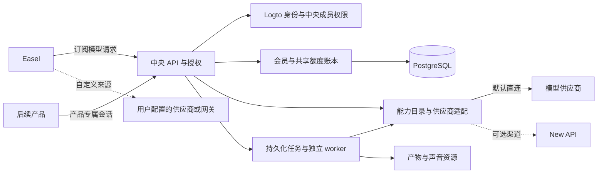

# 中央平台供应商直连与性能设计

日期：2026-10-20。分支：`codex/ui-redesign`。修订：借鉴New API运营设计，并根据用户提供的当前插件市场改为“优先评估插件与宿主复用，不默认重写所有供应商适配”。状态：中央平台设计草案，待审阅；用户尚未批准本设计的 P0 开发，本文件不表示平台已实现、部署或通过性能验收。

后续授权范围已增加现有 New API 升级、插件安装和 Easel 客户端适配；该批次的实际服务器结果见[升级与插件验收记录](../../validation/2026-10-20-new-api-upgrade-plugins.md)。这不改变中央身份、共享额度、持久账本与 D0 完整数据面选型仍待实施的状态。

用户已确认：多个产品共用账号、会员和额度；Easel 为首个产品，自定义接口模式保留；中台默认直接调用供应商，New API 不作为固定中转；第一阶段先在现有 4 核 4GB 服务器验证，预留横向扩展。继续使用当前分支，不合并主分支。

本设计补充已有的 [Logto 与中央会员设计](/Users/jiandan/Code/GitCode/Easel/docs/superpowers/specs/2026-10-16-logto-central-membership-design.md)。统一身份、账户迁移和共享账本规则沿用该方案；新增供应商目录、分能力适配和性能验收要求。[此前接口核对](/Users/jiandan/Code/GitCode/Easel/docs/validation/2026-10-19-new-api-easel-interface-audit.md)只代表v0.13.2核心基线，不代表当前插件市场的全部能力。New API设计参考见[对应表](/Users/jiandan/Code/GitCode/Easel/docs/platform/new-api-design-reference.md)，当前插件事实与选型门槛见[插件能力与复用评估](/Users/jiandan/Code/GitCode/Easel/docs/platform/new-api-plugin-evaluation.md)。

## 产品结果

用户注册登录后，选择其会员有权使用的模型和能力，消耗中央共享额度，不需要配置供应商密钥。后续产品接入同一身份和额度服务，使用产品专属会话；个人空间和团队空间的权限、钱包及产物隔离。

自定义来源继续使用用户自己配置的供应商或网关。中央服务故障、余额不足或订阅过期不会自动调用用户的自定义密钥，也不会破坏匿名自定义使用。模型服务来源、Agent 执行引擎及本机或云端执行仍是三个独立维度。

模型数据面直接连接供应商的目标保留。复用官方插件不天然要求再经过完整New API HTTP服务，但需要兼容宿主；完整New API作为任务后端也是需比较的候选。是否保留独立网关调用由D0验证协议、账本衔接、工程量和真实开销后选择，本轮不擅自把全部请求切到New API。原有部署保持独立，端到端性能不预先承诺加速倍数。

“可扩展到全部所需接口”表示有明确扩展边界，不代表第一版已兼容所有供应商或模型。供应商未开放的功能、缺少授权的接口和未经验证的跨协议转换不会被标成可用。

## 当前代码与变更范围

当前 `easel_platform` 是单实例账号及文本网关原型，已有预留、实耗、待核算、工具 SSE 和输出保护。它使用同步 SQLite、进程内锁和限流；上游每次请求创建客户端；启动恢复按单实例处理全部在途记录。直接增加 worker 会改变并发及恢复语义。

中央业务服务继续采用已规划的 `services/platform/` 独立 Python 包 `platform_service`，独立依赖、数据库、部署配置和测试目录；任务数据面的工程边界待D0定稿。服务不依赖Easel工作区，不进入桌面发行包。旧`easel_platform`保留为v1兼容服务及迁移输入。真实用户、账号数据库、现有7860服务和服务器部署不属于本次设计阶段的操作对象。

## 实现路线选择

| 路线 | 收益 | 代价 | 决定 |
| --- | --- | --- | --- |
| Python业务控制面、PostgreSQL，模型数据面优先复用官方插件宿主或兼容Go runner | 沿用身份/账本方案，复用已存在的供应商任务协议 | 必须验证宿主合同、任务/计量桥和资源预算，不能只导入JS引擎 | 优先进行D0选型，不把复用可行性标成已通过 |
| Python中央平台直接实现全部供应商适配 | 技术栈一致，业务合同控制直接 | 重复维护已有媒体插件，仍需自行解决轮询、下载与用量 | 改为缺口或复用不划算能力的候选，不再预设所有适配重写 |
| 一开始拆成账号、会员、钱包、计费、路由和媒体等多个微服务 | 可以独立扩容和发布 | 增加跨服务一致性、运维和资源开销 | 暂不采用 |

语言或框架不作为高性能证明。业务控制面保留Python 3.12、FastAPI、HTTPX和PostgreSQL 16的设计基线；模型/任务数据面的语言、宿主和部署边界改由D0定稿，不能据旧Python计划直接展开全部adapter。实施时锁定依赖与镜像摘要。Redis不作为余额、幂等或财务分录的唯一持久化来源。

## New API 设计的采用方式

借鉴New API的渠道管理、模型映射、优先级/权重路由、分协议适配器、受限令牌、预留结算、运营日志与管理工作流，形成我们自己的多租户、多产品平台。平台直接调用供应商，借鉴其结构不要求运行New API作为固定中转。

| 采用方式 | 收益与成本 | 本版选择 |
| --- | --- | --- |
| 参考运营对象并复用可兼容的官方插件 | 保持中央身份/账本，减少供应商字段、查询和产物适配重复开发 | 采用为优先评估方向；每个插件仍按完整生命周期验收 |
| 复用Go插件宿主/兼容runner | 供应商调用可直接发出，不依赖完整New API的一次HTTP中转 | 需D0验证host context、工具、文件、state、呈现、轮询和计量，不假设moejs本身提供这些能力 |
| 完整New API作为模型/任务后端 | 官方宿主兼容基准和可能的交付路径，复用能力较多 | 比较中央授权/账务桥和额外调用成本；与fork成整个会员中台分开，暂不决定升级已有部署 |

逻辑上分业务控制面和模型数据面：前者维护身份、产品/租户资格、用户钱包、价格和审计；后者执行获授权的路由、供应商请求、任务及用量采集。宿主可以是同进程模块、私有runner或完整New API后端，实际边界由D0选择，不能仅为逻辑分层新增无收益的流式转发。

### 官方插件复用的边界

当前市场主要是JavaScript任务插件，覆盖同步/异步图片、视频、音乐等；部分插件可包装为Images、Video或Responses协议。插件构造请求和报告usage，宿主负责HTTP、任务、所有权、轮询和结算。Python不能原样运行它们，独立Go引擎也不等于完整插件宿主。

新增plugin key/version/hash、宿主版本/commit、required capabilities、usage schema、协议模式和渠道绑定的发布记录。API v1仍在演进，不能只看`apiVersion: 1`或市场条目就判断旧宿主兼容。后台轮询可能使用新generation，升级时要验证旧任务state/data兼容或排空后切换，不假设自动固定旧插件。

任务Responses/SSE不自动满足Codex原生工具流；图片编辑不自动包含变体或所有蒙版；海螺视频不代表MiniMax声音登记。已确认插件优先复用，未覆盖能力保留自定义adapter，资格目录仍需要真实验收记录。

## 系统职责与调用路径



上述是逻辑模块，首期可以同一部署单元中的 API 进程加独立 worker，不要求每个模块部署成微服务。Logto 使用独立身份数据库；中央业务库是会员和额度的权威。

| 模块 | 职责 | 明确边界 |
| --- | --- | --- |
| identity | Logto broker、产品设备会话、租户成员与撤销 | 不把用户邮箱当自动账号合并凭据 |
| membership 与 credits | 会员版本、共享钱包、费率、预留、结算和对账 | 余额只在中央事务中变更，不依赖客户端自报消耗 |
| providers 与 channels | 供应商协议实现、渠道实例、服务端凭据版本、能力声明及模型映射 | 不允许用户传任意 URL、请求头或密钥覆盖平台路由 |
| catalog 与 routing | 公开模型、路由池、版本化优先级/权重策略、健康与限流筛选 | 路由池不授予租户、会员或钱包权限 |
| gateway | 有界准入、流式传输、attempt跟踪和可信用量采集 | 不执行用户电脑的文件或 shell 工具 |
| jobs | 异步任务状态、租约、轮询、回调及恢复 | 查询和取消不能凭供应商任务 ID 越权 |
| artifacts 与 voices | 文件、声音资源所有权、授权下载和有效期 | 不将供应商鉴权头发送到任意结果 URL |
| operations 与 consoles | 平台运营后台、租户控制台、审计、指标、受限CLI和故障演练 | 普通产品客户端没有授额、查看全局渠道或确认支付的权限 |

## 供应商与能力合同

中央统一身份、路由和计量，保留原生 Responses、Chat Completions、Messages、Images 和 Audio 的独立协议。视频、音乐、声音登记具有独立任务合同。工具、推理事件、multipart、二进制和供应商 usage 不被压缩成一种 chat 请求。

供应商适配器至少声明 `adapter_id`、`protocols`、`operations`、`modalities`、`tool_types`、`streaming`、`async`、输入输出限制、取消与幂等能力、可信用量来源和所需资源类型。跨协议转换标为 `converted`，原生转发标为 `native`；不支持的字段明确拒绝，禁止静默丢弃。

模型目录同时考虑供应商配置、能力验收、产品权限、租户成员资格、会员、费率和当前可用性。凭据存在或模型列表返回成功不能代替真实推理验收。对产品公开能力和限制，不公开供应商密钥、内部地址或运维数据。

每次接纳请求冻结模型、适配器、计费主体、能力、费率版本和 attempt。默认不在提交结果未知时自动切换供应商或重发可能收费的任务。跨供应商 failover 只有在可证明未消费或有对应业务补偿规则时启用。

首个适配器直连一个真正支持 Responses 的 API 上游。接口名称兼容不能推导它支持 Codex 的工具、事件、输出限制及 usage，必须验证完整往返。

### 渠道与模型的业务对象

| 对象 | 关系与关键字段 |
| --- | --- |
| provider_adapter | 协议实现的标识、版本、可支持操作；一个adapter可承载多个渠道 |
| channel | 实际供应商账号/端点/地区连接，包含状态、credential_ref、并发/速率/超时限制；平台拥有，本机自定义配置不自动上传 |
| credential_version | 凭据的加密存储引用、用途、创建/轮换/撤销；仅脱敏展示，不把原始Key放进目录、快照日志或页面回读 |
| public_model | 平台公开稳定别名、说明、协议、能力、限制和计量单位；会员授权指向此对象 |
| channel_model | public_model到某渠道上游模型名/部署ID/操作的映射，包含能力验收状态；同名模型不自动认为能力相同 |
| routing_pool | 可以承载一类流量的渠道集合，独立于tenant、product与billing_account |
| routing_policy_version | 适用产品/能力、候选池、优先级、权重、地域及数据限制、重试预算和发布状态 |
| rate_version 与 provider_cost_version | 用户额度费率与供应商采购成本分别版本化；后者保留原币种和原始单位，不冒充用户credits |
| request、provider_operation 与 provider_attempt | 一个逻辑请求绑定一份用户预留；一个供应商操作可有多次发送尝试，关联Scope、公开模型、渠道、凭据版本、策略、两种价格版本与最终结果 |

配置采用草稿→差异预览→校验/受控探测→发布的工作流。模型列表同步只生成候选差异，不自动开放能力或覆盖正式价格。发布生成不可变快照，后续回滚只影响新准入；已有attempt继续使用冻结配置，财务历史不随配置回滚。

参数覆盖仅允许已审阅字段，不能由配置绕过输出上限、计量、目的地址、授权头或数据地域约束。初期模型映射为一跳显式映射，拒绝循环；不引入无限链式别名。

### 选路与故障处理

1. 校验会话、产品、租户、成员、钱包及公开模型资格，确认请求操作符合该模型已开放能力。
2. 取得已发布路由策略，过滤能力未验收、人工停用、凭据失效、地域不符、健康不允许或并发不足的渠道。
3. 在最高可用优先级中按正权重选择；权重0表示不参与新流量，全部为0时返回无可用渠道。禁用另有明确管理状态，不能通过换group绕过。缓存与DB回退使用同一选路语义。
4. 按所选模型/渠道限制计算可执行上界，在逻辑request冻结用户费率与路由策略，在实际provider operation/attempt冻结采购规则；原子预留后提交，数据库事务内不进行供应商网络操作。
5. 每次实际发送记录独立attempt和候选排除/选择原因。总尝试数、总期限和所有可能产生的采购成本受预算约束。内部attempt_id与上游幂等键分开；恢复同一供应商操作时必须保持实际供应商账号/渠道、上游操作键和请求body一致，不能随新attempt生成新上游键，也不能把跨账号/渠道重发视为幂等恢复。
6. 尚未发送，或供应商明确支持上述同操作幂等恢复时，才按已验证语义重试；另选渠道必须能证明此前操作未产生费用或副作用，不能仅凭HTTP错误码断言未计费。已经向客户端写出业务事件、远端上下文存在亲和性，或提交结果未知时，不盲目切换。
7. 获取可信usage后按中央账本结算；无法确定成本的attempt保留pending。多次attempt分别核对采购成本，用户扣费按冻结规则结算，不因隐藏重试重复扣同一逻辑操作。

人工管理状态与自动健康状态分开。人工停用只能由有权运营者恢复；自动保护采用失败窗口、冷却、半开探测与恢复阈值，429优先按限流退避。健康可细分到渠道/凭据/模型能力，避免一个不支持的编辑操作禁用全部文本模型。探测采用租约防止多worker同时执行，有预算和操作审计。

### 令牌与凭据生命周期

产品设备会话、短期任务token、未来租户服务Key、operator会话及上游凭据分别建模，不共享audience或撤销语义。任务token绑定完整Scope、公开模型/能力、invocation和期限。令牌消费上限从中央reservations/usage原子检查，不给每个Key建立独立可充值余额。

长期自助API Key和产品M2M在独立批次开放，第一阶段重点是产品设备/任务凭证和平台operator。上游凭据轮换有版本与在途引用，新准入使用新版本，已有attempt的处理和旧Key撤销按供应商能力明确执行，不以删除配置假装远端任务已停止。

## 身份与共享额度

延续既有设计的 `Scope(user_id, product_id, tenant_id, billing_account_id, session_id, authorization_epoch)`。中央从已验证会话构造 Scope，产品不能在请求体中任意指定钱包取得消费权限。一个人可有个人和团队钱包；只有有权使用的同一个钱包才能跨产品共享余额。

平台内部采用整数 microcredits，原始 tokens、图片数、字符、音频或视频时长分别记录。一次请求冻结价格版本，使用可执行的保守上界预留，再按可信实际用量结算。没有可证明上界或可信计量依据的付费能力不开放。

```text
reserved -> dispatched -> settled
    |            |
    v            v
released    pending_reconciliation -> settled / reconciled_release
```

PostgreSQL 事务内进行准入、钱包和额度批次锁定、幂等登记及平衡分录写入；提交后才进行上游网络调用。结算写入与可信 usage 记录去重在同一事务完成。不得在持锁期间等待模型或下载文件。[PostgreSQL 行锁文档](https://www.postgresql.org/docs/16/explicit-locking.html#LOCKING-ROWS)

断流、取消、超时或进程崩溃不代表供应商停止计费。已提交但无最终 usage 的请求进入待核算，不能自动按零消费释放。多实例恢复使用数据库租约、心跳和比较更新，仅接管确已失去所有者的 attempt。事件重试和回调采用单次有效入账，不承诺跨网络 exactly-once。

用户rate_version在每个逻辑request接纳时冻结，provider_cost_version在相应供应商操作/attempt冻结，不能只在整个Agent会话开始时冻结一次。用户财务状态与供应商采购核算状态分开：一份用户reservation只按最终有效交付或规则允许的可信部分usage结算一次，不能把多个重试attempt的usage简单相加。平台隐藏重试、供应商故障且无有效交付的已知采购损失由平台损失科目承担，不向用户额外收费；用户主动取消或断网的已发生用量按准入时明确的取消计费规则处理。

若用户最终计费usage已确定，用户hold可结清，尚未核对的采购费用留在独立采购pending，不把已成功请求永久挂在用户预留。若用户计费usage本身未知，仍按原规则保留用户pending，禁止猜零。运营者决定由平台承担争议费用时，使用独立补偿/损失分录返还用户额度，采购pending继续保留，不能把未知费用伪造为零。相同供应商操作的幂等恢复按操作/receipt去重采购费用，多次发送不重复入账。

运营额度调整写入有原因、幂等键和相抵分录的事件，不提供任意覆盖余额的管理操作。平台首期不采用高余额免预留旁路；共享钱包同时服务多个产品时始终进行原子准入。首批仍只开放一条已验收Responses直连能力，多渠道自动重选在安全条件与故障夹具验证通过后才启用。

复用完整插件宿主时，其任务失败、404/410或轮询清理引发的内部退款不能直接映射成中央“零消费”。中央只接受绑定attempt、插件版本、受认证宿主和响应证据的用量/状态事实；原有quota只作为后端内部预算或核对信息，不成为第二份用户可花余额。无法桥接这些语义时，该复用途径不通过D0。

## 平台运营后台与租户控制台

借鉴New API的菜单分区与“列表→筛选→详情→操作→结果”工作流，建设两个权限域。它们是中央平台独立Web入口，不把平台管理功能堆进Easel设置页；可复用表格与详情组件，服务端授权和字段投影分别实现。

| 平台运营后台 | 租户控制台 |
| --- | --- |
| 运行概览、失败/pending/积压待办 | 当前租户、个人/团队空间与可用产品 |
| 供应商渠道、凭据轮换、健康、禁用和恢复 | 有效会员、共享钱包可用/预留额度 |
| 模型能力目录、映射、路由策略和配置发布 | 当前产品用量、本人请求与任务 |
| 产品、租户、平台用户状态与受限撤销 | 个人设备会话及授权范围内成员 |
| 测试套餐、用户费率、采购规则与测试授额 | 后续批次的租户服务Key和声音/文件资源 |
| 请求、attempt、账本、待核算和审计 | 授权范围内的产物下载和安全设置 |

第一阶段的页面采用可操作的列表和详情：渠道创建→凭据登记→模型差异预览→能力探测→映射/价格/策略发布→测试会员授予→调用→按request ID排障。探测分别显示连通、协议、产物与计量是否通过，不以模型列表成功显示“全部可用”。

运营者使用独立operator身份、角色和管理audience；Logto身份由中央映射成明确权限，普通租户owner/admin不能因为角色名相同取得平台权限。初始operator由受限CLI登记，后台不能允许公开用户自助升权。

Web管理登录、租户账户中心与产品broker分别注册客户端、会话和回调。管理/console使用固定同源Web回调和服务端会话，校验OIDC state/nonce/PKCE/audience及cookie绑定，不套用桌面loopback与一次性交接流程；浏览器仅持有受保护会话cookie，不取得上游或产品refresh凭证。cookie使用HttpOnly/Secure/SameSite及CSRF校验，状态改变不得使用GET。禁用账号/渠道、轮换凭据、发布价格、测试授额与财务对账要求明确能力、新鲜认证及操作审计。新管理路由显式定义同源策略，不全局取消现有Origin防护。

管理API使用独立`/admin/v1`权限域；租户账户中心使用单独console会话和受限读模型。既有产品`/v2/usage`仍只返回当前产品允许明细，不能因新增页面就向Easel bearer开放全部产品经营数据。财务对账和补偿在后端仍调用同一幂等账本，不因Web入口产生第二套写余额逻辑。

请求日志、财务流水和操作审计通过request/job/attempt、product/tenant/wallet、actor、渠道、令牌指纹、路由/价格版本关联。默认不保存提示词、文件正文、凭据或上游错误正文；各页面只取得权限范围内字段。HTTP状态、流终态、用户费用、供应商成本和pending原因分别显示，日志不能直接作为改余额依据。

## 性能设计

### 连接与流式传输

- HTTP客户端由应用生命周期创建并在退出时关闭，Python路径使用lifespan，其他宿主使用对应生命周期；按供应商或信任边界复用连接池。一次响应完成只关闭该响应，不关闭共享客户端；不保存或重放供应商响应中的cookie。
- 连接池设置连接总数、keepalive、等待超时和供应商并发上限；池饱和时有界等待或返回明确的限流错误，不无限排队。进程数乘以每进程池上限才是服务总预算。
- 数据库采用有界连接池及事务超时；读请求不统一使用写事务，不每次聚合完整历史来决定可用余额。流水明细和可花余额的事务维护与审计重算分开。
- SSE 保留原始事件语义，解析器和缓冲区都有上限。采用直接异步迭代或有界队列实施背压；慢客户端不能让内存随生成内容持续增长。
- 分开设置连接超时、池等待、首字节、流空闲和请求总期限。上游响应必须在成功、异常、取消和客户端断开路径均关闭；清理有界并可观测。
- SSE 存续期间不占有数据库连接或事务。用量结算和心跳通过短事务完成，不能每个 token 都写数据库。
- 静态模型与路由配置缓存为已发布版本快照；撤销、禁用、会员资格和可花余额在准入时读取权威状态，不能因缓存命中绕过。配置发布与跨实例失效有可测试的版本协议，无法核验当前禁用epoch时停止新准入。
- 活跃SSE、供应商在途任务、RPM/TPM与队列长度分别限额。空闲连接池上限不是业务并发上限，缓存或本机计数也不能替代跨实例原子预算。

这些要求符合 HTTPX 的[连接复用和异步流式资源管理说明](https://www.python-httpx.org/async/)。现有每请求创建客户端的代码不能作为新服务连接复用的实现。

### 资源隔离与故障控制

用户、租户、产品、钱包与供应商分别有准入预算，平台另有总上限。同一钱包的账务更新允许按业务需要串行化，但不能把所有钱包放在一把进程锁后。热点钱包与普通钱包分开测量。

媒体轮询、文件处理及回调使用独立 worker，不占用文本长连接的事件循环。任务状态持久化在 PostgreSQL；缓存和消息通知可加速处理，不能是任务恢复的唯一来源。重试采用退避和 jitter；重试预算、死信与 pending 账龄均有指标。

统计 admission、DB pool wait、wallet lock wait、upstream connect、first byte、事件转发、settlement 和 cleanup 等耗时，关联 request/job/attempt ID。日志默认不记录提示词、文件内容、密码、token 或供应商错误正文。模型首字节与中台额外耗时分开报告。

### 单机基准与候选门槛

用户已选择现有 4 核 4GB 服务器作为第一阶段部署验证目标。以下是候选测试合同，不是已测出的容量或对外 SLA：

| 项目 | 测试合同 |
| --- | --- |
| 环境记账 | 记录 CPU、总内存、平台/PG/Logto/worker/其他已有容器的限制与实耗；公布整机和中台组件两种口径，不能用“API 独占4GB”冒充“整套4GB” |
| 负载来源 | 压测机与假上游尽量放在目标机之外，报告网络 RTT；如同机运行必须单独披露，结果只算开发基准 |
| 长流基准 | 先测50、100条活跃SSE，100条持续30分钟；每次模型请求30秒，每秒10事件，每事件512字节，错峰结束并补足连接，生成与夹具计数一致的终态usage；随后250、500仅作为寻找饱和点的档位 |
| 控制API | 独立测20请求/秒的鉴权、目录与钱包查询，不将只测空闲keepalive当成业务负载；与长流混合时单独报告 |
| 候选延迟 | 中台admission至dispatch内部span的p95≤100ms；完整上游事件收到至包含该事件尾部的实际框架send/Flush完成的p95≤50ms，ASGI路径以send等待完成计，不能仅测yield；客户端收到时间另测。不包括供应商推理耗时，数据面定稿后固定可比边界，失败如实记录 |
| 正确性 | 零跨租户访问、零重复有效扣款、零负余额，所有平衡分录和额度批次恒等式成立；未知费用必须有pending记录 |
| 资源 | 记录CPU、RSS、文件描述符、出站连接、池等待和事件循环延迟；流结束并清理后资源回到稳定区间，慢客户端和超限事件不能导致无界增长 |
| 稳定性 | 30分钟仅是初始长流门槛，另做至少2小时稳定性测试及多轮断流/重启；未完成前不宣称长期稳定 |
| 可用性 | 单机不承诺多节点高可用或99.9%/99.99% SLA；横向扩展要通过多实例共享额度和故障接管的独立测试 |

夹具的300个事件中包含开始、增量和完成事件，正常文本增量与工具事件均受请求输出上限约束；额外网络负载采用明确的测试填充字段，不冒充模型输出。夹具通过可重复的脚本单位计算input/output usage并记录expected账务；每次请求max_output_tokens≤4096。持续30分钟指总压测时长，不是单次模型无限输出。常规容量测试预置足够覆盖全部请求上界的test额度及并发资格；额度不足、同钱包竞争和超限拒绝作为独立正确性场景，不混入正常吞吐错误率。

首先用相同事件夹具分别测直接上游、纯转发和完整鉴权/账本路径，结合内部 span 定位开销；不把两组 p95 简单相减当成精确的逐请求附加延迟。保留原始样本、分位数、吞吐、错误分类及机器元数据。

大规模压测使用合成租户、假凭证、独立临时数据库和模拟供应商，不消费真实模型额度。真实上游另以小规模有预算测试验证协议、限额和计量，不能由模拟吞吐推导真实供应商容量。

现有服务器同时运行其他应用。首次目标机压测之前必须盘点可用资源，并将平台置于拥有的隔离部署与硬资源限制内；若会影响已有服务，应改用等规格隔离实例测量，不能直接冲击共用生产入口。

## 第一阶段交付与后续批次

整个中台跨越身份、账本、网关、媒体和运维几个独立子项目，按下列顺序交付，每一批有独立的设计、实现和验收记录。

| 批次 | 可交付软件 | 通过条件 |
| --- | --- | --- |
| D0 数据面复用选型 | 设计确认后用完整宿主与兼容runner验证代表插件，先于P3数据面实现定稿；P0–P2业务合同可独立保持 | 固定宿主/plugin/hash和capability；同步图片、异步视频、原生文本工具对照、中央pending语义及资源/维护成本报告；尚未执行 |
| P0 独立工程底座 | `services/platform` 独立包、配置、完整Scope、PostgreSQL迁移及池、lifespan、日志/健康入口、隔离开发环境；operator权限/审计基础与受限CLI | 真实临时PG迁移幂等与哈希校验、资源生命周期、产品桌面打包隔离；普通产品身份不能调用管理能力 |
| P1 统一身份 | Logto broker、产品专属会话、个人/团队隔离、撤销与旧账号关联入口；最小管理登录及用户/租户/产品/设备只读页 | 两合成产品SSO但不互通bearer；operator与租户角色隔离、CSRF与新鲜认证；真实隔离Logto验证单独记录 |
| P2 共享额度 | 测试会员、整数钱包和费率、原子预留、不可变平衡分录、幂等、pending与恢复；测试权益/费率/钱包/待核算后台与租户钱包页 | 同钱包多连接竞争不超扣；跨产品/租户拒绝；受限授额和对账产生幂等平衡分录，没有直接改余额接口 |
| P3 文本供应商直连 | 按D0结论接通一个原生Responses上游，完成渠道/模型/路由发布、凭据、工具、计量、请求详情和性能探针；不用媒体任务包装代替 | 运营者完成配置→发布→测试权益→调用→排障；Easel和第二合成产品完整消费闭环，压测与真实小额验收分别报告 |
| P4 同步媒体 | 优先复用已验证的图片插件；标准TTS可走核心音频接口或缺口adapter，编辑另设能力门槛 | 实际可打开/播放产物、可信计量、资源归属和下载；不同宿主路径分别验收 |
| P5 异步媒体 | 优先复用视频/音乐任务插件；声音登记/克隆及未覆盖能力独立补充 | 创建/查询/取消/回调/下载/超时/未知提交/重启恢复及中央结算完整闭环 |
| P6 商业运营与上线 | 正式支付、高级报表与批量管理、备份恢复、监控告警和多节点部署；扩展已在P0–P3交付的基础后台 | 分别完成支付验签与幂等、恢复演练、故障注入和真实环境验收后，再对外承诺服务等级 |

第一阶段验收止于 P0–P3 的统一身份、共享额度与一条供应商直连文本链路，不把所有媒体适配、正式收款或云端执行捆绑为首批。P0、P1、P2、P3 各自独立提交和验收，未完成的批次保持明确状态。

P0–P2继续利用已有身份和共享额度计划，D0不得提前改写这些业务权威。P3数据面实现任务先等待复用选型结论，再补充provider/plugin registry、宿主桥、连接池、长流及性能探针。Easel E1–E3仍为P3必需子任务；中央独立测试不能替代产品登录、v2会话/Scope及冻结任务token验收。真实切换遵守排空、围栏和单一账务权威。

### 既有计划需要补充的接缝

本次仍处于设计调整，不把旧计划中的未完成任务标成已实现。设计通过审阅后，先补充下面的增量实施任务，再按依赖开发：

| 既有计划 | 本轮新增要求 |
| --- | --- |
| 身份I1、I2、I3 | operator管理audience与授权、管理/console固定Web回调及服务端cookie会话、CSRF/新鲜认证；与桌面loopback交接分开；Scope不包含可由产品自行指定的路由权限 |
| 额度C1、C2 | 用户rate_version与采购provider_cost_version分开；受限Web后台调用同一测试授额与账本服务。C2原CLI/服务身份边界不得直接放宽成普通产品bearer |
| 额度C3、C4 | 依据D0对接channel/model/pool/policy与plugin/host版本、可信receipt桥、凭据和attempt；一份用户reservation与多operation/attempt采购分离、稳定上游幂等键；宿主失败/退款不自动释放中央pending |
| 额度C5 | 请求/渠道/usage/分录/pending详情投影与证据对账，禁用与撤销的跨实例传播验收 |
| Easel E1–E3、E5 | 产品会话与账户中心/平台管理会话分离；保留原产品明细范围，验证双产品共享钱包及操作后台闭环 |

平台管理前端作为独立`services/platform/admin-web/`工程规划，不与Easel桌面构建绑定。Python/PostgreSQL业务控制面保留；任务数据面优先验证官方插件与宿主复用，已有“全部Python适配”实施假设以D0结论取代。插件和宿主的独立版本、许可与集成成本需在选型记录中明确。

## 媒体扩展合同

媒体任务绑定平台 job_id、actor、tenant、product、billing_account、provider_attempt 与费率版本。平台生成自己的任务 ID，供应商任务 ID 不是授权证明。提交、查询、回调、取消及下载逐次校验归属。

`cancel_requested` 与真正 `cancelled` 分开；供应商已收到请求但本地未取得任务 ID 时记录 submission_unknown，不盲目重发。回调验签、乱序去重、worker租约接管和超时对账是每个适配器的验收项。

产物以平台 artifact_id 管理，处理供应商同源带鉴权内容接口及无鉴权CDN直链的差异。声音登记独立于TTS，平台 voice_id 绑定所有者、供应商、授权范围及状态，不能由任意用户猜测ID消费他人的声音资源。

## 验证与完成定义

代码测试、真实组件集成、假上游压测、真实模型调用、服务器部署和商业运营是六种不同证据。每批报告包含实际版本、提交、命令、原始结果、失败和未执行项目。空目录、接口样例、模型列表或单次HTTP200不构成完整验收。

企业级能力至少需要实际证明：跨租户隔离、并发账务约束、多实例恢复、幂等与故障后的对账、长流与慢客户端资源边界、可观测性、凭证生命周期、备份恢复和安全升级。单机基准通过后仍只能报告该硬件、负载及配置下的实测容量。

本设计的依据是当前源码、既有Logto/额度计划、2026-10-19接口核对及New API版本源码参考。中央平台尚未开始实现、迁移真实账户或对现有服务器压测；后续独立授权的New API部署升级和插件接入已完成，其证据以上方链接的现场验收为准，不替代本设计的P0或D0验收。
