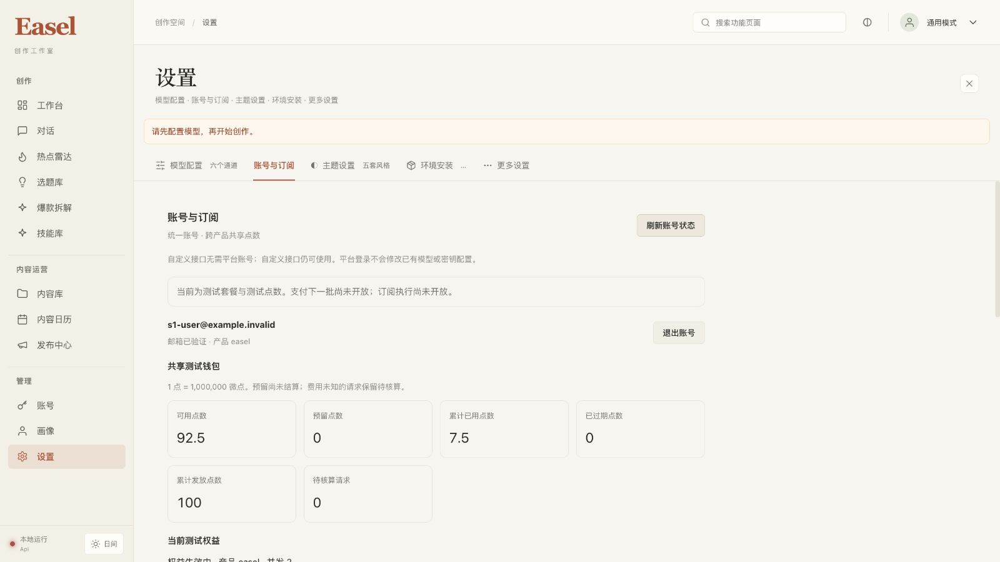

# S1 中央账号、套餐与共享点数钱包验收

日期：2026-10-22。工作区：`/Users/jiandan/Code/GitCode/Easel`，分支 `codex/ui-redesign`。本批完成本地开发与隔离验收，没有提交、推送、合并主分支或部署到远程服务器。

## 已交付行为

- 独立 `services/platform` Python 3.12 服务，使用单独依赖锁、异步 PostgreSQL 连接池和四个校验和迁移。桌面服务不承担中央数据库或身份密钥。
- Logto OIDC 托管登录入口；中央 broker 验证固定 issuer、产品 audience、签名、nonce、state、相关性 cookie 与 PKCE，再通过独立 PKCE 将一次性交接码送到本机拥有的随机 loopback listener。
- 同一 `(issuer, sub)` 对应同一中央用户、个人 tenant 和 billing account；两个产品分别持有自己的设备会话。相同邮箱不会自动合并不同身份。
- 不可变版本套餐、受限本地运营 CLI、`test_only=true` 的会员与点数批次、带运营来源的幂等发放。注册不自动发点，没有公开改余额、发点或客户端自行结算路由。
- 整数微点账本，1 点等于 1,000,000 微点。支持预留、发出、结算、未发出释放、过期结转和费用不明待核算；同一钱包跨产品并发准入使用数据库锁。
- 明细保存预算、实际扣点、状态、产品和费率版本。API 点数量为十进制字符串，前端使用整数运算，读取失败不会显示为零。
- Easel 设置 → 账号与订阅默认展示中央入口、测试套餐、共享钱包、用量和设备。旧 v1 开发账号移至“高级：旧测试账号”。自定义接口与原供应商配置保持独立。
- 中央 v2 私有会话另存，不覆盖旧 v1。明确失效会话支持退出和重新登录；网络故障保留凭证。任务运行中的账号变更和迟到回调由本地任务准入保护拒绝。

## 完整测试

以下数量是本批根代理实际执行结果，独立 reviewer 的定向测试不另行累加。

| 检查 | 结果 | 范围 |
| --- | --- | --- |
| 中央服务完整 pytest | 131 passed，11.24s | 真实 PostgreSQL 迁移、租户归属、钱包并发和约束、运营 CLI、HTTP API、签名 OIDC、撤销与重放 |
| Easel 相关 Python 回归 | 314 passed，5.82s | 中央本地桥、旧账号、订阅来源、自定义与媒体配置、图像／视频／音乐／声音适配、输出隐私 |
| 本地桥格式整理后复验 | 24 passed，0.82s | 新增客户端与本机 HTTP 回调测试；仅格式和未使用导入整理 |
| 全部前端测试 | 158 passed，0 failed，0 skipped | 包含真实 React 错误对象渲染、设备合同、钱包精度与会话恢复 |
| TypeScript + Vite | exit 0 | 生产构建成功；保留既有大于 500 kB chunk 提示 |
| 前端 lint | exit 0 | 仅原有 `linkifyOutputs.ts:27` 无用转义告警 |
| 新增 Python Ruff | All checks passed | 中央源码／测试及新增 Easel bridge 文件 |
| 独立 wheel 打包 | exit 0 | 包含全部 4 个 SQL 迁移；不包含 `.env` 或虚拟环境 |
| `git diff --check` | exit 0 | 当前已跟踪差异无空白错误 |

中央测试要求显式自有 loopback PostgreSQL，数据库名以 `easel_s1_test` 开头；每个测试使用独占 schema，缺少 DSN 会失败，没有使用 SQLite 替身或跳过数据库验收。

```bash
rtk proxy env EASEL_CENTRAL_TEST_DSN_FILE=/path/to/private-test-dsn services/platform/.venv/bin/python -m pytest services/platform/tests -q --tb=short

rtk proxy .venv/bin/python /private/tmp/easel-settings-pytest.py \
  tests/test_central_platform_client.py tests/test_central_platform_web.py \
  tests/test_platform_client.py tests/test_subscription_execution.py tests/test_output_privacy.py \
  tests/test_media_gateway_config.py tests/test_media_gateway_settings.py \
  tests/test_media_gateway_legacy_settings.py tests/test_media_gateway_settings_integration.py \
  tests/test_media_gateway_workflow_config.py tests/test_gemini_tts.py \
  tests/test_newapi_image.py tests/test_newapi_music.py tests/test_newapi_video.py tests/test_newapi_voice.py \
  -p pytest_asyncio.plugin -o asyncio_default_fixture_loop_scope=function -q --tb=short

rtk proxy node --test tests/frontend/*.test.mjs
rtk proxy npm --prefix web/frontend run build
rtk proxy npm --prefix web/frontend run lint
rtk proxy uv build --project services/platform --wheel
```

第二条记录使用本机已有 pytest 引导器，不是仓库运行依赖；其他环境可安装项目测试依赖后直接执行 `python -m pytest`。中央服务的可复现依赖与测试方法见其 README，不依赖该临时引导器。

## 真实 Logto 与浏览器闭环

本批实际启动官方固定镜像 Logto 1.45.0 和 PostgreSQL 16，以独立测试数据库、受限 runtime role、临时 HOME、临时 Easel 工作区及随机 loopback 端口验收。所有账号均为合成测试账号，未访问现有用户会话或真实供应商。

Logto 应用及合成用户通过其公开 Management API 创建，没有直接修改 Logto 数据表。使用浏览器实际完成托管登录、中央回调与 Easel 本机交接。第二个产品通过同一浏览器 Logto SSO 会话登录，无需再输入密码，并取得独立产品 bearer。

实际观察结果：

1. 首次登录后显示已认证账号、正确设备 client 和期限，钱包各项为 0，无测试权益。
2. 运营 CLI 以相同来源键重复授予 100 测试点，返回同一次发放，余额为 100。
3. 两个真实产品会话映射到同一用户和 billing account，分别用独立 PostgreSQL 连接池且 backend PID 不同，同时各预留 80 点。仅一方成功；未发出的一方预留随后释放。
4. Easel 预留 10 点，以内部合成操作实际结算 7.5 点；重复相同结算返回同结果，余额没有再减。
5. 两个产品通过公共只读钱包 API 均读到：可用 `92500000` 微点、已用 `7500000`、预留 `0`、累计发放 `100000000`。界面显示 92.5／7.5／0／100。
6. 第二产品 bearer 访问 Easel 专属权益返回 403；共享钱包不等于 bearer 可跨产品调用。
7. 浏览器退出 Easel 后私有 auth 清除，第二产品设备查询不再包含 Easel 会话；第二产品退出后旧 bearer 访问钱包返回 401。
8. 私有文件权限 0600、父目录 0700。账号页浏览器 error 日志为 0。
9. 主题 A 日间、主题 C 夜间均显示正常。实际 CSS 窄屏宽度 390，文档宽度同为 390，中央账号子元素无横向溢出；账号入口也完成键盘验收。临时视口覆盖已清除。

上述扣点是可信内部合成账本操作，**没有调用收费模型或媒体接口**。它验证了账本与共享会话，不能当作 S3 功能调用验收。脱敏回执见 [JSON receipt](2026-10-22-central-s1-receipt.json)。

真实 Logto 首次验收发现默认签名为 ES384／EC P-384，已补充固定 `RS256 / ES384` 白名单，并绑定密钥类型、曲线、用途和唯一 kid；未放开任意算法。新增合法 ES384 与错误签名、曲线、用途、issuer、audience、nonce 等拒绝回归通过，随后真实登录成功。

日间账号页，显示合成测试钱包：



[夜间截图](assets/central-s1/account-forest.png) · [390px CSS 窄屏截图](assets/central-s1/account-mobile.png)

## 独立审查与修复

最终报告：[独立安全与合同审查](2026-10-22-central-s1-final-review.md)。最终审查范围内无未关闭 P1／P2。审查执行了 40 项中央定向测试、3 项前端定向测试，另以真实 React 和临时 native 状态做了修复前后复现。

已修复数据库 TRUNCATE 与运行角色所有权缺口、reservation／hold／journal 一致性、CLI 与 HTTP 错误合同、错误产品授权破坏事务、失效 native 会话恢复、React 登录失败对象渲染及设备字段不一致。生产 runtime 在启动时拒绝 owner、superuser、可取得危险角色或拥有破坏账本权限的连接。

## 保留与清理

真实 `.env` SHA256 与开工基线一致；99 个既有未提交文件无缺失，只有 `web/app.py`、`lib/api.ts` 与旧账号前端测试因必要接入在其原改动上继续修改。没有回退或覆盖既有主题、媒体适配或其他用户改动。HEAD 和 main 的 commit 均未改变。

实际项目 7860 已在核对拥有的进程和无子任务后重启，新的中央 status 路由返回 200。未给真实工作区填入测试平台地址或测试账号，因此当前页面明确提示“运营者尚未配置平台入口”；自定义服务仍可使用。页面停留在设置 → 账号与订阅。

两个测试产品会话均已撤销；本批拥有的临时中央／Easel 服务、Logto 与 PostgreSQL 容器、带任务标签的网络及临时配置／凭据目录均已清理。仅保留正常项目 7860 服务。Docker Desktop 与官方镜像缓存保留，没有停止其他用户服务。临时浏览器标签页已关闭，原项目标签页保留。

详细基线回执见 [preservation](2026-10-22-central-s1-preservation.json)。部署及操作说明见 [中央服务 README](../../services/platform/README.md)，旧 v1 的定位和迁移边界见 [平台文档](../platform/README.md)。

## 尚未验收或交付的部分

本批没有部署到现有 4 核 4GB 远程服务器，没有生产域名／TLS、容量压测、监控告警、备份恢复演练、真实 SMTP 邮箱验证／找回密码投递或 Windows 平台会话验收。托管注册入口可见，但本批合成账号由 Management API 创建，不把它描述为真实邮件注册闭环。

S2 才接微信支付／支付宝、订单、签名回调、正式套餐与入账；S3 才把真实功能／接口执行、可信计量与当前共享钱包连接起来。旧 v1 token 余额不自动换成新点数，不自动按邮箱合并账号。当前 `payments_enabled=false`、`subscription_execution_enabled=false` 与界面提示保持一致。
