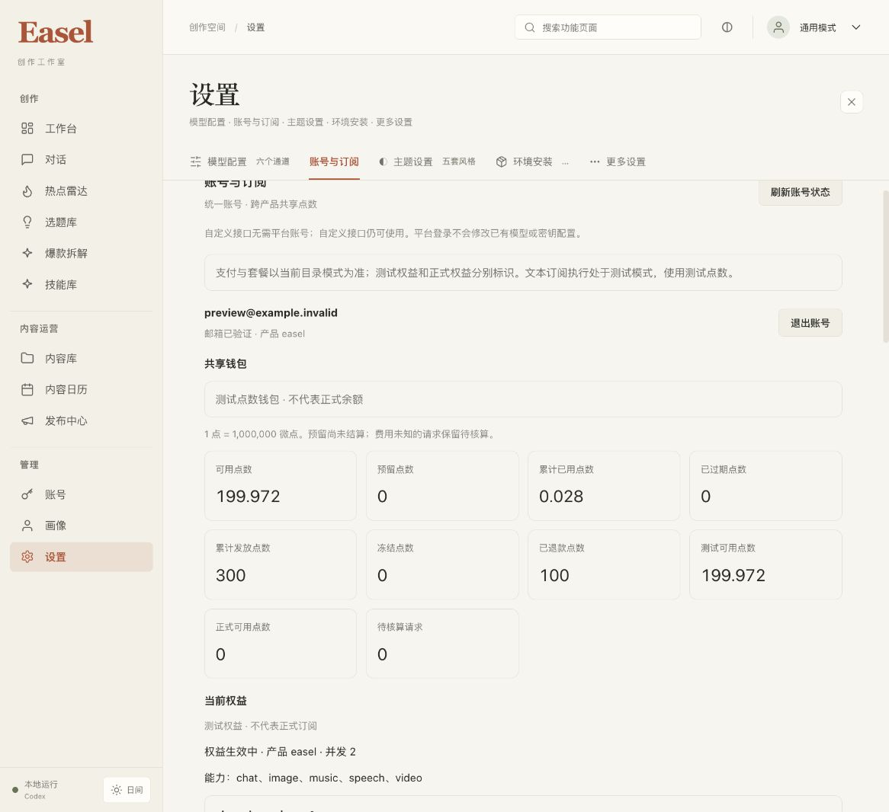

# S3-A 中央订阅文本与工具执行验收

日期：2026-10-22。开发分支 `codex/ui-redesign`。这是中央平台 S3 的文本／本机工具第一批，不是全部媒体、云执行或正式商户上线。

## 本批范围

- 在原自定义接口和旧版 v1 订阅之外，增加显式中央 v2 订阅渠道。旧配置缺少 backend 字段时保持 legacy；登录中央账号不自动改绑旧聊天。
- PostgreSQL 第 006 号迁移增加不可变模型费率、invocation、任务授权、一次派发操作、可信回执、结果缓存与恢复状态。现有 001–005 未修改。
- 复用已有共享钱包和原子账本，以整数微点和有理数费率结算 token。预算预留、实际结算、过期释放、冻结退款和并发共用同一钱包锁；费用未知的已派发操作保留待核算。
- 本地 Codex 通过拥有者限定的 loopback 代理访问中央 Responses。原生重试关闭；独立模型操作获得不同 UUID；同一操作不能重复物理派发。工具等待期间续期保持原 invocation 和完整身份；CLI 不同用户回合分别计费。
- 模型目录显示测试／正式模式、费率和上限，调用记录显示 token、预算、实际扣点与未知状态。完整账号范围切换会取消旧读取并隐藏旧数据。中央订阅设置不要求用户填写供应商 Key。
- 已支持媒体脚本在中央文本模式中、读取 dotenv 或派发子进程前拒绝待开放能力。原有自定义媒体接口继续独立使用。

## 证据分类

本批测试使用合成商户／模型、独立测试数据库，以及现有私有本地预览。真实 PostgreSQL、原生 Codex 和浏览器是真实运行；模型回答及 token 用量是明确标识的本地夹具。没有实际模型供应商计费，没有实际微信／支付宝收款，也没有远程生产部署或性能容量验收。

运行角色不持有迁移 owner 凭据，不能发布费率或改写财务历史。独立审查复现了列级 INSERT 权限逃过启动检查的问题，已用 `has_any_column_privilege` 修复，覆盖两张目录表全部八个列的启动拒绝／重授权清理回归。

原生协议探针与实际版本边界见 [原生协议验证](2026-10-22-central-s3-native-protocol.md)。已安装 npm/Node 启动器的参数顺序问题由实际浏览器首次失败暴露，补上 direct／Node × central／legacy 回归并验证初始化结果后修复；不能只凭打包原生执行文件的夹具成功推定 npm 入口也成功。

## 测试与最终预览结果

| 验证范围 | 当前结果 | 证据边界 |
| --- | --- | --- |
| 中央服务完整测试 | 405 passed，43.21 秒 | 真实隔离 PostgreSQL；包含账号、支付、钱包和新增执行逻辑 |
| 原生／中央／旧订阅／自定义／CLI／便携运行回归 | 353 passed、1 skipped，16.81 秒 | 指定了打包原生执行文件；唯一跳过项为显式开关控制的 npm/Node 用例 |
| 已安装 npm/Node Codex 集成补验 | 1 passed，0.45 秒 | 设置 `EASEL_TEST_CODEX_NODE=1` 后补齐上述跳过项；真实启动器、本地代理、生产验证器、合成响应 |
| 媒体与自定义接口回归 | 243 passed，8.12 秒 | 原有 New API 图片／视频／音乐／语音、Gemini TTS、网关配置和工作流等回归 |
| 前端完整测试 | 205 passed，0 failed、0 skipped | 包含账号隔离、钱包精度、调用记录和五主题／日夜模式 |
| 前端构建、lint | exit 0 | 保留既有 `linkifyOutputs.ts:27` 转义警告和大于 500KB 的 chunk 提示 |
| 现有 Ruff 0.12.10 | All checks passed | `ruff check services/platform --output-format concise`；额外未固定版本的 `uvx ruff` 检查提出 150 条更广规则问题，未批量自动修改已有代码 |
| 中央服务分发包 | wheel 与 sdist 构建成功 | wheel 中全部平台 Python 源码及 001–006 SQL 与当前工作区逐字节一致 |
| 独立最终审查 | PASS，无未解决的 P1/P2 | 仅限本批源码和可控夹具执行范围；见 [完整审查与关闭记录](2026-10-22-central-s3-review.md) |

测试组存在交叉覆盖，不将不同组的数量相加为唯一测试数量。开发用 PostgreSQL schema 自动隔离并清理，不使用 SQLite 替代账本验收。所有模型及商户回执均为夹具。

### 实际浏览器与本机工具循环

预览入口为 `http://127.0.0.1:18761/`。已在私有预览配置选择中央订阅、Codex 和 `central-text-fixture-v1`；项目根 `.env` 未改动。备份中央库与 Logto 库后，追加 006、配置最小 runtime 权限并仅重启拥有的中央/Easel 进程；未重启 Logto，也未改变其品牌设置。

实际 npm/Node Codex → 本机代理 → 中央服务 → 真实 PostgreSQL → 本机合成供应商完成如下流程：

1. 第一条模型请求返回 `update_plan`，由本机 Codex 执行工具。
2. 工具结果以 `function_call_output` 进入第二条模型请求，返回明确说明“模拟模型、测试点数”的最终文本。
3. 合成供应商精确收到 2 次 POST，第二次包含工具结果。数据库产生 2 个独立已结算任务，均使用测试资金及冻结的模型／费率版本。
4. 每条可信合成回执输入 100、输出 20 tokens，按 100／200 微点每 token 结算 14,000 微点，即 0.014 点。总扣点 0.028；可用测试余额 **200 → 199.972**，预留 **0**，待核算请求 **0**，正式可用余额 **0**。

两条任务为 `640a553f-423c-41c7-9ad6-aabfa3f38ab3` 和 `ccfdcbe6-3853-4341-a558-4ad8b5fe8440`。用量是夹具声明的可信测试数据，不是实际供应商的计量依据。早期启动器／元数据失败均发生在接纳和派发前，钱包未扣点；修复后才执行本次成功链路。

桌面已核对钱包、模型费率、两条已结算记录和最终工具回复。移动端以 CSS 390px 宽度检查钱包与调用记录，`innerWidth=390`、根文档 `scrollWidth=390`；模型名、费率和长请求编号换行，无页面横向溢出。验证后已清除设备模拟并恢复桌面日间预览。

其他截图：[工具回复](assets/central-s3/chat-tool-loop.png)、[桌面调用记录](assets/central-s3/executions-desktop.png)、[移动端钱包](assets/central-s3/wallet-mobile.png)、[移动端调用记录](assets/central-s3/executions-mobile.png)。

### 审查问题与修复

| 问题 | 最终状态 |
| --- | --- |
| 运行角色的列级 INSERT 权限绕过目录权限检查 | 已修复，两张表全部八列的启动拒绝和安全重授权回归 |
| 长工具等待超过 task token 期限 | 后续模型操作前续期，保持原身份、invocation 与预算；撤销／错绑拒绝 |
| CLI 不同用户回合共用 invocation | 每个新回合创建新 invocation；同回合工具循环保留同一个 |
| 切换账号范围后短暂显示旧调用记录 | 首帧隐藏，取消旧请求并拒绝迟到结果 |
| 旧测试 task token 在切为正式模式后可被接纳 | 认证后、预留与派发前检查资金模式；双向切换均拒绝，已发生费用仍可冻结结算 |
| Node 启动器参数被插到脚本前 | 保留完整启动命令顺序；direct／Node 与 central／legacy 交叉回归并实际启动 |
| 原生 `client_metadata` 被严格入口拒绝 | 仅接受六个已观察字符串字段、限制字节数，参与请求 hash 后从供应商请求剥离；不用于权限 |
| 中央订阅仍提示填写 Key | 依据成功读取／保存的服务来源显示中央、旧订阅或自定义说明 |
| 模型输出上限小于默认值 | 使用已认证不可变模型上限，覆盖 1024 tokens 回归 |

### 保留与后续

当前分支保持 `codex/ui-redesign`，HEAD 与 main 均未移动；本批未提交、推送或合并。开始时 198 个已有变更路径均仍存在；只在授权功能范围叠加修改。根 `.env` hash 与 001–005 SQL 保持原样。可核对 [脱敏验收凭据](2026-10-22-central-s3-receipt.json)。

下一步为真实 Responses 供应商的安全配置、用量与流式兼容验收，再发布正式模型／费率并使用正式权益测试。微信／支付宝真实商户收款、媒体能力和云端执行仍待各自验收。本地代理当前缓存有界 SSE 至完成后交给原生客户端，尚无逐 token 展示；已派发费用未知时保留预留，原生端尚未实现自动查询历史操作恢复。没有进行 4 核 4GB 服务器容量测试或远程生产部署。

完整实现与操作见 [中央文本执行说明](../../services/platform/EXECUTION.md)。
