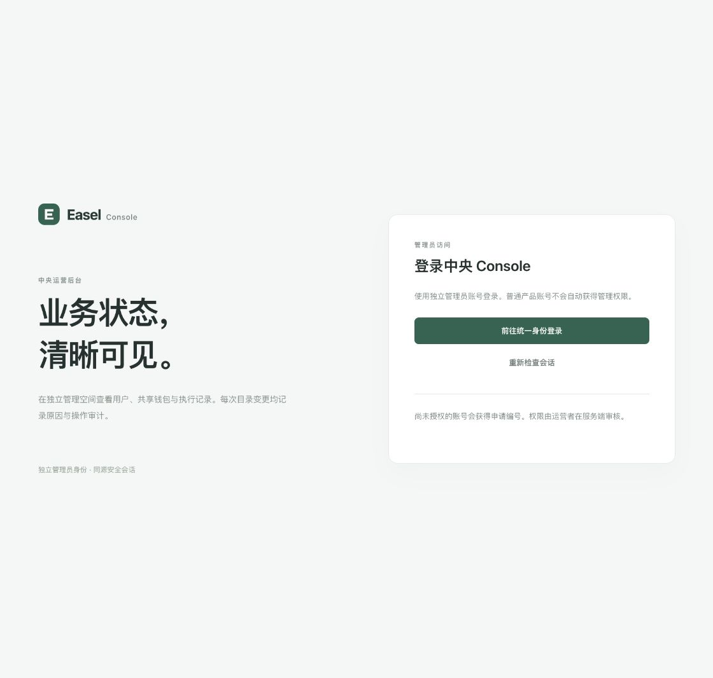
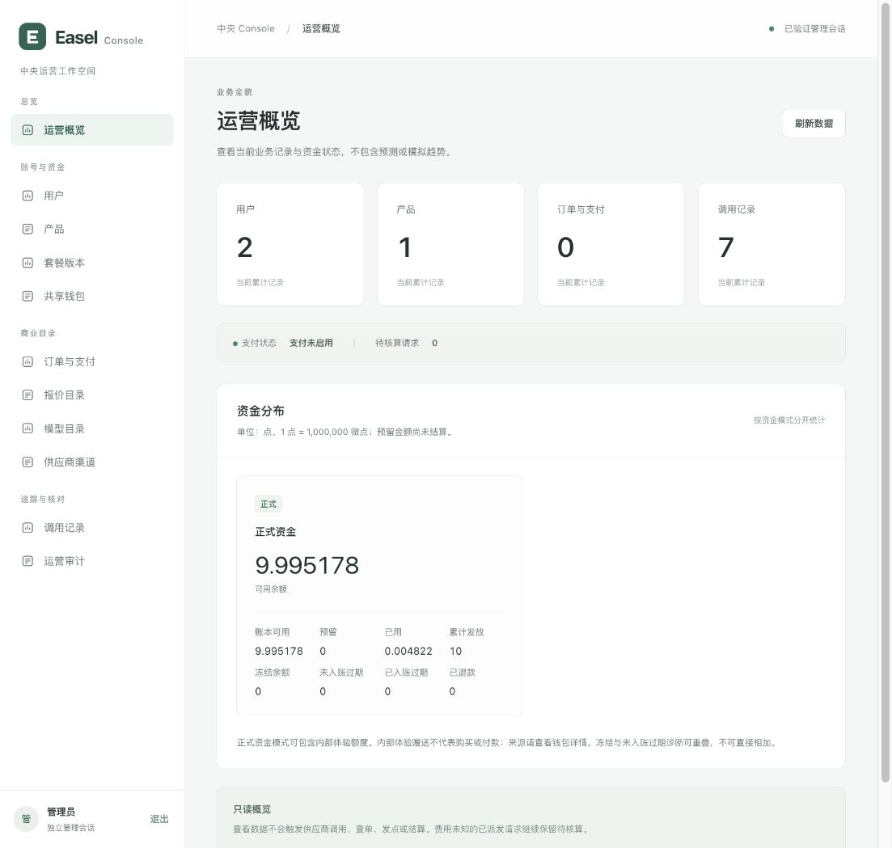
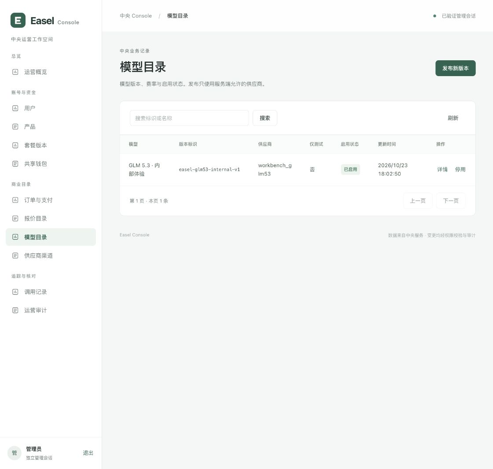

# 中央运营后台验证记录

## 当前证据范围

代码继续位于 `codex/ui-redesign`。本次新增独立管理网站和 BFF，保留 Easel 自定义接口与订阅两种模式。尚未执行提交、推送或合并。

本地完整后端验证：**630 passed，65.82 秒**。使用本次专用的 loopback PostgreSQL、随机测试 schema、真实 SQL 权限和签名的合成 OIDC。前端初始行为测试 20 passed；真实登录后发现导航白屏，新增回归并修复后 **22 passed**，TypeScript 与 Vite 构建成功。另重跑 HTTP／静态／CLI 相关后端 **27 passed**。真实管理员登录及页面读取现已单独验收，详情如下。

## 已实现与验证

- 概览、用户、产品、套餐、钱包、订单、报价、模型、供应商、调用记录、运营审计；用户、钱包、订单详情。
- 独立 Logto Traditional 客户端，固定回调；普通账号只生成已验证的待授权申请，owner CLI 批准前没有管理会话。
- 严格签名 `auth_time`、`max_age=0`、一次性登录事务、绝对有效期 Cookie、同源与 CSRF、即时撤销检查。产品 bearer 无法进入后台。
- 独立最小权限数据库角色，敏感业务字段与序列隔离，递归检查 NOINHERIT 可达角色。真实低权限角色完成查询和五类目录操作。
- 套餐／报价／模型发布、报价撤回、模型启停均要求原因和幂等键；业务、操作回执、不可变审计同事务提交。并发幂等、CAS 冲突、审计失败回滚均已验证。
- 只读查询使用一致快照，不发点、不执行过期结算、不调用模型或支付渠道。点数为十进制整数字符串，前端 BigInt 格式化。
- 分开显示账面余额和未冻结且未到期的实际可用余额；冻结与未过账到期诊断量可重叠。测试／正式分项也排除过期额度。
- Web 没有管理员自授权、发点、退款、手工付款确认、强制结算、供应商或支付密钥上传接口。
- 实际 HTTP 集成覆盖签名合成 OP → 待授权 → owner 批准 → 重新登录 → 查询 → 发布与幂等重放 → 单条审计 → 退出失效。

## 资源构建与打包

初始前端资产回执 SHA-256：`b73ea36f7b3b5abf713db7334b065484d75d31919e2f2cbd6c657ec69ab61976`，10 个公开构建输入、3 个输出资源。

初始独立服务 wheel：`easel_central_platform-0.1.0-py3-none-any.whl`，195,985 bytes，SHA-256 `4e5a7594579e86d0e1a1ef698034d85e3e0ceff606c89660fd308ad0a1cdbb09`。逐文件核对全部 Python、9 个 SQL 迁移、3 个静态资源与资产回执一致。该管理资源属于独立服务，未加入桌面安装包。

## 登录应用准备

新增应用 `Easel Console console-20261023-cbabf5af7060`，ID `ao8r5odz7yovjhsxmxjbi`，固定回调 `http://127.0.0.1:18875/oidc/console/callback`。应用 issuer 为本次 Logto 普通租户 `http://127.0.0.1:18763/oidc`。

实际运行的 Logto 对 Traditional 应用的 M2M `/roles` 查询返回 422，因此首次准备仅创建应用，未传递 secret。随后使用同一应用恢复，通过公开 `isAdmin=false`、`isThirdParty=false` 与数据库 `applications_roles` 关系数量为零核验，无角色变更。新 client secret 经 SSH 标准输入直接写入服务器 root 私有目录和 `0600` 文件，本机不保存。旧应用、5 个用户和品牌设置的数据库内计数／摘要前后相同。

## 本机 Docker 恢复

完整回归曾因宿主机磁盘不足、PostgreSQL I/O 错误中断；当时的 fixture 连接错误未计作业务通过。经用户明确批准后重启 Docker Desktop，并恢复原先运行的容器；未删除任何数据卷或重置数据库。Logto 首次恢复后退出，在确认 PostgreSQL ready 后再次启动，两个 issuer metadata 均正常响应。

旧 v2–v5 展开后的应用副本已与各自保留的 ZIP 完整逐文件校验，再回收展开副本，释放约 1.3 GB；所有 ZIP、当前 v6、用户工作区和配置保留。后续 630 项回归使用新建、带资源限制、tmpfs 数据目录的专用合成测试 PostgreSQL，未复用登录数据库。

## 部署与本人验收

独立 Console 预览已启动于 `http://127.0.0.1:18875/`，通过单独 SSH loopback 转发访问；复用原来的反向 issuer 转发，没有重启现有中央业务服务或 New API。健康检查返回 `ok=true`、`assets_ready=true`；匿名 `/api/session` 和 `/api/users` 均为 401。

服务器公开源码／资源精确清单共 52 文件，另有清单文件；上传逐文件摘要、旧迁移与数据库实际 9 个迁移全部核对。规范化源码清单摘要 `fe67f78928dec4ed5f72176be27c8bba2ce4b4a19c7c4d15bb17a87e748d97b6`。迁移前的 schema 私有备份 257,061 bytes，SHA-256 `b4a06ce4f0fe59f66c19753b8ffe45bf6c88a0dae27d3009e27320a161d48661`，已完整解码校验，未恢复执行。迁移／角色准备前后在同一快照核对原业务记录计数与摘要一致。

第一次服务器准备在非 root 导入探针处停止：运行中的 FastAPI 依赖公开 `opentelemetry` 包，初始白名单遗漏；同时补齐实际 CLI 的 `qrcode` 依赖。保留原脚本、依赖和 claimed 状态，使用新 `deps-v2` 和另名脚本修复并幂等重入，没有重置密码、备份或数据库。v2 SHA-256 `e897da14dd1ee997bd616cfcc34776ab3e631efe61293f25b70205d858b659c3`。本地 helper 3 项通过后，服务器真实非 root 完整 CLI／App 构造及私有文件不可读探针通过，服务随后以独立非 root 用户启动；运行 UID、精确 argv、PID／启动时间和所属监听 socket 校验通过。

浏览器已实际打开后台首页，显示独立管理员登录界面；点击入口成功进入该独立 Logto 应用的登录与注册页。部署时管理员数量为 0。随后用户本人完成独立账号注册，实际浏览器显示已验证的授权申请；该编号与服务器 owner CLI 查询结果精确一致，且申请的 issuer＋subject 未关联既有产品身份。已通过 owner CLI 批准为 active admin，并核对对应 ACL 审批事件恰好一条。没有将普通 Easel 账号升级为管理员，也未创建合成管理会话冒充本人登录。批准不直接创建会话；用户本人随后重新登录，服务器核对目标管理员为 active admin、申请精确匹配、有效会话 1 条、ACL 批准审计 1 条。浏览器实际显示已验证管理员会话。

原 Easel 工作台 `http://127.0.0.1:17868/` 返回 200；原中央服务仍运行，公开能力继续声明订阅文本 live、正式支付 disabled、媒体与云执行待接入。原分支／HEAD／main、根 `.env`、用户自定义接口文件和迁移 001–007 摘要全部与本阶段基线一致。专用合成测试 PostgreSQL 已停止，保留容器，未删除任何持久化卷。

尚不宣称已完成：真实目录写操作验收、正式商户收款、所有媒体或云执行接口、移动设备视口实测、性能压测、可用性集群、备份恢复演练、生产域名和 TLS 发布。schema 备份的可解码校验也不能替代实际恢复演练。

## 真实管理员读取验收与导航修复

2026-10-23，用户本人完成注册、重新登录。实际桌面浏览器逐项验证概览和 10 个列表：共享钱包 2、用户 2、产品 1、套餐版本 1、订单与支付 0、报价目录 0、模型目录 1、供应商渠道 1、调用记录 7、运营审计 0。零记录页显示明确空状态。另打开用户、钱包、模型和供应商详情，验证内部体验来源、账本明细、模型费率与预验证绑定。搜索无结果及清除恢复、重复点击当前导航、列表返回概览均通过。模型发布表单可打开并加载允许的供应商，仅开关表单，没有提交。

首次真实点击“用户”复现白屏：导航先切换页面，旧概览 ready 数据被列表读取，`items.length` 抛出异常；Effect 中清空数据晚于这次渲染。修复在导航事件中同步取消旧请求、清空数据并刷新 revision，同时为列表增加形状校验。新增测试先出现 20 pass／2 fail，修复后 22 pass。实际浏览器重新执行上述全部路径，修复后新增错误为 0；历史错误保留为已发现和修复的证据。Context7 核对的 [React 官方说明](https://github.com/reactjs/react.dev/blob/main/src/content/learn/you-might-not-need-an-effect.md) 也明确了 Effect 重置前会出现旧状态渲染。

热修复仅替换静态入口、资产回执和公开清单绑定，保留旧哈希资源及服务器私有备份，没有重启服务。48 个后端 Python／SQL 文件、runtime／operator 配置、原 PID 均保持一致。最新 canonical SHA 为 `6d9aab3014d76f07fd13fd5f252714839df83f73fe5226983f8c1fa902c786a6`，最新资产回执 SHA 为 `c3fddd3e9849e2f71057f02f9ef4c3abf9086f5391f15142e5270e839651d62f`。新 JS、CSS 与入口的实际 HTTP 内容摘要匹配构建，旧 JS 仍返回 200。

最新 wheel 196,047 bytes，SHA-256 `7addda835c3f4201d63c6c1f68e8173e5e8bb41e4f68f63dc98e44551745c24b`，逐文件核对新静态资源、全部 Python 和 9 个迁移一致。

只读检查前后采用真实 PostgreSQL READ ONLY 快照，8 张业务表计数均未变化：credit_journals 15、credit_entries 37、credit_lots 1、billing_orders 0、payment_transactions 0、execution_jobs 7、console_operations 0、console_audit_events 0。管理员授予单独记录在 console_acl_events（1 条），不冒充目录操作审计。本轮没有发点、扣点、模型调用、付款、订单生成或目录提交；这些计数核验不扩大为全库逐行数据不变的宣称。

非阻塞界面事项：模型详情复用通用展示区时，产品范围下面有一个多余的空“产品会话”标题；产品范围本身已正确显示。后续界面整理时处理，不影响当前目录、费率或调用状态读取。

运维流程见 [中央运营后台说明](../../services/platform/CONSOLE.md)。
