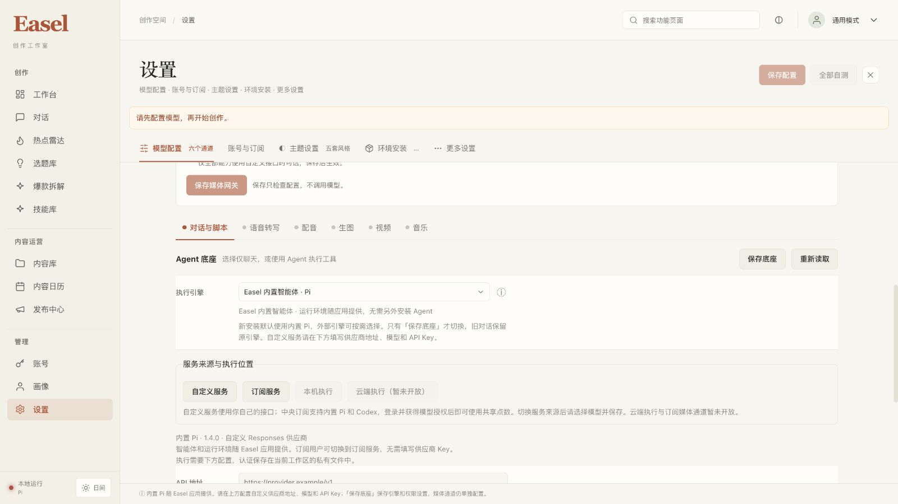

# Easel 内置 Pi 与 macOS 运行时验收记录

日期：2026-10-23。分支：`codex/ui-redesign`。状态：内置 Pi、v3 本机打包、真实模型／工具／测试点数验证已完成；隔离验收环境已按用户明确授权归档清理。

新安装默认使用 Easel 内置 Pi，应用包随附智能体、Node.js、CPython 和基础技能，基础聊天与工作区工具不要求用户另装 Agent、Node、Python、npm 或 pip。本轮 macOS ARM64 v3 包通过了实际迁移路径、全新 HOME、最小 PATH 下的启动与工具验收；实际 v3 运行时也完成了 GLM 的中央订阅文件工具往返、自定义模式文本与 Python 工具验证。

这些结果分别证明本机包、真实模型调用和测试账本行为。中央账号及点数来自隔离的合成非商业验收环境，没有支付或 OIDC 商业登录验收；生产中央地址尚未成为安装包预设。应用仍为未签名本地预览，通过浏览器显示界面。本机干净环境验收不等于独立干净 Mac 验收。

## 最终交付包

| 项目 | 本轮结果 |
| --- | --- |
| 应用 | `outputs/_run/pi-portable-20261023-v3/Easel/Easel.app` |
| ZIP | `outputs/_run/pi-portable-20261023-v3/Easel-Pi-macOS15-arm64.zip` |
| ZIP 大小 | 124,868,303 字节 |
| ZIP SHA256 | `31ab80a3d876c8e2247b68750c55b31332dc51972ae1cfdbf55e8fd7aff8200a` |
| 支持范围 | macOS 15+、Apple Silicon ARM64，本机未签名预览 |
| Pi SDK | `@earendil-works/pi-agent-core@1.4.0` 与 `@earendil-works/pi-ai@1.4.0` |
| Node.js | 24.22.1，官方 Darwin ARM64 固定发行包 |
| CPython | 3.12.13，随包私有解释器 |
| Python 核心依赖 | 25 个离线、逐项哈希锁定的 wheel |
| ZIP 完整性 | 35,798 个 ZIP 条目 CRC 通过 |
| 应用资源 | 15,251 个文件哈希及精确文件集合通过；运行后无额外或缺失文件 |

稳定资源根为：

```text
outputs/_run/pi-portable-20261023-v3/Easel/Easel.app/Contents/Resources
```

私有解释器、Node 和 worker 分别位于 `python/bin/python3`、`runtime/pi/node/bin/node`、`runtime/pi/worker.mjs`。交付目录的 `artifact.json` 与资源中的 `build-provenance.json`、`source-manifest.json`、`build-inventory.json` 记录该轮实际输入与哈希。

默认可写工作区为 `~/Library/Application Support/Easel/workspace`，与应用资源分开。关闭网页不代表停止服务；交付目录提供 `Stop Easel.command`，通过自有实例身份与 token 停止本工作区实例。已有显式引擎配置、旧会话归属和用户编辑继续保留，旧 OpenClaw 隐式环境也有兼容回归。

## 固定输入与完整性

Node 官方发行包在解压和执行前核对固定 SHA256：

```text
node-v24.22.1-darwin-arm64.tar.gz
89c682593d76cd44233fa53b1563264e7de9cbb189cad169135c5b4fadfbc0a7
```

Pi 的 npm 安装在开发准备阶段完成，使用固定 lock 与 registry integrity，执行 `npm ci --ignore-scripts --omit=dev`，隔离 npm 配置和缓存。实际安装闭包含 86 个包，payload 清单登记 11,931 个文件；应用启动不运行 npm 或在线安装。Node 原始 LICENSE、README，以及依赖树中的 82 个许可证／NOTICE 路径保留在清单覆盖的运行时中。包内不携带 npm。

Pi 使用独立的 `EASEL_PI_RUNTIME_MANIFEST` schema 2，记录平台、架构、Node、worker、Pi 版本及完整文件哈希。缺失、损坏、越界、符号链接、不兼容平台或不可执行 Node 均失败关闭，不回退到系统 Node／Agent。旧 Codex schema 1 的解析语义保留。

Python 已核对准备目录的逐文件／内部链接清单及全部 25 个 wheel 哈希，使用精确的 `cpython-3.12.13-macos-aarch64-none` 目录。原始上游 Python archive 不在本次准备输入中，因此 `python_archive_verified=false`；不能把逐文件校验改写成原始 archive 或签名验证。

打包前冻结了 877 个当前公共源码输入，包含本分支未跟踪的中央客户端、Pi 和 React 文件，并另外固定构建脚本、package／lock、许可证及元数据。公共源码规则排除环境文件、用户状态、输出、缓存、虚拟环境和普通开发 `node_modules`。只有独立验证的 Pi payload 通过专门路径进入包。

前端生产构建通过 TypeScript 与 Vite。receipt 覆盖 80 个当前源码输入和 13 个 dist 产物，构建器拒绝过期源码或额外、缺失、篡改的产物。

| 清单 | SHA256 |
| --- | --- |
| 源码清单 | `71305e70de238e33b879bd20d203aa13fbc50b9e2e11070330b3ea5edd286c82` |
| Pi runtime manifest | `dbe6e347af5257c065a7edac1aabef44c35101f17f6db2012e4858fee0c06feb` |
| 前端 receipt | `845c4ff4a3e735741821dbbced200fc76c9265c8120f7dab003247e2f74e5b39` |
| 运行后资源 inventory | `7396313f13ee2b1bce5075128c1f59ac3870ff3515c66a47d610c66f24253559` |

v2 与 v3 的 14,420 个引擎／运行时文件进行了比较：14,414 个字节哈希完全一致；六个 Python `.dist-info/RECORD` 只在已从两包移除的 `site/bin` 入口脚本哈希行不同，原因是生成 shebang 的构建路径不同。实际 Python 可执行代码、Node、SDK、worker、适配器、工具、中央客户端和会话模块一致。`web/app.py` 的 AST 差异仅限 `api_status` 状态说明。这里不声称两个包所有安装元数据字节相同。

## 实际本机包验收

只将新包移动到含中文和空格的路径，使用独立 HOME 与工作区、`PATH=/usr/bin:/bin`，不继承全局 Agent 配置，并对非 loopback 代理设置拒绝出口。实际随包 Python 启动 Web，实际随包 Node 运行官方 Pi SDK；随后移回交付位置并重新校验资源。

通过的项目包括：

- HTTP 页面、静态资源、默认 Pi、经过完整性验证的 bundled 状态。
- 三个本地非商业 Responses 请求完成 `write_file → read_file → 最终流式文本`，实际工作区 marker 内容一致，fixture 观察到工具结果继续进入下一次请求。
- 独立的显式批准工具检查执行 `run_command`，其 `python3 -I -B` 输出为迁移路径中的随包私有解释器。
- provider、harness 和 chat 的外国 Origin 写请求返回 403；响应与流中没有输出 fixture Key。
- 自有 token 身份校验、停止、同端口立即重启、设置和用户文件保留、技能文件用户编辑保留；外部占用端口时拒绝启动并保留原监听进程。
- Python 启动隔离拒绝宿主 `PYTHONHOME`／user-site 污染。实际中文路径沙箱回归通过；路径以原生 UTF-8 写入规则，没有扩大文件读取范围。
- 运行后全部资源哈希及精确文件集合仍一致，Pi payload 无新增文件或符号链接，没有隐式运行时安装。

本机预览使用 `http://127.0.0.1:17868/`。安装包未配置生产中央地址，中央入口如实显示尚未配置；自定义供应商为空时，侧栏显示“内置 Pi 供应商未配置”，不会提示安装 Pi CLI。保存供应商后仍注明认证与模型可用性待验证。设置页说明 Pi 随 Easel 应用提供，并保留 Codex 与旧订阅的兼容提示。



一次预览切换的 1 秒 `/api/status` 超时短于实际约 1.374 秒的状态检查；重复探测积压后造成暂时阻塞。轮询退出、队列清空后，自有身份请求恢复至 1–3 毫秒，v3 状态正常。预览编排宜使用轻量身份／HTML 就绪检查，状态接口使用合理超时并串行探测；该记录不代表应用启动失败或重启了其他进程。

## 回归测试

| 证据 | 结果与范围 |
| --- | --- |
| 本轮最终相关 Python 回归 | 527 passed、6 skipped；两项依赖实际 v3 Python／Unicode 路径的检查随后补测通过，剩余四项为 Codex 可选检查。不能改写为同一轮“529 passed、4 skipped”。 |
| 最终全部前端回归 | 219 passed、0 failed、0 skipped。最后修复仅为导航测试 VM 补齐 `setRuntimeDetail` 与成功／失败状态断言，没有改动生产代码或重新打包。 |
| 生产前端构建 | TypeScript 与 Vite 通过；保留既有大 chunk 提示，不据此声称性能优化。 |
| 实际官方 SDK 离线回归 | 流式、工具结果继续、取消、8 次模型请求及 16 次工具上限、错误终止等有独立核心测试；与实际模型／计费证据分开记录。 |

## 真实 GLM 中央订阅

使用实际 v3 私有 Python／Node／Pi SDK、服务器端供应商业务 Key，以及隔离的合成账号／非商业测试点数。中央流程的真实模型依次请求 `write_file`、`read_file`，工具结果继续进入下一轮，最终返回精确 marker `EASEL_PI_LIVE_OK`；实际文件 marker 与最终回复匹配。本轮耗时约 108.002 秒，三次模型请求均完成并获得可结算用量。

验收费率是测试规则：

```text
每次结算 microcredits = ceil(input_tokens / 2 + 3 × output_tokens / 2)
1 测试点数 = 1,000,000 microcredits
```

| 请求 | input tokens | output tokens | 实际结算 microcredits |
| --- | ---: | ---: | ---: |
| 文件写入请求 | 511 | 185 | 533 |
| 文件读取请求 | 547 | 16 | 298 |
| 最终回复请求 | 574 | 38 | 344 |
| 合计 | 1,632 | 239 | 1,175 |

三笔均为 `settled`，账本合计 `533 + 298 + 344 = 1,175` microcredits，即 0.001175 测试点数。此费率和点数不构成人民币、供应商成本或商业售价。

只对白名单中的 12 个精确验收请求 ID 读取网关计量元数据，12 个 ID 全部匹配。上述三笔中央结算逐一对应通道 4 的 GLM 记录，input／output tokens 完全一致，并已按整数费率复算。网关的 quota 字段、中央 microcredits 与人民币是不同单位；取消请求即使存在网关计量记录，也没有自动据此修改中央未知账目。

幂等重查返回 HTTP 200，重查前后观测到的物理网关 POST 均为 4；financial snapshot、jobs、receipts 和 dispatches 均未变化。此时的 4 次包含此前一笔 custom 文本及三笔 central 请求，不能把重查算成新模型请求。

## 自定义模式与取消恢复

自定义模式通过受控服务器侧转发使用同一实际 Pi 执行核心，供应商业务 Key 没有复制到客户端：

| 场景 | 实际结果 | 观测到的物理网关 POST | 中央账本 |
| --- | --- | ---: | --- |
| custom 纯文本 | 精确 marker `EASEL_PI_CUSTOM_OK`，约 6.194 秒完成 | 1 | 不新增中央扣款 |
| custom Python 工具 | 显式批准 `run_command`，实际 Python 工具成功，最终精确 marker，约 25.874 秒完成 | 2 | 不新增中央 job 或扣款 |

中央取消场景在观察到流式输出后发起取消，确认 cancellation observed。该次只有一个物理网关 POST；没有完整可信终态用量，记录保持 `pending_reconciliation`，保留 8,960 microcredits 预占，`actual`、input／output tokens 仍为未知。两次显式只读恢复查询均返回同一待核算事实，没有重试模型、没有归零，也没有自行释放未知预算。

GLM 测试钱包的安全快照为：issued 100,000,000，available 99,989,865，held 8,960，spent 1,175 microcredits，四项满足 `available + held + spent = issued`。支付订单、支付事件和支付交易行数均为 0。恢复查询证明可见状态和账本稳定，不等于已经取得供应商最终账单或完成取消退款。

## MiniMax 部分结果与旧状态保留

MiniMax 初测实际执行了一些工具，但没有达到最终精确成功条件。前四次请求具有完成用量并结算 `432 + 520 + 493 + 471 = 1,916` microcredits；第五次物理网关 POST 返回 HTTP 500，9,728 microcredits 保持 `pending_reconciliation`，actual 与用量未知。不能将该次整体流程写成最终回复成功。

| 保留对象 | spent microcredits | held microcredits | 本轮处理 |
| --- | ---: | ---: | --- |
| MiniMax 初测钱包 | 1,916 | 9,728 | 保留已结算及第五次未知预占 |
| 之前的 S3B 钱包 | 1,349 | 33,152 | 原待核算操作及余额保持不变 |

本轮 GLM 共观测到 7 次服务向网关的物理 POST：central 三次、custom 文本一次、custom Python 两次、取消一次。加上 MiniMax 初测五次，共 12 次。这里统计的是 Easel 可见的实际网关 HTTP 派发；SDK 显式 `maxRetries=0`，但这份计数不证明网关或供应商内部实现、调度与重试次数。

## 网关变更与凭证边界

为 GLM Responses 兼容验证增加并保留了通道 4 `Easel Pi GLM Responses v1`，模型 `glm-5.3`，使用 Responses 到 Chat Completions 的转换器。变更前已备份；原有通道 1、2、3 未修改。安全收据记录 original channels unchanged、未重启 New API、业务 Key 未离开服务器；不在本记录中复制备份内容或任何访问／代理凭证。

客户端中央授权、task scope 和服务端预占／结算保持既有责任边界。合成账号并非付费会员，测试点数并非已支付余额；本次没有商业支付或 OIDC 端到端验收。运营方生产中央 URL 尚未打入包，本机预览不会假装具备生产登录与套餐入口。

## 支持范围与待补充项

本轮保证的是内置 Agent 与基础执行环境：Web 界面、Pi SDK、私有 Node／Python、固定基础依赖、工作区文件工具及需批准和系统沙箱的命令工具。文件工具保留只读／工作区写入限制，保护凭证、会话、启动器控制状态及私有目录。已有引擎选择与旧会话归属不被 Pi 默认值重解释。

ffmpeg、完整浏览器运行时、媒体生成／发布 CLI、外部模型与其他可选依赖没有因此全部打包；这些能力需要单独安装条件和验收。没有 Windows／Linux 包、原生桌面窗口、签名、公证、Gatekeeper 或独立第二台干净 Mac 成功的声明。

开发与验收保留 `codex/ui-redesign`。本轮不改变 HEAD／main，不提交、推送或合并，不覆盖根 `.env`，不重置已有用户配置、旧会话或钱包状态。

**归档与清理：已按用户明确批准的范围完成。** 首次清理命令被自动审批拒绝，未执行；用户随后明确批准了备份、撤销两套合成登录、停止专用服务及移除临时私有配置的范围，才执行独立审查通过的脚本。服务器私有归档位于 `/var/lib/easel-validation/pi-embedded-20261023`（0700），中央数据库备份为 923,683 字节，SHA256 `569228a40851fa470639757202c9dddbca0d4f1166ce301a2c886a23b2f7ec3c`；已有 New API 变更前备份仅复制至该目录并核对原哈希，未下载到本机。

仅撤销 old Pi 与 GLM 两套精确的合成验收会话；两个专用 HTTP 进程、自有测试 PostgreSQL 容器及本次两个 SSH 隧道已停止，容器和数据卷保留。两套服务端临时业务 Key／DSN／任务捕获配置，以及本机八个合成登录／代理凭据文件已移除。原 S3B 私有恢复配置保留。三套账本九张财务／执行表的计数及指纹在清理前后完全一致，12 次网关调用计数没有增加；原待核算预算没有释放、归零或重发。

生产 New API 未重启，通道 4 保留；原预览和本机 v3 预览 `17868` 未触及。备份验证包括 pg_dump 成功、文件同步与哈希，尚未进行恢复演练；数据库归档不包含集群角色，现存容器、卷和原 S3B DSN 仍保留。归档在撤销合成会话之前创建，恢复后需重新撤销这些合成会话。详见[服务器归档清理](assets/2026-10-23-pi/archive-cleanup.json)与[本机清理](assets/2026-10-23-pi/local-cleanup.json)。

清理后另做只读检查：生产 New API 与生产 PostgreSQL 容器运行，公开健康接口 HTTP 200；测试 PostgreSQL 容器停止，专用端口 `18872`／`18873` 无监听；归档目录／备份权限与哈希符合预期。原本机端口 `7860`、`18761`、`18762`、`18763`、`18764` 仍可连接，v3 预览 HTML／状态 HTTP 200，默认 runtime 为 Pi。端口可连接不等于这些旧服务新增业务验收。

## 安全证据索引

公共安全证据已保存到仓库。以下均使用相对链接；私有 auth、代理配置、隧道日志及数据库备份内容不属于可发布附件。

| 公共证据 | 支持的结论 |
| --- | --- |
| [总收据](2026-10-23-embedded-pi-receipt.json) | 最终阶段状态与各项证据边界 |
| [最终独立审查](2026-10-23-embedded-pi-review.md) | 交付包、18 个安全附件、结算关联和保留边界复核 PASS |
| [原状态保留](2026-10-23-embedded-pi-preservation.json) | 分支、根配置、旧状态与保护对象的最终核对 |
| [包构建收据](assets/2026-10-23-pi/package-artifact.json) | v3 路径、大小、版本与 ZIP 哈希 |
| [实际包验收](assets/2026-10-23-pi/package-proof.json) | 迁移路径、全新 HOME、最小 PATH、真实 SDK fixture 与私有 Python 工具 |
| [运行后资源校验](assets/2026-10-23-pi/post-smoke-proof.json) | 资源哈希及精确文件集合 |
| [执行核心比较](assets/2026-10-23-pi/engine-equivalence.json) | v2／v3 执行文件一致性、六项 RECORD 元数据例外及 ZIP CRC |
| [真实中央流程](assets/2026-10-23-pi/central-live.json) | GLM 文件写入／读取、最终 marker 与实际 v3 路径 |
| [自定义文本](assets/2026-10-23-pi/custom-live.json) | custom 纯文本最终 marker |
| [自定义 Python 工具](assets/2026-10-23-pi/custom-python-live.json) | 真实模型请求已批准命令并取得最终回复 |
| [取消与恢复](assets/2026-10-23-pi/cancel-live.json) | 取消观察、待核算与两次只读恢复 |
| [最终服务器安全快照](assets/2026-10-23-pi/final-server-snapshot.json) | settled／pending、用量、余额、物理派发和旧钱包保留 |
| [财务断言](assets/2026-10-23-pi/financial-assertions.json) | 重查不变、精确整数算术、custom 不新增中央扣款 |
| [网关计量](assets/2026-10-23-pi/gateway-metering.json) | 12 个精确请求 ID 全部匹配；仅指定字段 |
| [结算关联复算](assets/2026-10-23-pi/gateway-correlation.json) | 三笔结算 token 与网关一致，合计 1,175 microcredits |
| [归档清理](assets/2026-10-23-pi/archive-cleanup.json) | 用户批准后完成服务端归档／撤销／停止／精确配置移除，账本不变 |
| [本机清理](assets/2026-10-23-pi/local-cleanup.json) | 两个自有隧道和八个已撤销的合成凭据文件清理 |
| [清理后健康复核](assets/2026-10-23-pi/post-cleanup-health.json) | 生产健康、测试服务停止、归档权限哈希与本地预览状态 |
| [MiniMax 初测](assets/2026-10-23-pi/initial-minimax-live.json) | 部分工具活动与未取得最终成功的边界 |
| [MiniMax 初测诊断](assets/2026-10-23-pi/initial-minimax-diagnostics.json) | 初测请求／错误的安全分类 |
| [GLM 兼容通道](assets/2026-10-23-pi/glm-compat-channel.json) | 通道 4、备份与原通道保留 |

本记录只摘录版本、状态、计数、单位、哈希和安全结果；没有访问／业务／代理 secret、账号私有配置或原始认证日志。本机阶段原始安全报告位于 `/private/tmp/easel-pi-20261023`，公共证据以上述仓库内归档为准。
