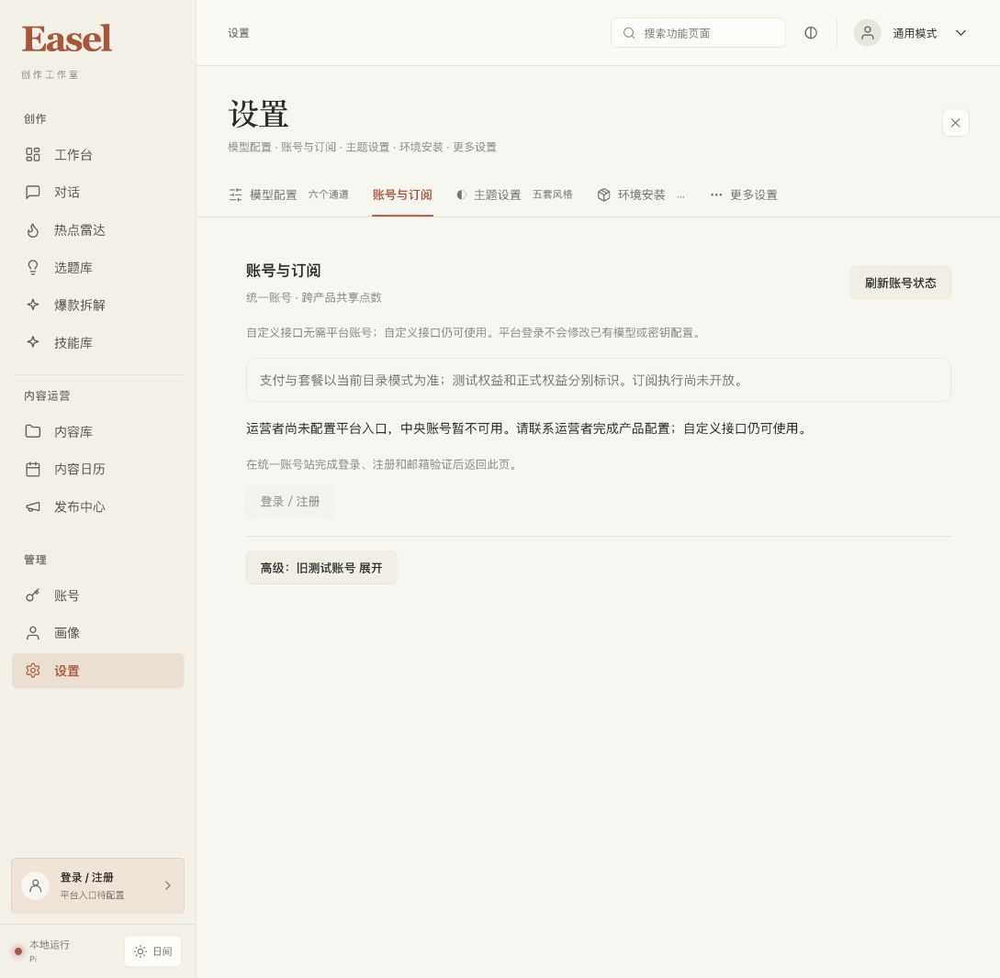

# 左下角账号登录入口

2026-10-23，`codex/ui-redesign`。已将账号入口放在左侧栏底部、原“本地运行”和日夜切换上方。点击复用现有“账号与订阅”设置，不启动新的认证流程或改变对话会话。

未登录显示“登录 / 注册”，服务端明确未配置时附“平台入口待配置”。只有成功读取到 `configured && authenticated` 才显示邮箱或账号 ID；其他读取错误显示“状态待确认”，不沿用未经确认的身份。状态仅在挂载、设置开关变化和窗口聚焦时读取，取消旧请求且忽略过期结果，没有新增轮询。

侧栏使用当前主题的语义颜色。窄屏样式保留 40px 原生按钮、无障碍名称和键盘焦点，隐藏文字；本轮没有模拟窄屏浏览器，不将源码审查写成实际移动设备验收。

前端全量 **226 passed、0 failed、0 skipped**，TypeScript／Vite 生产构建通过，增量独立审查 PASS。实际浏览器已确认底部入口可见、点击直达账号设置、关闭及重新打开正常；当前预览没有生产中央配置，真实不可用原因可见，没有进行账号注册、支付或新增模型调用。

已构建新的 v4 包并在同一工作区、HOME、端口认证替换自有预览：<http://127.0.0.1:17868/>。原画像／底座配置、根 `.env`、HEAD／main 保持不变，其他预览未触及，旧 v1–v3 包保留。

新包：`outputs/_run/pi-portable-20261023-v4/Easel-Pi-macOS15-arm64.zip`，124,869,231 字节，SHA256 `ec19d6d7a755f87532715fb0d1440e353d09a7d76a428e513418d9cddec40268`。878 个当前公共源码及构建输入、81 个前端输入／13 个产物、15,251 个应用资源与 ZIP CRC 均已校验。仍是 macOS 15+ ARM64 未签名预览包；先前 Pi 真实模型与账本验证范围见同日内置 Pi 报告，本轮是界面增量验证。

证据：[总收据](2026-10-23-sidebar-account-receipt.json)、[包完整性](assets/2026-10-23-login-entry/package-proof.json)、[运行预览](assets/2026-10-23-login-entry/preview.json)、[增量审查](assets/2026-10-23-login-entry/review.md)。

