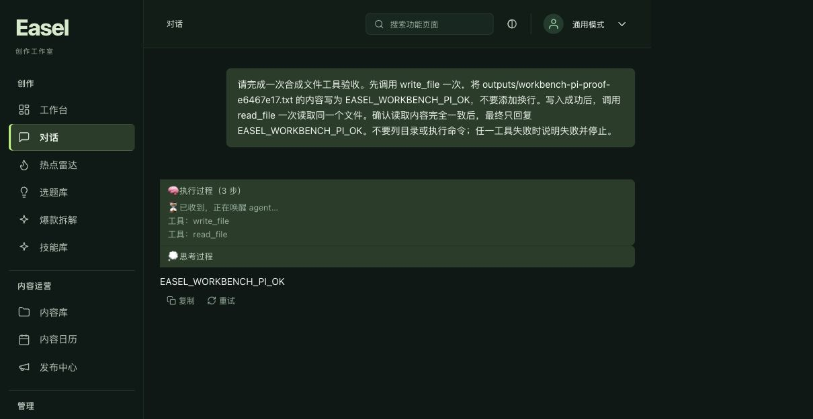
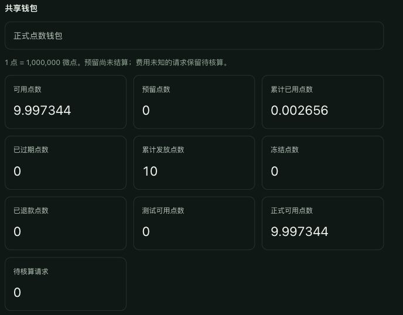

# 工作台中央登录与内部体验验证

2026-10-23，当前分支 `codex/ui-redesign`。用户本人完成新账号注册和正常 OIDC 登录后，17868 内置 Pi 工作台已通过真实文本、文件写入／读取和中央扣点验收。未提交、推送或合并主分支。

## 实际结果

工作台入口 `http://127.0.0.1:17868/`，当前配置为 Pi、中央订阅、本机执行、`GLM 5.3 · 内部体验`、项目工作区写入。原有自定义供应商文件摘要保持一致；旧对话保留原渠道，新建验收对话使用中央订阅。

用户亲自设置密码并完成注册；验证器确认当前会话与新注册账号一致，具有正常 OIDC transaction 来源，没有复制旧会话或合成登录。旧账号和钱包保留。报告不保存密码、code、state、Cookie、访问令牌或完整身份 Scope。

| 验收项目 | 实际结果 |
| --- | --- |
| 额度 | 10 点内部体验，运营者发放，非付款，不代表购买订阅 |
| 有效期 | 2026-10-23 19:23:47 至 2026-10-30 19:23:47，Asia/Shanghai |
| 幂等／审计 | 相同键重复调用不增发，赠送审计 1 条 |
| 付款记录 | orders、payment events、payment transactions 均为 0 |
| 真实文本 | 新对话最终精确回复 `EASEL_TEXT_READY` |
| 工具 | `write_file`、`read_file` 各调用并成功返回 1 次，调用与结果 ID 配对 |
| 实际文件 | `outputs/workbench-pi-proof-e6467e17.txt`，21 bytes，无换行，精确为 `EASEL_WORKBENCH_PI_OK` |
| 工具最终回复 | 浏览器显示 `EASEL_WORKBENCH_PI_OK`，执行过程列出两个工具 |
| 模型请求 | 两个工作台任务，共 4 个中央 job，均 completed／settled |
| 已扣点 | 2,656 微点，即 0.002656 点 |
| 剩余可用 | 9,997,344 微点，即 9.997344 点 |
| 预留／待核算 | 均为 0，未人工释放或将未知费用归零 |

文件 SHA256：`26e33aa25db8c2ccedc3a5c8a3b246bd4915efa8bd854ca432906755373cd04b`。机器证据来自持久化 Pi SDK toolCall/toolResult 和实际文件；浏览器画面独立证明结果在工作台呈现。

## 真实扣点与网关证据

费率 `internal-glm53-20261023-v1`：每个请求独立计算 `ceil((input_tokens + 3 × output_tokens) / 2)` 微点，随后汇总。工具本身不单独计费；工具之后的模型请求按实际 token 计费。

| 用途 | input tokens | output tokens | 微点 |
| --- | ---: | ---: | ---: |
| 纯文本 | 627 | 166 | 563 |
| 工具任务第 1 次模型请求 | 699 | 585 | 1,227 |
| 工具任务第 2 次模型请求 | 744 | 24 | 408 |
| 工具最终回复 | 780 | 45 | 458 |
| 合计 | 2,850 | 820 | 2,656 |

只读账本快照的 13 项检查全部通过，包括 Scope、模型／费率、输出上限、reservation、receipt、invocation、资金批次和不可变分录。发放 10,000,000 = 可用 9,997,344 + 已用 2,656，其余桶均为 0，分录总和为 0。

New API 同一时间窗、指定令牌／模型／channel 下有 4 条消费日志，每条 token 用量分别存在唯一候选。中央 provider_response_id 与网关顶层 ID 的原始值不同，当前审计不做前缀转换，故 **未证明请求 ID 级别的一一关联**。token 候选不冒充精确身份匹配，网关 quota 不等于中央扣点。中央可信用量回执及不可变账本是扣点依据；没有为补证据重发模型。

安全回执：[subscription](2026-10-23-workbench-subscription-receipt.json)、[usage](assets/2026-10-23-workbench-usage.json)、[tools](assets/2026-10-23-workbench-tools.json)、[grant](assets/2026-10-23-workbench-grant.json)。

## 源码、验证和运行包

- 新增 `007_internal_grants.sql`，001–006 不改。正常 OIDC 会话记录来源 transaction，旧会话不回填。
- 发点默认关闭，要求私有精确环境策略、owner DSN、`internal:issue` 能力。固定 10 点、7 天、文本、并发 1，没有网页自助发点或任意金额参数。
- 发放在单事务创建权益、可用于真实执行的资金批次、平衡分录及不可变审计。同环境钱包只能获赠一次，幂等键跨运营者保持，旧测试点数不支付真实模型。
- 本次新应用可选 force_login，旧客户端默认不变。账号页展示内部体验余额／到期与非付款标识。登录超时导航已改为安全中文页，JSON／HTTP 状态／五分钟 TTL／state／PKCE／Cookie 校验保持，见 [login expiry](2026-10-23-login-expiry.md)。
- root 独立完整中央回归 **486 passed，0 failed，63.19 秒**；之后新增的 CLI 前导连字符回归另跑 **3 passed，0.05 秒**。后者覆盖新 session ID 以 `-` 开头时用 `--session=value` 传参，业务源码未改。前端 **229 passed**，TypeScript 和 Vite 构建通过。
- 当前运行 **v6**：`outputs/_run/pi-portable-20261023-v6/Easel-Pi-macOS15-arm64.zip`，124,869,561 bytes，SHA256 `9cad3d2dcb1370268ab713c809376b80d7de918fd0981f03964b4b2ac5b80725`。878 公开源码、81 前端输入、13 构建输出、15,251 资源、35,798 ZIP CRC 条目均验证。内置 Pi 1.4.0、Node 24.22.1、Python 3.12.13，未打包供应商凭证或中央运营服务。

独立审查：[UI](2026-10-23-workbench-ui-review.md)、[core](2026-10-23-workbench-core-review.md)、[issuance](2026-10-23-workbench-issue-review.md)、[final acceptance](2026-10-23-workbench-final-review.md)。

## 隔离环境与边界

| 项目 | 标识 |
| --- | --- |
| 环境 | `wb-20261023-e6467e17dc33` |
| 中央服务 | `http://127.0.0.1:18874`，服务器仅 loopback，经专用 SSH 正向转发 |
| OIDC issuer | `http://127.0.0.1:18763/oidc`，服务器经反向转发访问本机 Logto |
| 新登录应用 | `xr99q57cbky3ut5pjrmdg`，Traditional，回调 `/oidc/easel/callback` |
| 服务器目录 | `/var/lib/easel-workbench-preview/e6467e17dc33`，0700 |
| PostgreSQL | `easel-workbench-e6467e17dc33-db`，loopback 18776，独立持久卷 |
| 数据库／schema | `easel_workbench_preview`／`workbench_e6467e17dc334faabcba1ad78d6c23ad` |
| 数据库资源 | 256 MB、1 CPU、128 PIDs、20 connections、32 MB shared buffers |
| 模型 | `easel-glm53-internal-v1` → New API `glm-5.3`，canonical HTTPS Responses 路径 |
| 请求限制 | 16384 input tokens，1024 output tokens，并发 1，120 秒，不自动重试 |

New API 业务令牌与登录 confidential secret 仅在服务器私有目录保存，不进入桌面、源码、浏览器或聊天。工作台复用原 workspace／HOME，配置通过普通 UI 选择中央订阅。

这是依赖本机 Logto 与专用 SSH 转发的内部预览，当前包面向 macOS 15 ARM64，未签名／未公证。商业支付仍 disabled；未证明生产 HTTPS 域名、长期托管、恢复演练、订阅图像／视频／音乐／语音或云端执行。

旧 S3-B、MiniMax、GLM 验收钱包和待核账记录不迁移、不清零、不释放、不重发，旧验收数据库保持停止，New API 生产容器未重启。根 `.env`、001–006、branch／HEAD／main 保留性见 [preservation](2026-10-23-workbench-preservation.json)。

继续体验：打开工作台，点“对话”→“新对话”发送文字；左下角“账号与订阅”查看余额、点数明细和调用记录。旧对话继续保留原渠道，测试中央订阅请用新对话。额度到期、隧道停止或模型不可用时查看状态，不重复发放或将未知费用归零。
