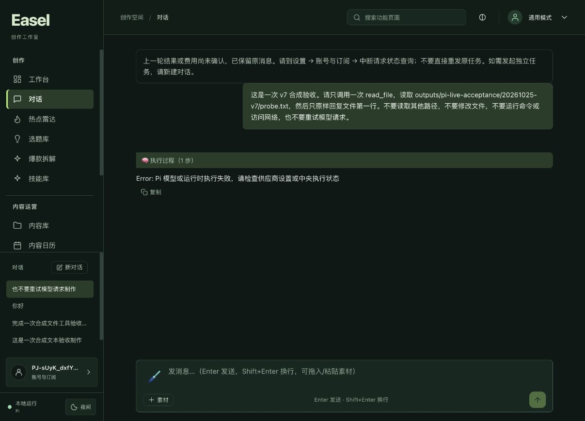
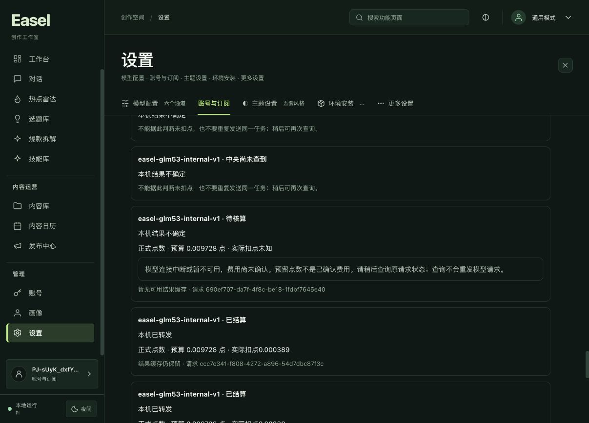
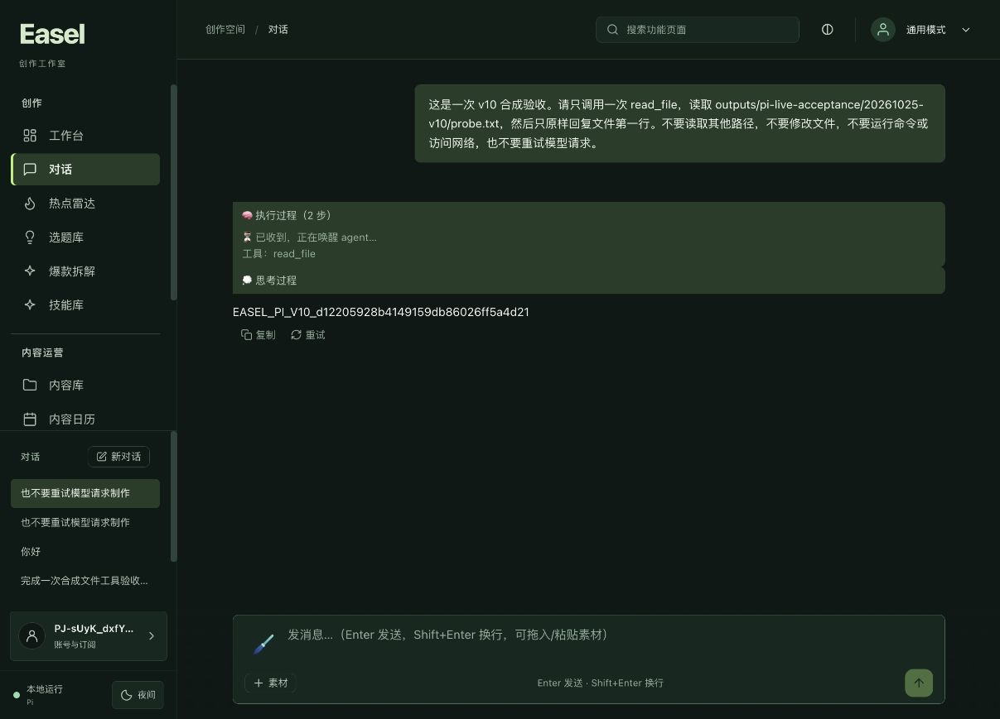
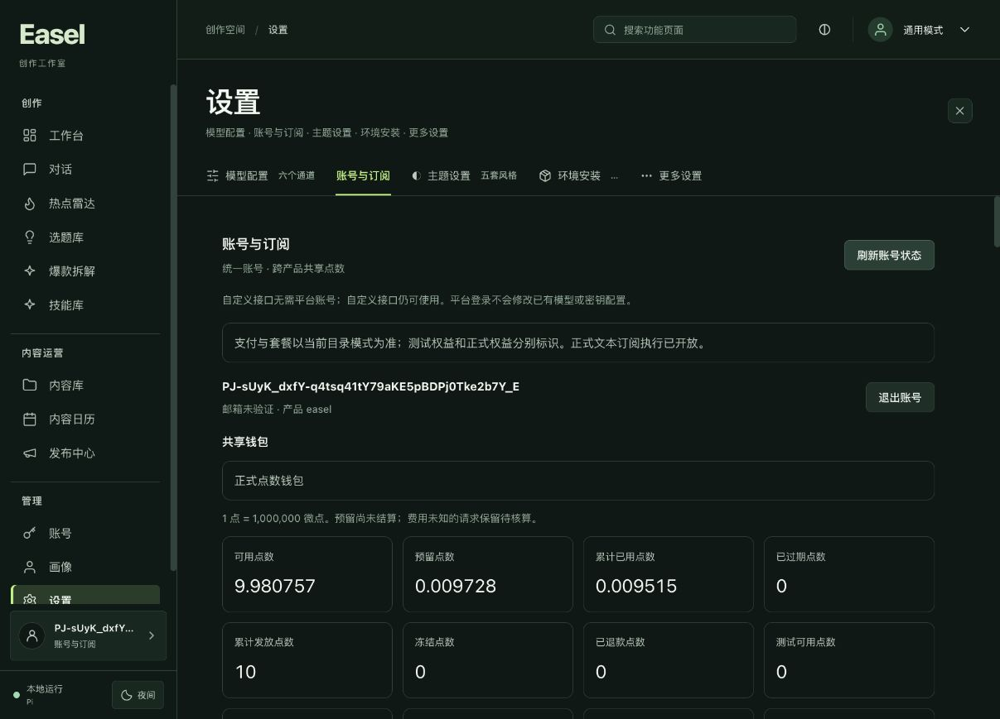
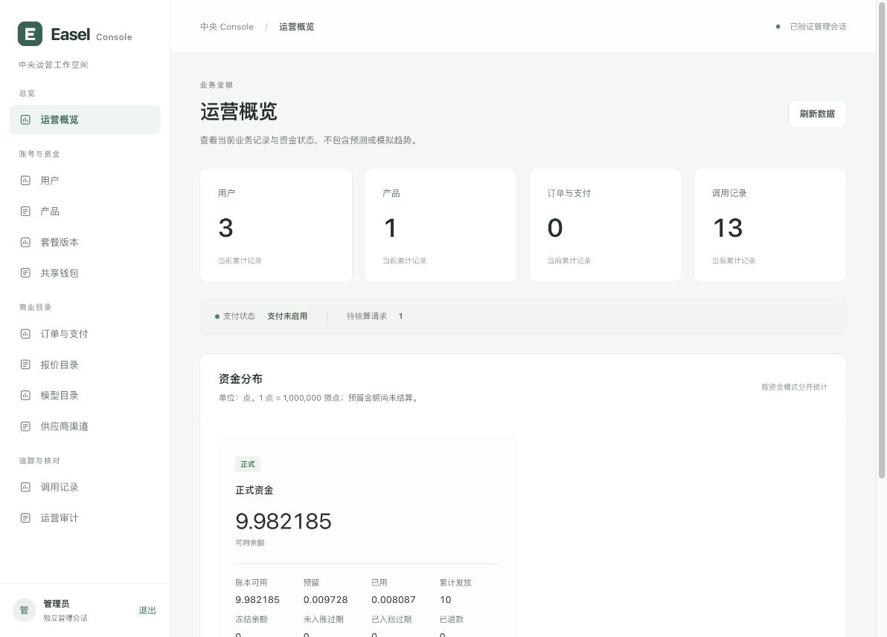
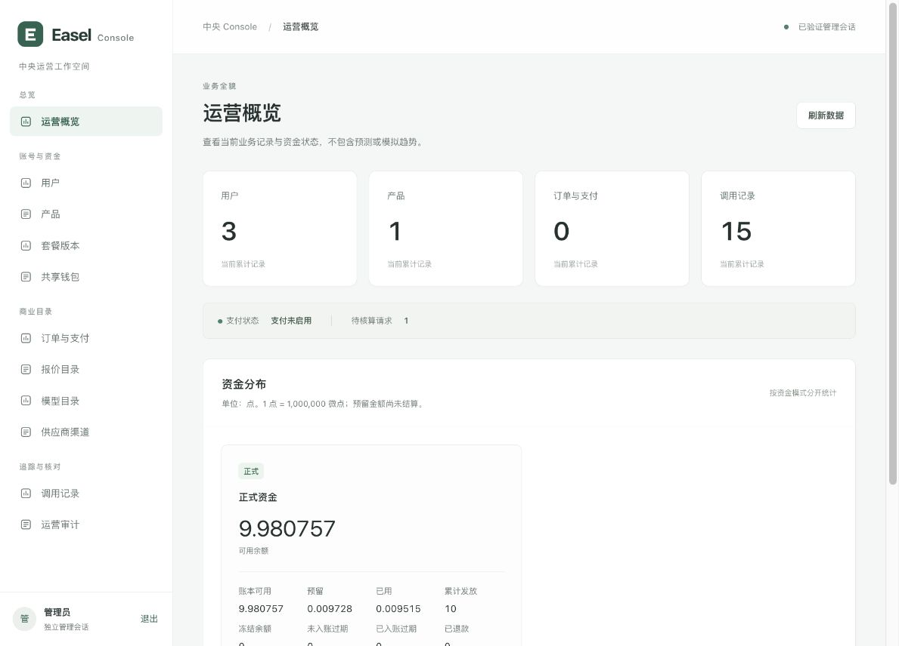

# 2026年10月25日执行稳定性阶段验收

状态：**本阶段完成**。超时与未知任务重试保护、用户批准的方案 A 生产切换、v10 精确包、浏览器 UI 一次发送的真实 Pi 文件工具往返、1428 微点结算、两次完整只读恢复和同一管理员会话查看均已验收。旧任务的 9728 微点仍保留为未知费用；本阶段不包含其核清，也不扩展为长期稳定性、显式 stop、支付、媒体或高可用验收。

代码基线为 `codex/ui-redesign`，HEAD `e972af0`；本阶段未合并到 `main`。部署职责保持为 154 承载中央服务、Logto 与私有 Console，115 承载 New API，139 承载网站。本报告汇总已保存的安全回执、已确认的阶段执行结果与截图；文档整理过程没有发起远端操作、模型调用或付款。

结构化结果见[最终安全回执](2026-10-25-execution-stability-safe.json)，其状态为 `passed_for_current_stage`。该回执 SHA256 为 `0334f5db821052a3ef21b30e1dc5f1aab99f7eec18b057e946d618b996a25b92`。

## 旧任务与核账证据

2026年10月25日16时检查时，旧任务 `690ef707-da7f-4f8c-be18-1fdbf7645e40` 仍处于 `pending_reconciliation`：预留 9728 微点，`actual = null`，原因是 `upstream_unavailable`。

| 已确认字段 | 记录 |
| --- | --- |
| 派发时间 | `2026-10-25T01:04:13.037897Z` |
| 进入待核算时间 | `2026-10-25T01:06:13.058124Z` |
| 两个时间点的间隔 | 约 120 秒 |
| 原预留 | 9728 微点，继续保留 |
| 最终实际费用 | 未知，不能写为零 |

New API 同期窗口中，日志 id 52、53、54 为正常 `done`，这三笔的 response ID 可以精确匹配；日志 **id 55** 出现 `client_gone` / `context canceled`。55 是一条日志记录的 id，不是错误条数或渠道号。由于旧未知任务没有持久化的上游请求 ID，id 55 只能列为同期候选记录，不能认定已经与旧 attempt 严格一一绑定。

候选记录中的 1227 / 187 为估算 token 数，不是可信终态核账凭据。不能用这些估算或时间近似关联来执行 settle，也不能借本阶段超时修改、直接改余额或重新派发旧任务来解除原预留。

## 超时修改与方案 A 生产切换

先前中央 release `/srv/easel/releases/20261025-execution-stability-v1` 仅包含核心公开失败语义、配置超时上限与运行时稳定 timeout 错误码三处修改。当前 API 与 Console 均已切换到 `/srv/easel/releases/20261025-pending-concurrency-v1`；新 wheel 相对上一 release 仅改变 `credits.py`，SQL 迁移未变，本次没有执行数据库迁移。

| 层级 | 已确认配置或行为 |
| --- | --- |
| 中央配置 | 超时配置上限为 300 秒；代码默认值仍为 90 秒，生产配置为 300 秒 |
| accounts 代理 | 330 秒 |
| 新客户端代理 | read timeout 为 310 秒，total timeout 为 315 秒 |
| Pi | header timeout 为 `330000` 毫秒，`maxRetries = 0` |

这些数值是相应层的等待上限，不代表模型响应时间或成功率承诺，也不会补回旧请求缺失的可信终态用量。

方案 A 现已生效：实际执行计数仅包含 `reserved` / `dispatched`，待核算单独按共享钱包计数；待核算达到三笔时拒绝新的模型操作。三笔是新操作的准入阈值，若此前已有的多个请求随后转为未知，仍须完整保留实际 pending 与 hold，不能裁剪或清零。

受控切换先暂停 task token、模型派发和 cancel，确认维护 503，等待 reload 前 Nginx worker 退出并确认全局执行计数为零，再比较原钱包九表金融投影、停止旧中央、切换两 unit 与验证双服务健康。首次恢复 Nginx 后立即检查公开 GET 405，因 reload 异步窗口而失败，脚本自动回封；直接回环确认两条 GET 均为 405 后，修正为有界轮询的 finalize 成功。该失败及恢复过程保留，不替换成首次即成功。

154 上的最终安全回执 `/root/easel-migration-20261024/pending-concurrency-20261025/switch-safe.json` 确认新 API、Console 与 Console assets 健康，原 Nginx 已恢复，公开 `/v2/responses` 与 `/v2/task-tokens` 的无认证 GET 均为 405；原钱包九表投影前后一致，原 pending 的 9728 微点及未知 actual 保持，执行配置哈希一致。该回执的范围为原产品钱包，`execution_results` 的 payload 通过长度与摘要比较，不能扩展为全库所有钱包的原始全行审计。整个切换和 finalize 没有模型调用。

本次发布前的新认证加密备份已 self-verify；实际模型验收后又生成下文记录的最新备份。两者的 fresh restore 与 offsite 均不由自校验推导。

## 重试保护与浏览器验证

前端在 GET 原任务状态前保留历史；状态为 unknown 或中央任务元数据缺损时，阻止创建新的订阅任务。两个后端入口在 authorize 前及 session 锁内分别执行保护，防止绕过前端或并发点击重新派发。自定义接口、明确 legacy 路径、独立新 session 与已完成中央任务的既有行为保留。

v9 浏览器实测点击旧任务重试时成功拦截，原 turn 文件的字节与 SHA256 保持一致。该次 UI 操作后的财务快照哈希仍为 `905dea7d3e38aaa8c0d6e7a58155827b9ec611b7b14f92978e389e88935aa17f`，九张被核对表的内容与计数均保持一致。





较早的 v7 浏览器验收曾提交一个新合成任务。由于旧 pending 仍占用体验套餐唯一并发名额，该任务在准入时被拒绝，只新增一个零操作 invocation，没有新增模型 job、receipt 或费用。`execution_jobs = 13`、`execution_receipts = 12`、`credit_journals = 26`、`credit_entries = 64` 均保持不变。因此，这次操作证明了准入拒绝及账本保持，不能写成新的真实模型调用已通过。

## 测试和构建结果

以下是各自独立阶段的执行结果；存在覆盖重叠，不能相加为同一轮总数。报告整理时未复跑这些测试。

| 验证范围 | 已确认结果 | 证据范围 |
| --- | --- | --- |
| 中央超时阶段全量测试 | 939 passed | 使用真实隔离 PostgreSQL；首次以 256 MB tmpfs 执行曾因 DiskFull 失败，保留该失败证据；改为 1 GB tmpfs 并将 WAL 配置为 64 MB 后，该轮 939 项通过 |
| 中央方案 A 最终全量测试 | 953 passed | 独立最终轮次，使用真实隔离 PostgreSQL；不与上一轮相加 |
| 客户端相关测试 | 387 passed，10 skipped | v9 前阶段的一轮结果；10 项跳过继续保留，不代表 v10 新一轮全量测试 |
| v8 实际运行资源补验 | Python 2 项、SDK 6 项，共 8 passed | 独立补验，不累加为 387 项所在同一轮，也不冒称 v9 重新运行了这 8 项 |
| v9 前端测试 | 247 passed | 历史独立轮次 |
| v10 前端最终测试 | 251 passed，0 failed，0 skipped | 方案 A 客户端/UI 对应的最终前端结果 |
| TypeScript 与 Vite | 验证成功 | 类型与构建检查 |
| 新包完整性与隔离启动 | 验证成功 | 对应下节 v10 精确包与本地隔离 smoke；smoke 没有真实模型调用 |

## v10 包与主预览保全

当前阶段交付包目录为 `outputs/_run/pi-portable-20261025-v10`，应用位于 `Easel/Easel.app`。归档 SHA256 为：

```text
337af54acb527da5360f45638e7e3cbc70a6326663359e90adf15f67da954cf4
```

v10 包验证包含 15251 个资源文件清单、精确归档绑定，以及全新 HOME、最小初始 PATH 的隔离 smoke。该 smoke 禁止外网，未配置中央服务，模型 POST 为 0；验证了页面与静态资源可达、内置 Pi 可识别、所启动进程正常退出及端口关闭，启动前后资源清单一致。

v10 前端绑定 81 个 source inputs 与 13 个 outputs。相对 v9，内置 Pi runtime、Python 执行代码与 web backend 逐字节一致，Easel 侧仅包含批准的三个客户端变更：`easel/harnesses/pi.py`、`easel/platform/central.py`、`easel/platform/execution_proxy.py`。六个 Python distribution 的 `RECORD` 仍仅因已移除的生成 bin 入口行哈希而不同。安全回执明确没有重跑离线 SDK/Python 八项补验；其不变 runtime 承接 v8 证据，新客户端钱包与错误映射使用独立回归证据，不能把这些描述为 v10 新一轮 SDK/Python 实测。

主预览 `http://127.0.0.1:17868/` 已切换到 v10。安全回执确认切换前后仍为原登录状态、原 scope、工作区与 HOME，四个受保护文件未变，配置及钱包保持一致；本次切包没有发起登录或模型调用。随后在该 v10 主预览新会话中完成的真实任务单独列入下节，不与离线 smoke 混为同一项证明。

历史 v9 归档 SHA256 `5058ee69987108f8df6828d2157da6074c2c7d751d99e27cc118477c3e9f4e44`、15251 文件哈希、35798 ZIP 条目 CRC 和隔离启动证据继续保留，其主预览版本已由 v10 替代。

相关安全回执保留在 `/private/tmp/easel-zhiyin-migration-20261024`，本报告只引用其公开可复核的结论，不复制私人原始记录：

- `preview-v10-safe.json`：主预览切包及状态保全。
- `v10-clean-smoke/safe-receipt.json`：离线隔离启动、钱包新字段相关源码与 15251 文件清单。
- `v10-clean-smoke/supplemental-safe.json`：精确归档哈希、前端绑定、v9 执行资源比较及批准的客户端变更。
- 原 `preview-v9-safe.json`、`v9-clean-smoke` 与 v8 补验回执：各阶段历史证据。
- `stability-live-after-wallet-safe.json`、`stability-ui-after-wallet-safe.json`：财务状态、表计数与 UI 操作后的保持情况。
- `live-v10-client-safe.json`：真实浏览器任务、工具序列与两次完整只读恢复。
- `pending-server-safe.json`：生产切换、本次真实结算、旧记录保持及最新加密备份的安全汇总。
- `pending-live-after-wallet-safe.json`、`pending-recovery-after-wallet-safe.json`：实际扣点后与恢复查询后的财务快照。

## 真实浏览器任务与只读恢复

主预览 v10 的新会话 `mvnlnsnc0ltqn5`、turn `1792919039646-i24yznjy9lo` 通过浏览器 UI 只发送一次合成任务，运行路径为 Pi / subscription / central / local。Pi 返回 `clean_end=true`、`stop_reason=completed`；模型回复与未在提示中预先泄露的随机 fixture 精确匹配，fixture 保持不变。SSE 只读重放得到的工具序列恰为 `['read_file']`，并记录 done。



该次 UI 请求产生一个 invocation `f300f114-39be-4d04-b38c-6d79408072e6`，包含工具往返所需的两次不同模型操作，并非 UI 重复发送。两个 operation 与 attempt 均各自独立，每个 job 只有一个 attempt，两个结果均为 `settled` / `live` / `completed`：

| Job | 输入 token | 输出 token | 实际费用微点 |
| --- | ---: | ---: | ---: |
| `05fff069-e35e-433d-b169-a662cdd017ec` | 667 | 438 | 991 |
| `68d192ce-99e4-457a-ac7c-8698185b755f` | 727 | 49 | 437 |
| 合计 | 1394 | 487 | 1428 |

本轮实际费用为 **1428 微点，即 0.001428 点**，沿用冻结费率 `internal-glm53-20261023-v1`。安全回执确认新增一个 invocation、两个 job、两份 receipt、四份 journal 和十条 entry；原有各行除 lot 余额变化外逐行保持，原 pending 的 9728 微点及未知 actual 不变，没有新增 grant 或真实付款，财务与 journal 均平衡。

随后对原会话执行两次完整 GET recoveries，两次均 `truncated=false`，新两笔操作全部 found 且仍为 `settled/live`、结果可用，旧 pending 两次均返回；lookup 阶段聊天 POST 为 0。查询前后的原钱包财务快照 SHA256 相同：

```text
15d5f24fe9eee71dd9c91ad2f5b061004ea0f6dd0f36e158132f568b8b8ad0eb
```

这验证本次完整查询没有重派模型或新增消费。期间曾短暂出现 `platform_unavailable`，另有一次 recoveries 受十秒预算限制而返回 truncated；后续原会话恢复，两次全量查询成功。该现象的根因尚未确定，不能用最终成功或本次有限样本推导长期稳定性。

日志正文读取曾被自动审批拒绝，未执行；安全替代仅在服务器侧统计固定分类，结果均为零。该结果只覆盖所选分类，不代表已读取全部日志、所有错误均不存在或上述瞬时现象的根因已经查清。

## 钱包与私有 Console

本次新真实任务前后已核对的钱包金额如下，单位为微点：

| 字段 | 任务前 | 任务后 | 变化 |
| --- | ---: | ---: | ---: |
| issued | 10000000 | 10000000 | 0 |
| available | 9982185 | 9980757 | -1428 |
| held | 9728 | 9728 | 0 |
| spent | 8087 | 9515 | +1428 |
| refunded | 0 | 0 | 0 |
| expired | 0 | 0 | 0 |

最终可用余额为 9.980757 点，已冻结 0.009728 点，累计已支出 0.009515 点。财务和分录平衡检查通过；旧 pending 与其原 hold 保持不变。本阶段没有以测试发点、手工余额修改、免除未知费用或正式收款补齐验证。



部署验收时钱包新字段已实际返回 `active_requests = 0`、`pending_reconciliation = 1`、`pending_reconciliation_limit = 3`。原待核算不再占执行名额，本次新任务独立准入并正常结算；新任务结束后仍保留原一笔 pending。

用户已亲自登录新的私有 Console。SQL 比对确认其原 migration kind、`console/admin_id`、admin role、active 状态与 authorization epoch 一致；新增一个有效 session，原 approve 事件仍为一个，没有新增权限。浏览器实际查看了概览、三个钱包的列表、原钱包详情、一个启用模型、零条审计记录及十三次调用，没有执行目录写操作。



真实任务后继续使用同一管理员会话查看升级后后台，概览为 15 个 job、一笔 pending、零订单，钱包余额与上述最终金额一致。没有新增权限或目录写操作。



Console 证据支持本人真实登录、同一会话升级后继续访问及上述页面查看，不扩展为管理写操作或支付验收。

## 最新加密备份

在方案 A 及本轮真实模型验收后，154 最新认证加密备份为：

```text
/var/backups/easel-encrypted/20261025T091036Z-59975318-f7f7-4268-913a-23ffeccbf322.sealed
SHA256 6679e11d3b5f7df84965909562c5cceccaf51a3be34fd11cf6982ed238f983a4
```

归档 809802 字节，包含 13 个文件，权限 0600；安全回执记录 selfverified、systemd completion job result 为 done，且新产物哈希与权限已核对。这证明该次归档生成和自校验成功，不是异地备份，也不是将此新归档恢复到全新数据库的演练。

## 最终状态保全与收尾

最终只读探测确认工作台 HTTP 200、原账号仍为 authenticated、wallet HTTP 200 且为上述最终余额，`active_requests=0`、`pending_reconciliation=1`、`pending_reconciliation_limit=3`；Logto OIDC issuer 正确，中央 API HTTP 200，公开 Console 为 404，私有 Console 为 200。

原用户 `config.json` 与 `bundled-provider.json` 最终仍逐字节保持，完整 SHA256 保存在安全回执中。本轮自有合成 PostgreSQL `test-v2` 容器已停止，inspect 确认为未运行 / exited，容器保留；没有停止用户或生产容器。最终安全汇总和本轮测试资源的受控 cleanup 已完成，没有以回滚生产数据收尾。

## 已完成范围与保留边界

用户批准的[方案 A](../superpowers/specs/2026-10-25-pending-concurrency-proposal.md)已完成实现、最终回归、精确包与受控发布，并按[执行计划](../superpowers/plans/2026-10-25-pending-concurrency.md)完成本次真实浏览器 Pi 工具/流式/扣点、两次只读恢复及管理员查看。套餐原并发上限、原未知 hold、同 key 防重派、余额保护与供应商全局上限继续保留；本阶段未合并 `main`。

旧任务费用仍未知，不能用这次新任务结果回填、释放或清零。显式 stop、整机 reboot、压测、HA、新备份 fresh restore、PITR、offsite、告警、正式支付、媒体与云端执行仍未验收。当前客户端为未签名的 macOS 15+ arm64 预览包，其他操作系统或第二台设备未验；本次有限成功样本不作为长期可用率或容量承诺。
