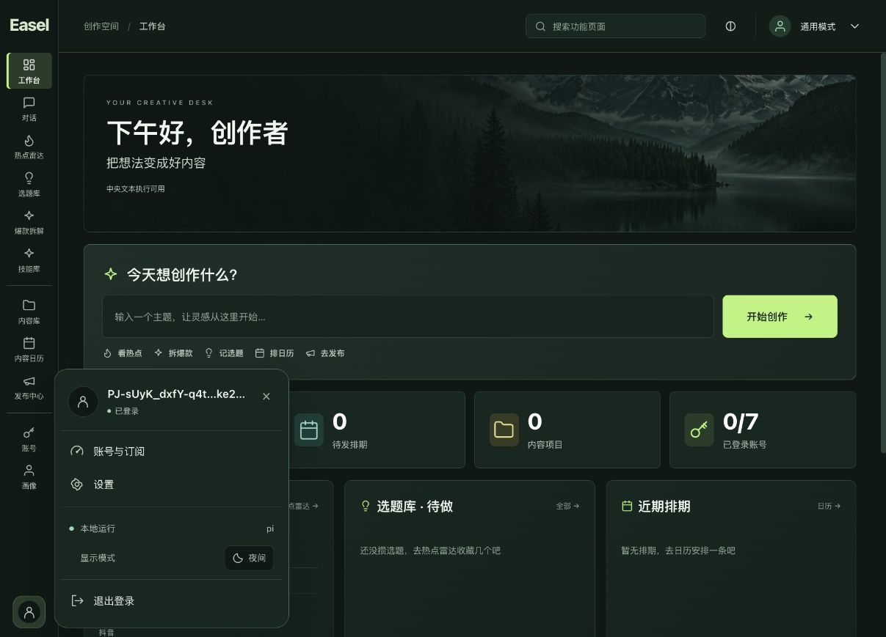
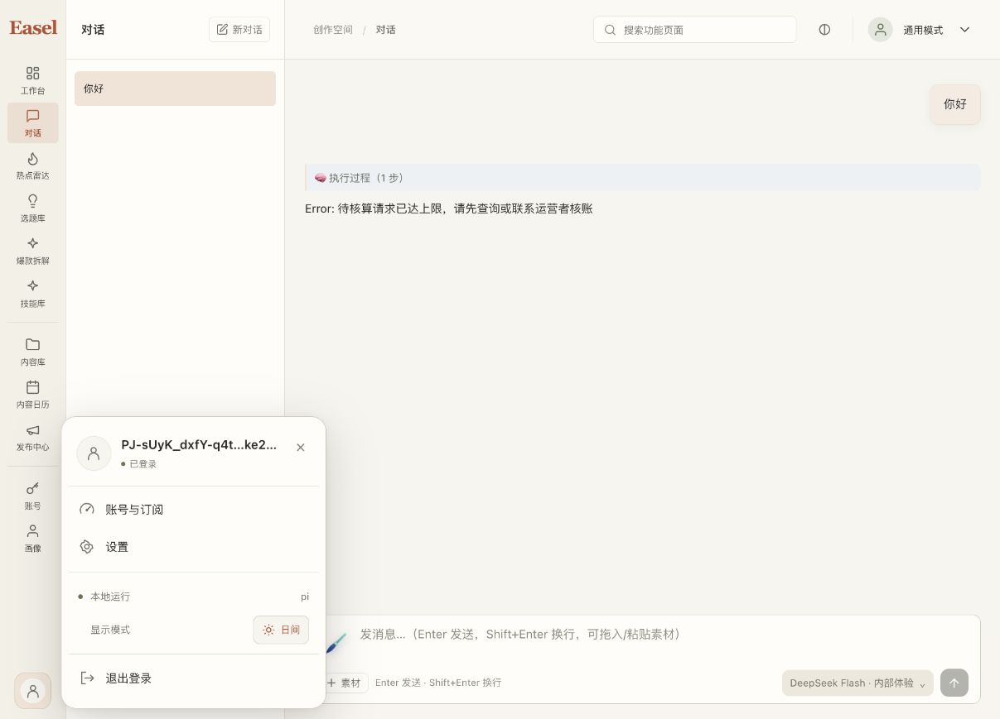

# 用户卡片收纳运行状态与日夜切换

已在 `codex/ui-redesign` 完成，并同步原 `http://127.0.0.1:17868/` 工作台的 v16 包；未提交、推送或合并主分支。

## 本次变更

- 侧栏底部只保留头像，移除原“本地运行 / Agent”及独立日夜按钮。
- 用户卡片保持账号信息、账号与订阅、设置；新增两行本地偏好，显示真实运行状态/Agent 和日夜按钮，退出登录位于底部。
- 沿用原运行状态判断与详情。复用原 `AppearanceToggle`，未修改设置内容、主题实现或账号认证状态机。
- 本地偏好位于认证状态条件分支之外，登录待完成、入口未配置或账号状态异常的卡片也能访问。未登录头像直接发起登录的既有行为保持。
- 新 CSS 使用当前主题语义变量，并显式保留窄屏按钮文字；卡片继续采用原锚点定位、内部滚动及键盘关闭逻辑。

## 验证

- 关联账号/主题/对话侧栏回归最初 67 项通过；完整首次回归 302 项中 3 处旧布局断言失败。调整两处运行状态测试为验证传入卡片的状态数据，删除已过时的“齿轮旁截断状态”静态断言，最终 **301/301** 通过、无跳过。
- 前端 TypeScript/Vite build 成功。Lint 退出 0，保留已有 `linkifyOutputs.ts:27` 无用转义警告；构建保留已有大 chunk 提醒。
- 原 17868 浏览器实测：卡片包含运行状态及一个日夜按钮，侧栏两类旧控件数量均为零；卡片位于视口内，按钮文字可见。
- 实测夜间 C → 日间 A → 原夜间 C，卡片保持打开；Escape 关闭并恢复头像焦点；卡片设置入口正常导航，再关闭设置，没有保存配置。
- 验收时的对话列表、当前对话正文摘要、空草稿及 `forest/dark` 外观前后相同。后续页面可继续由用户正常导航；不扩展为全部历史正文逐条审计。
- 95 个受保护用户文件集合保持，仅中央登录会话文件发生常规 token 刷新，剔除 access/refresh token 和过期时间后内容相等。原账号 scope、钱包、历史及自定义接口配置保留。
- 没有发送聊天、调用真实模型或执行账本变更。本次没有修改中央服务、模型目录或原待核算限制。
- 原短视口定位和主题模式单元测试通过；本次实际浏览器截图为桌面视口，没有将其声明为全设备/所有主题的视觉验收。

## 打包与运行

使用现有离线 builder、885 文件源码 authority、前端 receipt、已验证 Python/wheel 输入及 v15 中与当前 authority 匹配的 Pi runtime。最初选用更早临时 Pi payload 的尝试被 worker hash 校验拒绝，未生成交付目录；改用当前 v15 已验证 payload 后构建成功，没有放宽校验。

构建时本机可用空间较紧，以 APFS clonefile 优化新输出目录的物理文件复制，仍经过原 builder 的全部内容/源码校验和 ZIP 生成，没有使用硬链接或改动旧应用。ZIP 完整性检查通过，旧 v15 ZIP SHA256 保持不变。

- 新包：`outputs/_run/pi-portable-20261026-v16/Easel-Pi-macOS15-arm64.zip`
- SHA256：`de755e507c5485d72a3191f43dbb8e055a85738919b8cc8ab57f69ca2e418451`
- 大小：124,888,232 字节；资源 inventory 15,252 文件。
- macOS 15+ Apple Silicon 本地预览包，仍未签名、未公证。
- 原 HOME/workspace 和端口 17868 保持；使用自有实例停止协议切换到新包，未按 PID 强制终止进程。
- v15 包外本机启动/停止入口已转发到 v16，原脚本保存在本机私有备份目录；v15 应用及 ZIP 保留。

安全结果见 [2026-10-26-account-card-controls-safe.json](2026-10-26-account-card-controls-safe.json)。截图：

