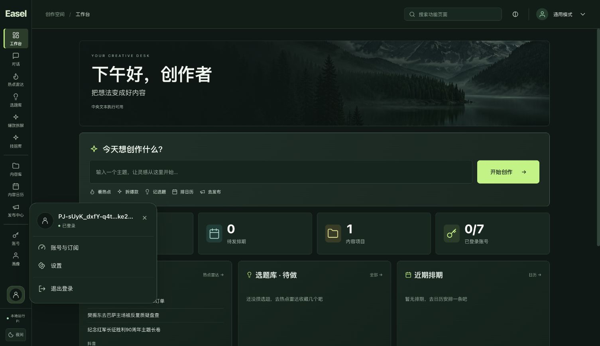

# 左下角用户卡片验收

状态：本批已完成，并同步原 `http://127.0.0.1:17868/` 的 v12 包。保持 `codex/ui-redesign`，未合并主分支。

已确认登录时，点击头像打开用户卡片，显示真实账号与已登录状态，提供账号与订阅、设置、退出登录。工具栏独立设置按钮已移入卡片，原主题快捷入口保留。确认未登录时，点击头像同步打开受控窗口，再导航到既有统一登录URL；已有pending不隐式重启，未知账号状态不清理旧会话。弹窗阻止时提供用户可点击的原登录URL。

SettingsPanel、CentralAccountSettings和store三个源码文件哈希保持不变；设置内容没有重设计。公开源码相对v11仅新增SidebarAccount.css、修改SidebarAccount.tsx及Sidebar.tsx。真实登录scope、HOME、workspace、钱包及45个受保护用户文件前后相同。

## 验证证据

- 前端最终276 passed、0 failed、0 skipped，包含23项账号组件测试；类型、构建和相关lint通过。23项是全集中的子集，不另加总。
- 覆盖真实身份/未知态、重复点击锁、原pending、弹窗阻止、恶意或过期URL、取消/退出失败、迟到返回、卸载清理、Escape与外部焦点关闭。300/400高度定位有单元测试；隐藏合成标签的视口覆盖未实际改变尺寸，不作为短视口浏览器验收。
- 最终隔离浏览器夹具记录starts=accepted_starts=completions=logouts=1，model_posts=0；头像确实自动打开本机合成登录页，完成后原工作台显示账号卡片，设置入口可用。初版夹具表单因no-referrer策略返回Origin拒绝，仅将夹具Referrer-Policy修正为same-origin后重做最终流程，严格Origin守卫未放宽。
- 原17868真实账号仅打开卡片、Escape关闭及设置导航，没有真实退出或重新登录。原列表1项、当前4条历史消息的DOM摘要相同，forest外观保持；该结论不扩展为完整browser storage审计。
- v12资源15251文件、ZIP35798条目CRC及全部归档资源校验通过；881源码/58构建输入、84前端输入/13产物精确绑定。Agent/SDK、Python执行文件、Web后端保持字节一致；六个RECORD差异仅为已移除bin入口的hash项。
- 全新HOME、最小PATH、禁止外网的隔离启动/正常停止与资源前后清单保持通过。本批没有新真实模型、扣点或支付验收。

## 交付

应用包：`outputs/_run/pi-portable-20261026-v12/Easel-Pi-macOS15-arm64.zip`，SHA256：`659534ddcb82e55a0909cfe12304e0eb7653eb6fe7079eb81f4a2bb2e7f9481c`。仍为未签名/未公证macOS15+arm64本地预览包。

v12包外本机启动/停止入口沿用原HOME/workspace/17868；原v11包外入口已转发至v12，修改前脚本保留在私有阶段目录。v11应用本体与ZIP保留，个人数据不进入通用分发包。合成服务已停止，真实工作台继续运行。

安全汇总：[2026-10-26-account-popover-safe.json](2026-10-26-account-popover-safe.json)。私有原始阶段证据在`/private/tmp/easel-account-card-20261026`；不导出私有基线、备份内容或聊天正文。
