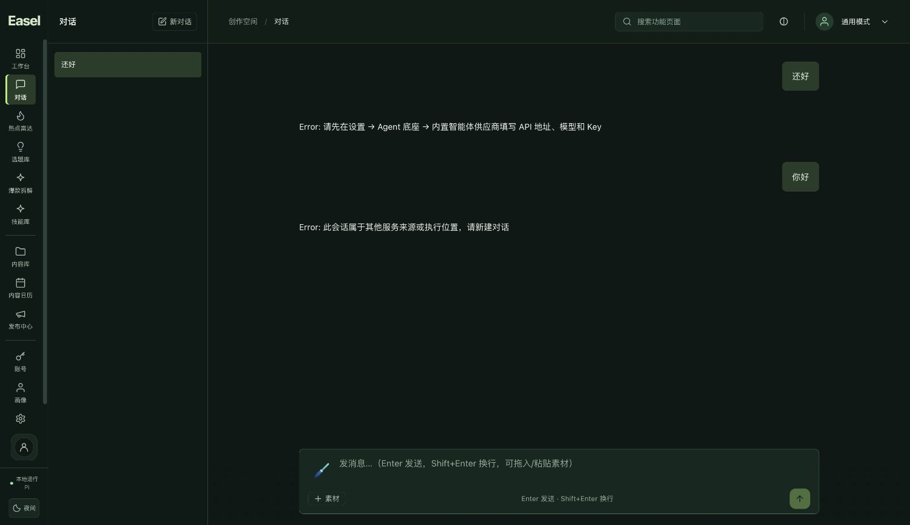

# 2026年10月26日 Codex 工作台布局同步与 v11 打包验收

状态：**本次授权范围已验收**。用户追加要求的原17868同步与重新打包已完成：工作台运行v11，显示工具栏、会话列表和内容区三列；原登录scope、HOME、workspace、钱包和45个受保护文件保持。原标签页可见的一笔会话、一个激活项及四条消息，其列表与消息DOM摘要前后相同。该历史结论限于可见DOM，不扩展为完整浏览器storage审计。

对应[布局执行计划](../superpowers/plans/2026-10-26-codex-workbench-layout.md)的Task 4。最终[安全汇总](2026-10-26-codex-layout-package-safe.json)状态为 `passed_for_v11_ui_package_and_17868_preservation_scope`，SHA256为 `aca55320efc1642afc1ba053189f96daf02e9c4ff01b188063f40510bfa2821f`。当前分支继续为 `codex/ui-redesign`，未合并 `main`。

本次文档整理只读取指定安全回执、回归日志及已有计划，只新增本报告并更新该计划的Task 4/交付状态；未读取 `baseline-private` 或 `user-state-backup`，未修改源码或安全JSON，没有网络、远端或模型操作。

## 从5173预览到原17868交付

前一阶段在 `http://127.0.0.1:5173/` 完成源码预览，当时原17868仍为v10，尚未重新打包。这一记录作为历史保留；本次用户追加授权后，已用独立v11包完成原17868切换，取代此前“仅5173、未打包”的交付现状。

5173与17868是不同origin。本次沿用原 `http://127.0.0.1:17868`、原浏览器标签页及其原有存储，没有复制5173的合成测试历史、重置原storage或导入聊天数据。原v10应用和资源保留，没有覆盖或删去旧包。

## 精确交付包

[v11 ZIP包](../../outputs/_run/pi-portable-20261026-v11/Easel-Pi-macOS15-arm64.zip)位于：

```text
outputs/_run/pi-portable-20261026-v11/Easel-Pi-macOS15-arm64.zip
SHA256 707443f83e788b92f04587d3ee340822c18605ec0253b4c52d0fe599eb5bafc9
大小 124873946 字节
```

应用为 `outputs/_run/pi-portable-20261026-v11/Easel/Easel.app`。这是未签名、未公证的macOS 15+ Apple Silicon/arm64本地预览包；不包含其他操作系统或全新第二台设备的运行验收。

本机另有包外的 `outputs/_run/pi-portable-20261026-v11/启动现有工作台.command` 和 `停止现有工作台.command`，固定使用当前验证HOME、workspace及17868。两个脚本不包含凭据、权限0700、shell语法检查通过；启动入口以 `--no-browser` 验证返回0并复用原PID47661，未另启实例。停止入口未用于停止当前主预览；正常停止能力由隔离smoke和受控切换分别验收。通用ZIP默认使用独立数据目录，不携带本机45个私有数据文件；本地入口保留现有验证工作区，不代表临时目录的长期持久化或整机重启已验收。

`package-safe.json` 确认独立产物验证通过：

| 绑定与完整性项目 | 实际结果 |
| --- | --- |
| 资源inventory | 15251个文件，归档全部资源与清单一致 |
| ZIP CRC | 35798个条目通过 |
| 公共源文件与构建输入 | 880个源文件、58个build inputs |
| 前端来源与产物 | 83个输入、13个输出，逐项精确绑定 |
| 符号链接 | 没有外部符号链接 |
| v10/v11资源 | 比较过程后两者均保持原清单 |

源码清单SHA256为 `ffabcfd404cc67311a638cf8db67466f3ec8a83a6386b6e91825131043665395`，资源清单SHA256为 `fe7c2ddb470a85a2c1725e3ad16d543401bd34bd4d741d6891709ac81a8f23dc`。

相对v10的源码差异仅为两个新增UI文件 `ConversationSidebar.tsx`、`workspace-layout.css`，以及 `App.tsx`、`Sidebar.tsx`、`index.css` 三个既有UI输入变化。包内前端bundle、HTML和来源清单随之更新。

Python执行代码、Easel执行代码、web backend、Pi agent/SDK、launcher/plist与交付控制逐字节保持。六个Python distribution的 `RECORD` 差异仅对应已移除生成bin入口的hash行，已逐行核对；不能表述为全部Python元数据字节完全相同。本阶段不新增原始Python归档/签名验证声明，使用已准备的精确runtime清单和固定wheels完成包验证。

## 回归与实际包运行资源补验

| 独立轮次 | 实际结果 | 范围 |
| --- | --- | --- |
| 前端回归 | **260 passed，0 failed，0 skipped** | 包含新会话侧栏交互及既有主题/认证缓存回归 |
| Python相关回归 | **154 passed，8 skipped** | 保留该轮8项跳过记录 |
| 实际v11包运行资源补验 | **8 passed，0 failed，0 skipped** | 6项内置Pi SDK离线fixture和2项实际包Python sandbox用例 |

前一轮8项跳过需要实际payload环境变量；后续针对v11实际包的独立补验运行了这些用例。不能将两轮加总成不存在的“单轮162 passed”，也不能把实际包的离线SDK测试称为真实供应商或付费模型验收。文档整理没有复跑这些测试。

## 全新HOME隔离启动

`clean-smoke/safe-receipt.json` 记录全新HOME/workspace、初始PATH仅 `/usr/bin:/bin:/usr/sbin:/sbin` 的隔离启动。中央URL未配置、外网被拒绝，模型POST为0；内置Pi可识别，HTML、两项静态资源与图标可达，所启动进程正常退出，所属端口关闭，启动前后15251资源清单相同。

该阶段已绑定三栏源码与编译产物，但 `rendered_ui_verified=false`，没有打开浏览器，不能单独证明三栏实际渲染。原17868的真实浏览器验证另列如下。

## 原17868受控切换与状态保全

preflight确认原v10自有PID为15099，已有认证、无待完成登录、运行时为Pi且未锁定；45个受保护文件与受控备份哈希已核对。文档没有读取备份内容。

首次切换校验因package回执字段名称不匹配而发生 `KeyError`，发生在任何stop前，确认旧PID15099仍运行且未改用户文件或进程后修正校验，再完成实际切换。此失败保留，不表述为首次即成功。

成功切换后的自有PID为47661，launcher PID一致，原入口仍为 [http://127.0.0.1:17868/](http://127.0.0.1:17868/)。安全回执确认：

- 原登录仍有效，scope、HOME和workspace一致，没有发起新登录。
- 45个受保护文件逐字节保持，钱包保持。
- 实际服务的两项前端资产与v11包一致。
- 原v10保留，切换没有真实模型调用。

浏览器操作后的独立 `post-browser-preservation-safe.json` 再次确认当前PID47661、45个受保护文件仍相同，15251个包资源在实际启动及浏览器读取后仍与inventory一致。这与后续的DOM摘要比对是不同证据，不能相互替代。

## 原标签页三栏与可见历史

原标签页同源刷新后的DOM显示三个同级元素都在 `app-layout` 下，顶部与高度一致：工具栏约80px、独立会话列表约264px、右侧内容区占剩余宽度。页面保留原forest外观，运行时文案为“本地运行pi”。



浏览器前后可见范围均为1个会话、1个激活项、4条消息，主题均为forest。摘要保持如下：

| 可见DOM范围 | 切换前后相同的SHA256 |
| --- | --- |
| 会话列表 | `65ab6397ea04860a2654c634f9e2cc95e32d26a01ac3680a6cd5e07bf4f54f70` |
| 激活对话消息 | `74f567653941fcfb464e2b61ae6ba3b9caf778f4f6cc8dcced894e886611c001` |

这些摘要没有导出聊天正文。原对话包含既有配置/来源不匹配提示，作为历史保持，不能归因为新升级失败。

支持的浏览器接口没有提供完整storage哈希能力。本次直接证明的是上述可见列表与激活对话DOM保持；不能据此宣称全部归档、不可见会话、所有localStorage/sessionStorage键或浏览器存储字节已完整审计。既有存储逻辑未改、同源同tab未重置/导入，是实现和操作保全证据，不替代完整storage比对。

前一阶段5173已做五主题与窄屏交互验证；本次原17868实际保留并核对的是forest及该标签页可见状态，不把此前不同origin的结果写成原17868各主题均重新逐项验收。

## 收尾与保留边界

最终安全汇总与 `cleanup-safe.json` 确认仅本轮自有5173临时Vite正常停止。原17868继续运行v11、18885私有管理隧道及其他服务保留，浏览器保留原工作台tab1与后台tab15。v10和受控本地备份继续保留。

本阶段模型调用为0，没有新做真实供应商、模型、扣点、支付或发点验收；先前真实模型/结算证据属于各自独立阶段，不能由本次布局和打包推导。本批没有合并主分支，也不包含签名公证、其他OS、第二设备或长期稳定性验收。

本轮证据位于 `/private/tmp/easel-v11-20261026`，已读取的范围为 `package-safe.json`、`clean-smoke/safe-receipt.json`、`preflight-safe.json`、`upgrade-safe.json`、`browser-upgrade-safe.json`、`post-browser-preservation-safe.json`、`cleanup-safe.json`、`frontend-regression.log`、`python-regression.log` 和 `actual-runtime-tests.log`。私有基线和用户状态备份未读取；最终公开安全字段见[同名安全汇总](2026-10-26-codex-layout-package-safe.json)。
