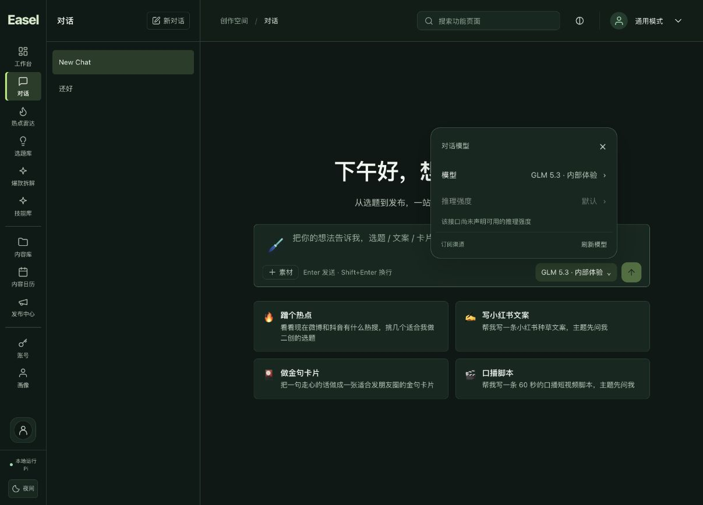
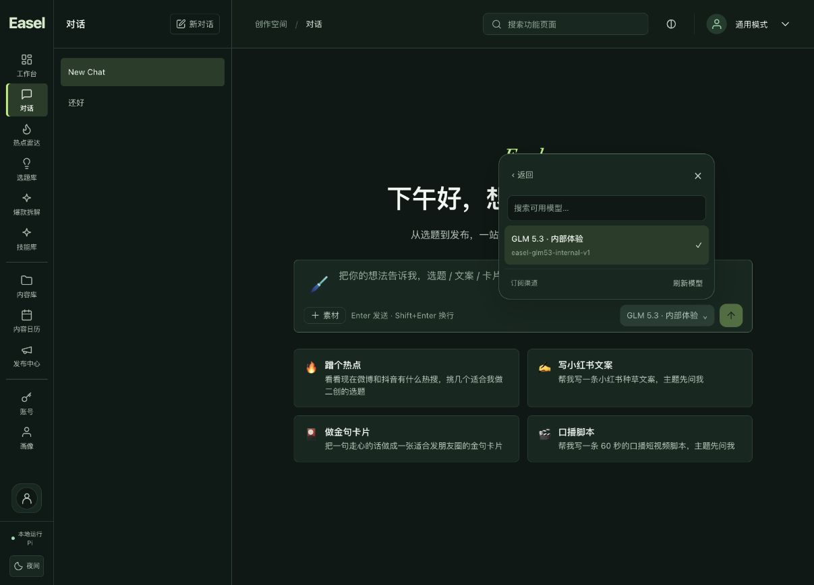
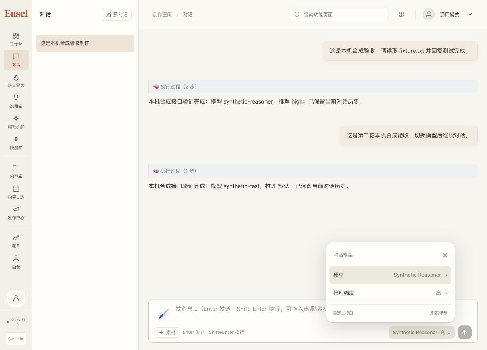

# 对话模型与推理强度选择器验收

已在 `codex/ui-redesign` 完成，实现和最终 v15 包已同步原 `http://127.0.0.1:17868/`。没有提交、推送或合并主分支。

## 已实现

输入框右下显示当前模型与已选推理强度，弹层提供模型列表、搜索、刷新与推理强度子页。模型来自当前订阅账号的中央目录，或自定义 Pi/API 接口的 `/models` 目录；没有在网页保存或展示供应商 Key。设置模型继续作为默认，不通过修改全局配置实现本轮切换。

显式选择经服务端短期目录凭据校验，包含来源、身份、模型成员和推理档位。请求接受后冻结模型与强度；运行中禁用切换，SSE 恢复只读取原任务。120 秒目录租约在到期前只读刷新；同来源保留选择，账号、供应商 Key、目录或能力改变需重新确认。最终补齐正常中央令牌续期与真正身份变化的区分，续期保持 UI 来源版本，提交凭据仍绑定实际认证状态。

能力只依赖明确的 `reasoning: {efforts: [...]}`，自定义目录也接受 `supported_reasoning_efforts`。没有元数据时为 unknown；空数组或显式 false 为不支持。允许 minimal、low、medium、high、xhigh、max，不按名称推断。默认不额外发送推理参数。Pi 和 API 直连实际下发已验证参数；尚不能安全切换的其他底座保留原默认路径并说明限制。

Pi 同一供应商及同一账号范围内换模型可继续原私有历史；更换供应商、账号、平台或 scope 仍拒绝。旧对话来源不匹配时显示新建对话提示，保持原历史。未修改 SettingsPanel、CentralAccountSettings、store、供应商配置存储与钱包费率公式。

## 实际验证

| 验证 | 最终结果 | 范围 |
|---|---|---|
| 全前端 | 302 passed，0 failed，0 skipped | 包含 26 项模型选择器测试；焦点、租约和发送保护先红后绿 |
| 本地后端回归 | 306 passed，7 skipped | 目录、Pi、API、既有引擎、订阅准入、恢复与重试；1 条既有 python_multipart 弃用警告 |
| 中央隔离 PostgreSQL | 147 passed，0 failed，0 skipped | 目录能力、任务认证、预留前校验、HTTP/SSE、账本、资金模式、待核算与恢复；专用 tmpfs 测试库 |
| 实际锁定 Pi SDK | 9 个正常报文场景、3 个非法输入拒绝、6 个生命周期场景通过 | 使用包内 Node/Pi 1.4.0 和本机合成 Responses；包含六档位、不注入默认参数及工具后续轮次 |
| 类型、构建和差异 | 通过 | 既有主 JS 超过 500 kB 提示仍存在，未做无关拆包 |
| 最终包 | 清单、归档 CRC、全新 HOME 启停通过 | 885 源码、58 构建输入、87 前端输入/13 产物、15252 资源、35800 ZIP 条目 |

浏览器实际操作通过搜索、推理子菜单、禁用不支持档位、选择高强度发送、切换模型续聊以及原工作台真实目录读取。首个 v13 候选的子页焦点卸载问题由浏览器发现，最小修复后 v14 分步操作保持焦点；最终 v15 只有目录正常续期修复，前端和 worker 字节与通过浏览器合成调用的 v14 相同。最终 v15 又在原 17868 实际加载目录并截图。

合成服务累计观察到 5 次聊天 POST、6 次上游请求（含 1 次工具后续轮次），其中最终 v14 有 3 次 POST。最后一笔同提示请求之前存在 `GET last`，界面保留 4 条用户消息，与重试准入路径相符；具体触发操作未精确归因。只读审查未发现选择器定时刷新或 SSE 恢复自动触发新 POST 的路径。本观察保留在安全收据中，不据此声称是已确认的人为点击，也不隐去额外请求。全部为本机合成接口，禁止外网，没有真实模型、支付或钱包扣点。

## 原工作台与当前限制

真实账号仍登录，钱包相同，原来一条对话的四条消息正文与列表保留。升级瞬间 45 个保护文件相同；长时间验收中账号文件仅发生正常 access/refresh token 和到期时间轮换，44 个其他文件保持相同，账号配置与身份范围保持。刷新前后仅本机私有备份，没有恢复旧令牌。为展示订阅菜单创建了未发送的空对话；空对话刷新不保留是原行为。

当前真实中央目录只向该账号开放 **GLM 5.3 · 内部体验**（`easel-glm53-internal-v1`），尚未声明可选推理档位，所以真实菜单显示“默认”并禁用强度。其他订阅模型须经中央发布、启用和授权后才能出现在此账号目录；不能把 New API 全部渠道模型直接当成用户已获授权的模型。

中央能力定义、目录透传与预留前能力校验代码已完成并通过隔离数据库测试，**尚未部署到生产中央服务，也没有发布新的生产能力定义**。上线前需要供应商能力验证和既有不可变模型版本发布。此阶段没有新的真实供应商、真实扣点或移动端浏览器尺寸验收。

## 交付与证据

最终包：`outputs/_run/pi-portable-20261026-v15/Easel-Pi-macOS15-arm64.zip`。SHA256：`c39b449fba67d1b44653f5b1c34a11a1b94471ad3a679bdaaf559869c73928ee`。macOS 15+ Apple Silicon 本地预览包，未签名、未公证。旧包保留；本机旧启动入口转发最终 v15，个人账号和供应商配置不进入通用分发包。

合成应用、供应商夹具及专用 PostgreSQL 均停止；原 17868 继续运行。当前工作区仍为原临时验收工作区，没有扩展声称重启电脑或迁移持久目录已验收。

安全汇总：`docs/validation/2026-10-26-composer-model-picker-safe.json`。原始日志与私有备份在 `/private/tmp/easel-composer-models-20261026`；安全汇总不包含这些备份、令牌或聊天正文。中央能力专项说明见 `docs/validation/2026-10-26-model-reasoning-review.md`。
