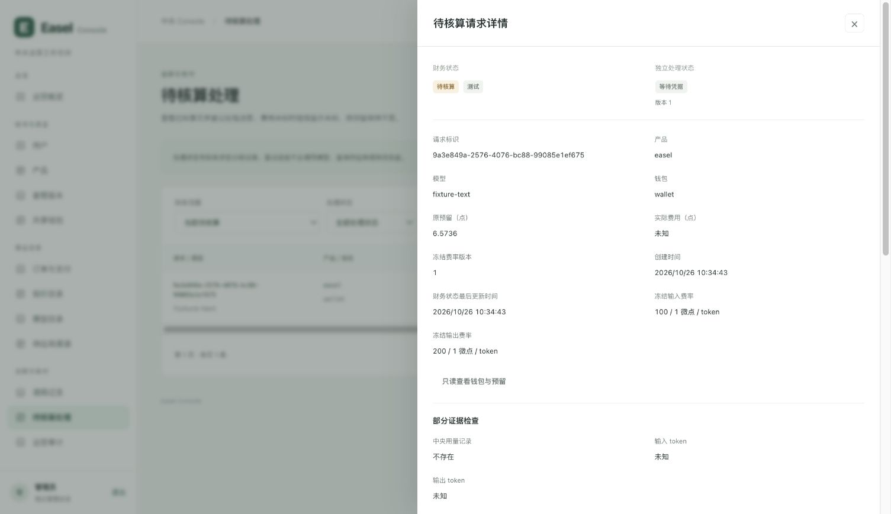
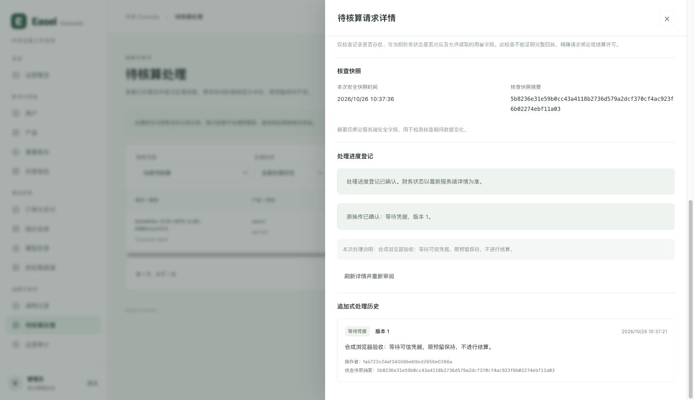
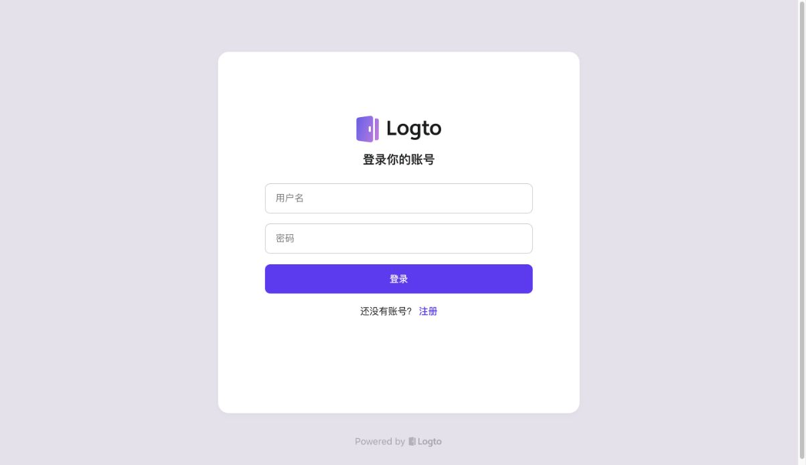
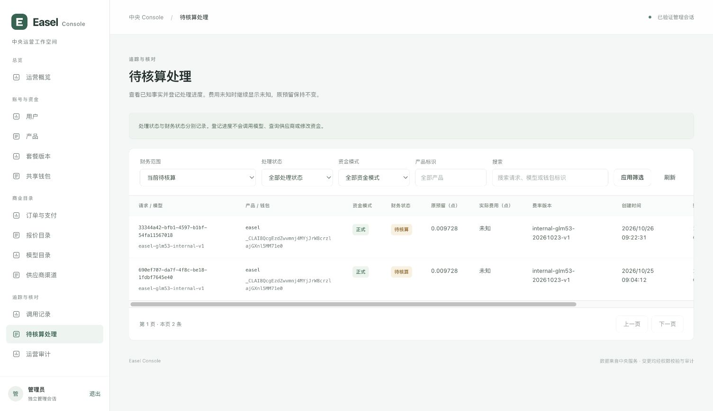
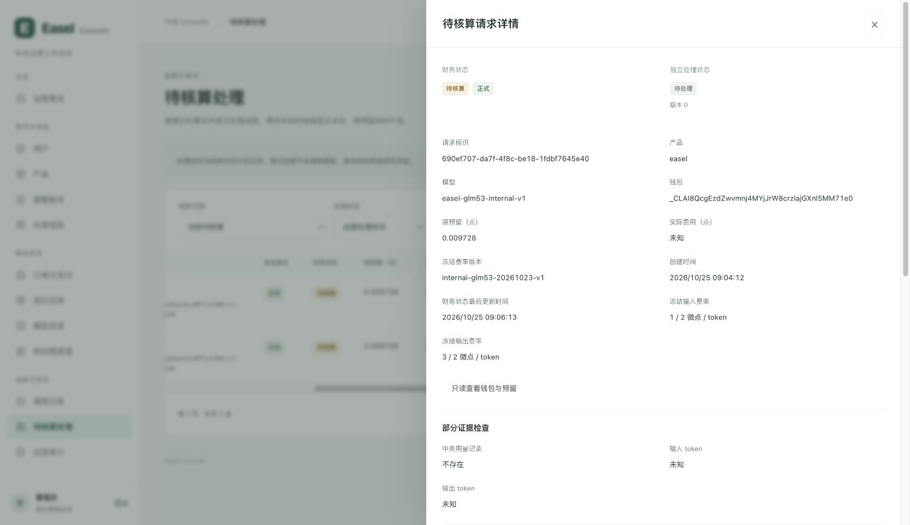

# 2026年10月26日待核算运营工作台 R1 阶段验收

状态：**R1约定范围已验收**。用户批准的私有 Console 待核算队列、安全详情、处理进度与不可变审计，已完成实现、本地真PG/前端/合成浏览器验证、生产部署和本人管理员对真实队列及两笔独立详情的只读验收。浏览器后的独立数据库复核确认八张权威表哈希、余额与原pending保持，工单/操作/审计均为零。生产未提交处理进度；旧未知费用保持未知，R1不包含可信补结算。

对应[批准设计](../superpowers/specs/2026-10-26-reconciliation-workbench-design.md)和[执行计划](../superpowers/plans/2026-10-26-reconciliation-workbench.md)。当前分支为 `codex/ui-redesign`，HEAD `e972af0`，未合并 `main`。本轮文档收尾仅更新报告、执行计划和运行手册，读取本地文档、已保存证据及根任务提供的实际部署结果；没有发起网络、远端、供应商或模型操作，没有修改代码或重复运行测试。

## R1 的行为和资金边界

R1 将运营处理状态与真实财务状态分开。没有工单时显示“待处理”，不能为显示默认状态创建行；允许登记“核查中”“等待凭据”“存在争议”。工单登记不把 job 改成 settled，不降低 pending 数量，不释放 hold，也不使未知 actual 变为零。

本批新增 `console_reconciliation.py` 与追加迁移 `011_console_reconciliation.sql`，只为处理元数据、既有操作与不可变审计提供必要能力；历史迁移保留。`execution:review` 是处理进度权限，不是金融结算权限。admin/operator 可登记，viewer 只读，产品角色不能因此读取工单。

Console 继续按允许的安全列读取原财务及执行记录，不能读取原始 prompts、结果正文、HTTP headers、私密 token、raw reason、完整 Scope、上游响应正文或原始核账凭据；不能更新原钱包、hold、reservation、job、receipt、journal、entries 或发点记录。工单只引用已有 job，归属由服务器确定。

| 接口 | 本批行为 |
| --- | --- |
| GET `/api/reconciliation-cases` | 有界队列，默认 pending；严格筛选与分页，读取不创建工单 |
| GET `/api/reconciliation-cases/{job_id}` | 独立服务端详情、安全快照摘要与追加历史；actual 缺失保持未知 |
| POST `/api/reconciliation-cases/{job_id}/reviews` | 只登记进度，校验同源、CSRF、当前会话/ACL/epoch、快照与 revision；元数据与审计同事务 |
| GET `/api/reconciliation-cases/{job_id}/review-operations` | 仅按当前 actor、job、原 Idempotency-Key 查询原操作结果，不创建记录 |

安全摘要只绑定已授权字段，用于核对观察期间的数据变化；它不是供应商可信证据，也不是精确 attempt 绑定或补结算许可。中央用量记录的有无及允许字段的部分一致性诊断，同样不能升级为完整回执证明。

## 真实隔离 PostgreSQL 与独立审查

中央测试使用真实隔离 PostgreSQL，不以 SQLite 或模拟金融不变量替代。测试覆盖受限角色、严格投影、读取无写入、工单/审计原子性、会话与 ACL 即时复验、幂等、CAS 竞争、原键结果查询，以及处理操作前后原金融记录保持。

独立审查发现并修正了列级与表级授权守卫问题、资金模式筛选遗漏，以及 runner 的 `REQUIRED_MIGRATIONS` 未包含 011 的问题。runner 修复相关独立轮次为 16 passed。不能把旧的启动条件用于声称新 R1 已具备完整运行条件。

| 阶段 | 实际结果 | 证据范围 |
| --- | --- | --- |
| 首轮中央全量 | 1019 passed，2 failed | 保留失败记录，不表述为首次全绿 |
| 后端早期相关回归 | 69 passed，13.05 秒 | 独立子集轮次 |
| 后端资金模式补漏后回归 | 77 passed，13.23 秒 | 独立相关 PG/HTTP 轮次 |
| runner 011 守卫修复 | 16 passed | 独立相关轮次，不与全量相加 |
| 中央最终全量 | **1030 passed，114.88 秒** | 最终真实隔离 PG 轮次，exit code 0，stderr 为空 |
| Console 前端最终 | **38 passed，0 failed，0 skipped** | `frontend-funding-green.log` 所记录轮次 |
| Console 类型与构建 | `tsc -b && vite build` 成功 | `frontend-funding-build.log`，构建产物已绑定进 wheel |

这些轮次存在覆盖重叠，不能相加为总测试数。最终中央命令 wall time 为 115.446 秒，pytest 报告时间为 114.88 秒；这两个数是测试运行记录，不是生产性能或容量指标。文档整理没有复跑上述测试或构建。

`central-final-safe.json` 确认最终测试前后源码清单相同，源码清单 SHA256 为：

```text
5677892152f5784b30cb5b61689a108aa2bc52bdc233a0dc94d4c5707af26d4b
```

最终 stdout SHA256 为 `4244efb73fe0d1bfc99a6af99c27cf06d1e67304b212f2308b260b3a4f3a742f`。这些哈希绑定最终通过的测试输入和输出，不用于掩盖前一轮失败。

## wheel 与已部署 release

已准备的本地 wheel 为：

```text
outputs/_run/reconciliation-r1-20261026/wheel/easel_central_platform-0.1.0-py3-none-any.whl
SHA256 94ca79973b12cab2b552edf426473ad127785d7118c20e7b817589c67f9b7857
```

安全回执记录 57 个公共 payload 文件，wheel 与当前源码、Console dist 一致；原迁移和金融执行模块逐字节保持。相对上一发布绑定的源变更为 `console_app.py`、`console_auth.py`、`console_permissions.py`、新增 `console_reconciliation.py` 与新增 migration 011。没有用修改历史迁移来安装 R1。

本次报告整理独立复核了实际 wheel 的 SHA256，并对 60 个 ZIP 条目完成 CRC 检查，结果通过。57 个公共 payload 文件与 60 个总 ZIP 条目是不同口径。

154 的 R1 独立 release `/srv/easel/releases/20261026-reconciliation-r1-v1` 已完成 fresh venv、`pip check` 与 57 payload 核对并成为实际运行版本。迁移 011 已应用，SHA256 为 `ad3219dcfe496137a32493bd97e69519799f6cc221494ac54e8209bf7efef7d5`；最小 Console 列权限与启动 guard 通过，四项服务 active。原配置哈希保持，模型准入与原 Nginx 配置已恢复。生产切换及数据保持记录见下节。

## 合成浏览器验收

浏览器验收使用隔离本地 Console 与合成账本，没有使用生产旧 pending 作为写操作对象，也没有调用真实模型。截图中的 fixture、金额与处理历史均为合成数据，不能映射为真实用户的钱包或生产处理结果。

`browser-v2/browser-proof-safe.json` 记录以下完整结果：

| 项目 | 实际结果 |
| --- | --- |
| 处理进度 POST | 1 次 |
| 模拟响应丢失 | 1 次 |
| 原 actor/job/key 操作结果 GET | 1 次 |
| 最终处理状态 | `awaiting_evidence`，revision 1 |
| 对应处理审计 | 1 条 |
| 真实模型 POST | 0 次 |
| 资金保持 | before / after 财务快照 SHA256 相同 |

模拟 POST 已提交而响应丢失后，页面通过原键 GET 确认原结果，未换键、未补发第二次 POST。成功反馈、原操作确认和追加历史均显示同一 revision 1；财务状态仍是待核算，实际费用仍为未知。





该合成财务快照的前后 SHA256 均为：

```text
9fcbd893f2c99c775c2cc2c0d45092c39cd9b551c7f08a8dd912f7d81b2d4fbc
```

此项证明合成进度登记和原键查询过程中资金投影保持，不能扩展为生产金融表已完成写操作验收、原未知费用已核清，或真实模型/供应商路径通过。

## unknown registry 的当前限制

未知提交结果按 App 内存中的原 actor、job、key 和提交内容登记，可跨关闭详情、应用内页面导航保留；再次进入时只查询原操作，不自动重发 POST。GET `found=false` 仍表示尚未观察到已提交结果，不能判定原 POST 没有执行，也不能据此换键重提。

**整页 reload 后的持久化恢复尚未实现。** 当前证据不涵盖浏览器整页刷新、关闭浏览器或第二个浏览器实例后自动恢复未知提交上下文。不能把关闭详情/站内导航的恢复能力描述为跨 reload 的持久恢复。

## 生产切换与权威数据保持

切换前只读 readiness 的运行版本为 `/srv/easel/releases/20261025-pending-concurrency-v1`，既有服务 active、无实际执行中请求；随后完成上述 R1 发布。下列八张财务权威表的全钱包快照在切换前后相同，SHA256 为：

```text
3fcd787bf72e79a76d6669255e8e15feb2eda2a2ae68312e73d385503c248e79
```

| 权威表 | 切换前后记录数 |
| --- | ---: |
| `credit_lots` | 1 |
| `credit_reservations` | 27 |
| `credit_holds` | 27 |
| `credit_journals` | 53 |
| `credit_entries` | 131 |
| `execution_invocations` | 11 |
| `execution_jobs` | 27 |
| `execution_receipts` | 25 |

该比较涵盖这八张表的全钱包范围，不包含 `execution_results`，也不扩展为所有业务表的全库审计。原 job `690ef707-da7f-4f8c-be18-1fdbf7645e40` 的 9728 微点及 `actual=null` 保持，pending 仍为两笔。切换时余额为 available 9954247、held 19456、spent 26297 微点，切换前后未变；这些是10月26日快照，不复用昨日的余额。

生产 review 写入为 0，模型调用为 0；迁移与部署没有借测试创建生产处理事件、改账、释放原预留或重新派发旧任务。生产最小角色与 guard 的通过，也不替代本人浏览器对真实队列和详情的验收。

## 切换前后加密备份

本次前后两份 sealed 备份均在服务器保留，权限 0600、包含13个文件，服务器端自校验通过：

| 阶段 | sealed SHA256 | 大小字节 |
| --- | --- | ---: |
| 切换前 | `7ce95a0240db601513e1484b4dff479bc4d03c16b9a1f2433b8625862de244e1` | 809802 |
| 切换后 | `5aef207f6fddeb9c4ce1e7974d5dda83aa7d2c7c79eec878d147d8ee0d495907` | 830282 |

完整归档路径、ID与本次部署后的核账快照已绑定到[安全汇总](2026-10-26-reconciliation-workbench-safe.json)，不复用10月25日归档名称。自校验不是 fresh restore、异地备份或完整灾备演练。

## 本人管理员生产只读验收

18885 私有管理员隧道已恢复，入口接口返回200。此前出现登录页白屏；根任务新建 IAB tab13 打开入口并点击统一登录后，约3.8秒显示正常的用户名、密码和登录按钮。过程中没有修改认证、代理或服务器配置，旧白屏未复现，但根因未确认，不能表述为根因已修复。



随后用户表示登录成功，实际进入待审批申请页。根任务仅做只读身份比对：本次请求issuer为当前issuer，但本次subject在任意issuer下匹配admin为0、匹配alias为0；原active admin仍为1、当前issuer的原管理员alias仍为1，近三天原管理员session为3。确认本次使用的是不同于原独立管理员的账号，未授予新权限；这不是原管理员权限丢失或迁移映射损坏的证据。

随后重新打开18885，实际已存在有效的本人管理员会话，AX显示“管理员 独立管理会话”和“已验证管理会话”。在真实生产后台只读查看待核算队列两笔及各自独立详情，完成了本次R1本人页面验收；没有用此前不同账号的申请页、入口200或10月25日历史记录替代。

| 真实请求 | 财务状态 | 原预留点数 | actual/中央用量 | 工单版本与历史 |
| --- | --- | ---: | --- | --- |
| 原任务 `690ef707…` | pending | 0.009728 | actual未知；无中央用量，tokens未知 | 版本0，暂无处理历史 |
| 另一任务 `33344a42…` | pending | 0.009728 | actual未知；无中央用量，tokens未知 | 版本0，暂无处理历史 |

本次未填写处理表单、未点击登记处理进度，没有为了验收在真实旧请求上创建review事件。tab15保留在队列页面；该读验只证明授权页面和安全字段的实际展示，不是生产写入或补结算验收。






- [x] R1 本地实现、真实隔离PG、前端/类型/构建与合成浏览器验收。
- [x] 生产独立 R1 release、migration 011、最小列授权与 guard、服务健康及原准入恢复。
- [x] 八张财务权威表全钱包快照前后不变，旧 pending/原预留/未知 actual 保持，生产 review 写入与模型调用为零。
- [x] 切换前后两份服务器备份自校验，SHA256、大小和权限已记录。
- [x] 18885入口恢复、统一登录表单可见；不归因历史白屏。
- [x] 本人有效管理员会话只读核对真实R1队列及两笔独立详情、安全字段和权限；未填写或提交处理进度。
- [x] 归档最终生产安全汇总、绑定备份完整身份，并核对本轮自有测试资源收尾。
- [x] 浏览器只读验收后的独立数据库财务复核已并入安全回执，使用新增回执而非复用此前切换后快照。

根任务完成本人浏览器读取后的独立只读数据库复核，原始安全结果为 `/private/tmp/easel-r1-20261026/post-browser-verification-safe.json`，已原样并入汇总的 `production.post_browser_verification`。八张权威表的全钱包哈希仍为 `3fcd787bf72e79a76d6669255e8e15feb2eda2a2ae68312e73d385503c248e79`，各表计数与上述切换快照完全相同；available 9954247、held 19456、spent 26297微点，pending为2，原9728微点的actual仍为null。`console_reconciliation_cases`、`console_operations`、`console_audit_events`均为0，财务与journal平衡，四项服务active，复核模型调用为0。该新增证据证明本人这轮页面读取没有登记处理事件或改变资金。

本轮专用合成预览已停止。退出后检测到其隔离 schema/role 仍在，根任务校验本次专用测试数据库名、loopback 端口和完整随机对象名后，显式清理并验证对象不存在；随后仅停止本轮 PostgreSQL 测试容器，保留容器。真实后台的私有 SSH 隧道与17868用户工作台保持运行。原工作台 `config.json` 与 `bundled-provider.json` 的 SHA256 与本轮开始时一致，没有恢复或覆盖用户配置。

## 保留边界与证据位置

R2 的可信证据采集、精确 attempt 绑定和有权限的补结算命令不属于 R1。原预留不释放、未知费用不清零，不提供补扣、退款、重发、运营赔付或“只有费用、没有结果”时的伪造结果恢复。支付、媒体、云端执行、HA、压力/长期稳定性、灾备 fresh restore、PITR 和 offsite 均不由本批本地验证推导。

本轮证据保留在 `/private/tmp/easel-r1-20261026`：`central-final-safe.json`、`central-final-source-manifest.json`、`backend-final-tests.txt`、`backend-funding-final-tests.txt`、`frontend-funding-green.log`、`frontend-funding-build.log`、`wheel-safe.json`、`browser-v2/browser-proof-safe.json`、`production-receipts-safe.json` 和 `cleanup-safe.json`。[最终安全汇总](2026-10-26-reconciliation-workbench-safe.json)已落盘，重新校验65个源码/资产哈希与测试时清单一致，wheel SHA256和ZIP CRC通过。服务器私有连接仅在服务器内使用；汇总不包含凭据、原始账本行或日志正文。
