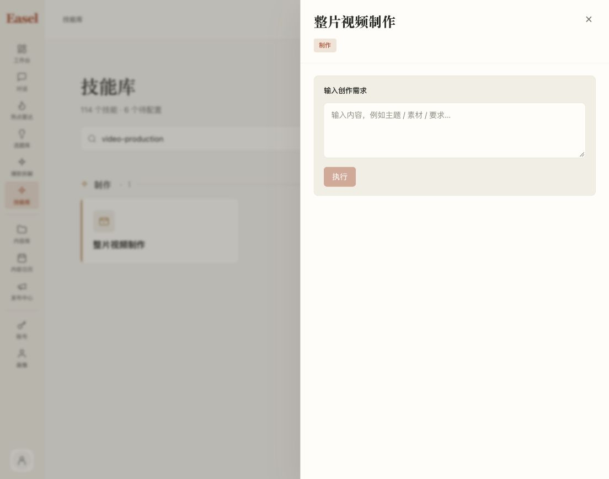
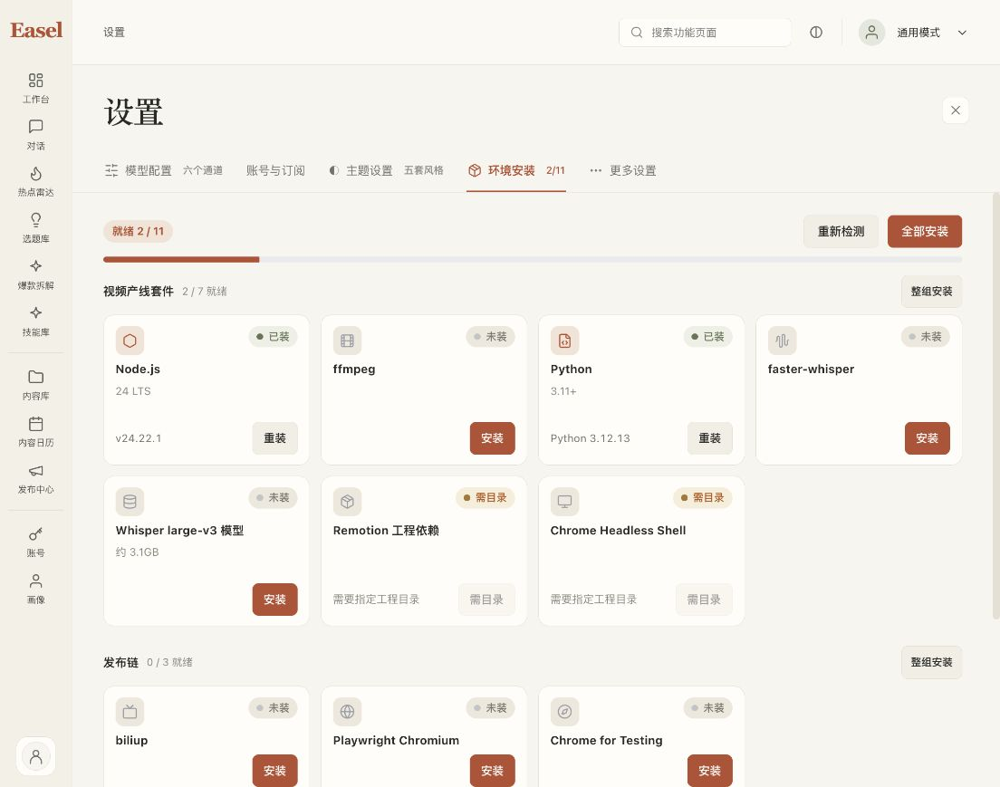
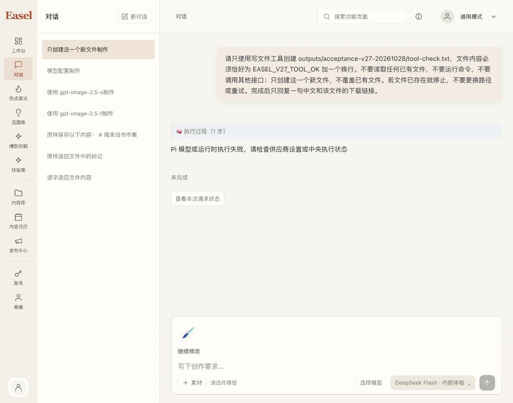

# macOS v27 本机工作台更新验证

v27 已在原 `http://127.0.0.1:17868/` 激活，原账号登录有效。升级过程没有模型请求；升级后的一次独立真实文本／写文件验收收到上游 HTTP 400，文件未创建，因此本报告不声称新包真实工具验收通过。

## 包与状态保全

ZIP：`outputs/_run/pi-portable-20261028-v27/Easel-Pi-macOS15-arm64.zip`，SHA256 `2cb9e38759a90083813139c4fbb15ff61294a306c6ec99b0902660ce73053948`，129,828,928 bytes。36,116 项 CRC、15,401 文件逐 SHA 库存、新显式 workspace 启动与自有进程停止均通过；具体范围见同名安全 JSON 及 `/private/tmp/easel-v27-package-20261028/v27-delivery-safe.json`。

相对 v26 的903公共来源仅 EnvBoard、SkillDrawer、media_contracts 三项变化；58项构建输入相同。Pi／Node 11,932 文件相同。Python运行时代码／依赖资源相同，仅6项实际生成的RECORD中未发货bin行不同，原始metadata保留，不能声称整Python树逐字节相同。新的应用层 music.generate 合同只增加 n／lyric 白名单，未把中央 Incho 服务源码打入桌面包。

原工作区 `/private/tmp/easel-pi-20261023/user-preview/workspace` 未变。升级前后138项受保护文件全部相同、无新增项，已登录账号完整scope与钱包相同；旧App和ZIP保留，旧启动入口指向v27。没有覆盖HOME、重置登录或修改自定义接口配置。随后真实验收引起的状态变化单独列在下方，不能混入升级保全结论。

## 实际界面与回归

前端完整462 passed／0 failed／0 skipped，3.708756709秒；TypeScript与diff检查退出0。界面实测114项技能，内部名称video-production仍能搜索到中文“整片视频制作”；技能主卡和详情不再直出Agent触发规则、原始SKILL正文或内部slug，输入与执行入口保留。环境页保留实际版本、容量、状态、错误与安装操作，删除安装配方的开发说明。

A–E五套主题均实际选择、关闭设置并核对114项技能，保存截图后已恢复原“跟随系统”；当前系统为日间A。此证据是当前尺寸下的界面显示，不能替代所有页面、窄屏、VoiceOver或原生输入法验收。

## 一次真实模型验收的失败证据

仅在新会话 `mvridwfi6pmrzb` 提交一次写文件任务：创建新路径 `outputs/acceptance-v27-20261028/tool-check.txt`，内容为 `EASEL_V27_TOOL_OK` 和换行，禁止读已有文件或运行命令。路径事前不存在，模型为 DeepSeek Flash。

回合 `b01ee330-6497-479b-9ce3-90eb913c02ba` 已被持久接受，之后failed；中央execution `bdbc4509-7b03-42ac-9b68-3c1381e977c5` 只有一个provider attempt，上游模型deepseek-flash，HTTP400，http_request_id为空，未返回provider response ID。只查询原回合，没有自动重发、换模型或新POST。文件未创建，工具成功与新轮真实扣点验收均未通过。

中央原记录保持pending_reconciliation、actual=null、input/output_tokens=null，预留9,728 microcredits（0.009728点），未改成零费用或成功。钱包目前可用6.942425点、预留1.009728点、已用2.047847点，active=0、pending=2／上限3；其中原Flare未知任务仍预留1点，新的9,728仅属于本次独立文本验收。原三笔GLM平台承担授权不覆盖这两笔。

自动审批拒绝了按30秒时间窗读取共享New API日志的动作，理由为可能涉及其他用户内容，该命令未执行。随后仅查schema及本次唯一中央request ID，发现网关未保留同一个ID。用户随后明确批准该限定诊断；服务器内仅匹配到一条错误记录，导出内容限固定类别、公开参数名及关联ID，无原始正文／账号／密钥。已确认错误为create_media工具schema缺少根object类型；工作树Type.Union(variants)在多个媒体模型时的序列化缺type，与网关错误类别吻合。schema修复单独开发，尚未真实复验。文本X-Oneapi-Request-Id关联补丁只改善后续定位，不能替代schema修复。详见同日期deepseek-flash-schema-diagnostic.safe.json。

## 仍未完成的门槛

签名／公证、独立干净设备、原生剪贴板／中文IME／VoiceOver、真实模型本轮失败修复及工具／扣点复验尚未完成。历史两款真实图片交付仍以原v23报告为准，本轮没有新增生图。中央M3和Incho已本地验证、尚未生产部署，真实mixed DR仍failed待诊断，Linux AV工具尚缺；正式支付按用户决定继续关闭。所有工作保留在codex/ui-redesign，未commit、push或merge。
