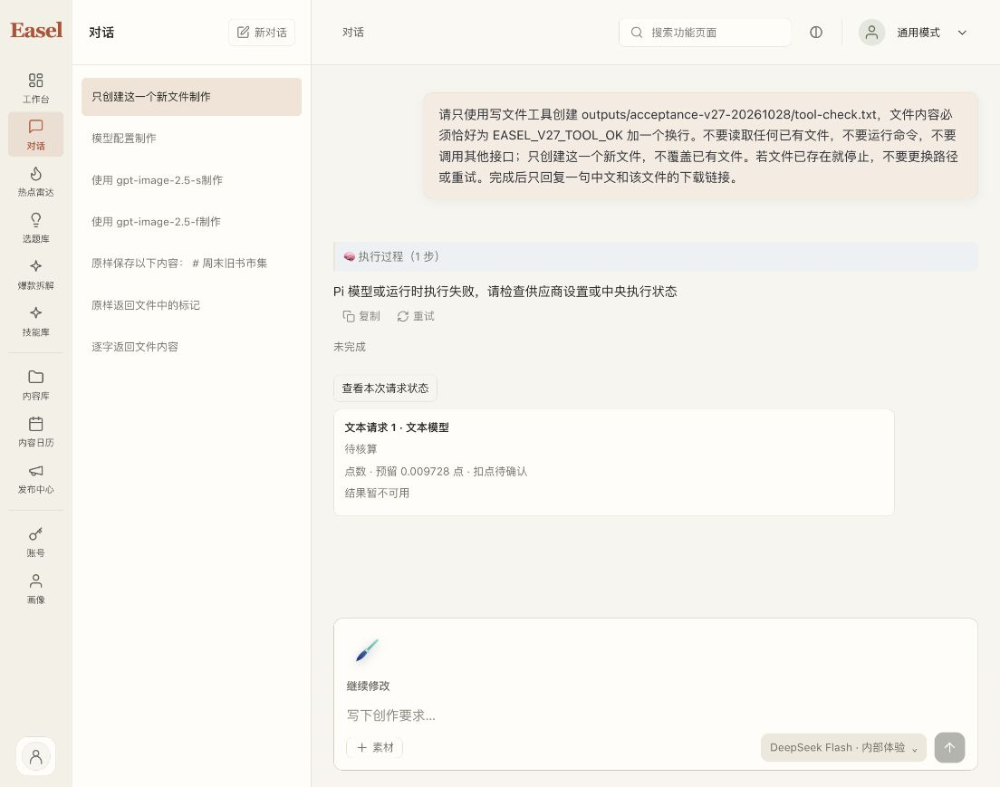
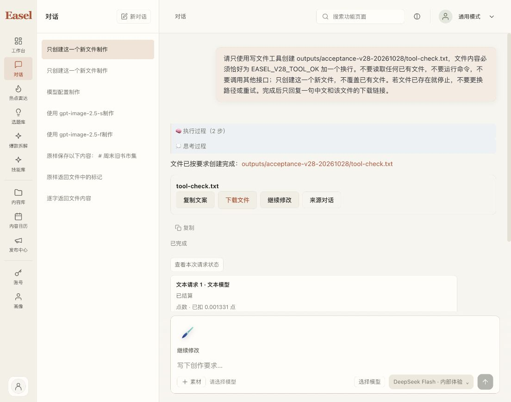
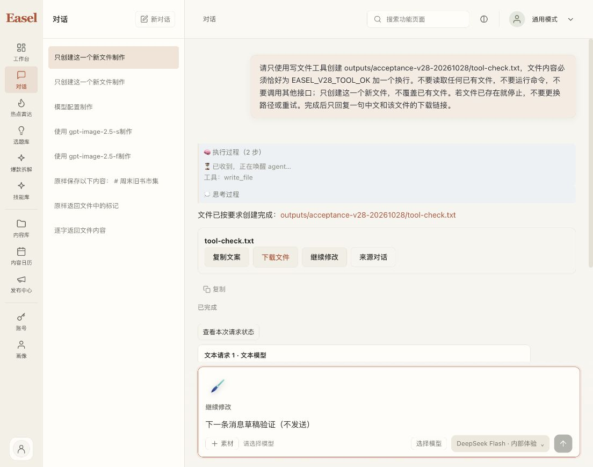

# macOS v28 工作台与真实工具验证

后续更新：本报告记录的连续输入问题已在 [v29实际验证](2026-10-28-workbench-v29-delivery.md)修复，原17868现运行v29。以下保留v28当时的真实工具／资金和问题证据。

v28 已在原 `http://127.0.0.1:17868/` 激活。DeepSeek Flash 的根对象 schema 修复已通过一次全新真实任务：Pi 调用 write_file，新文件及下载字节完全正确，两次模型操作均结算。后续连续输入检查发现同一会话结束后模型就绪状态丢失，已实际复现，正单独修复；本报告不将连续任务体验标记通过。

## 交付与升级保全

ZIP 位于 `outputs/_run/pi-portable-20261028-v28/Easel-Pi-macOS15-arm64.zip`，129,745,093 bytes，SHA256 `421dad0981b0d3383915ac8e0f00ac5333aeb92cabb2a532d1a86c53ba31b81a`。归档 CRC、ZIP／App 逐字比对、15,402 个资源库存、904 个公共源和59个构建输入全部通过。源 manifest 为 `8efca377e36273042096c12c6a249eb1036f0809b61d7f2511e92017b182f7e1`，Pi manifest 为 `23bd3438ff8864722f359200a313686d3098f97e200310aa2c41af103f052a06`。

新运行环境实际验证固定官方 Python 归档来源，26 个 wheel 不变。显式 clonefile 模式保留来源／副本核验和200MiB余量；历史空间不足记录仍保留。包内 Python imports、PNG编解码及实际 Pi SDK 的0／1／2／100模型 strict Mock 均通过，没有外部请求。新隔离 workspace 在52825启动并精确停止；这些证据与后面的真实任务分开。

root 升级前新备份146个保护文件，升级后全部字节相同，没有新增保护文件；完整账号scope／钱包相同，历史和自定义配置保留。原workspace不变、HOME不变，v19–v28旧App／ZIP保留，旧启动入口备份后转向v28。激活PID为70171，HTML与新包一致，升级本身没有模型调用。此保全结论以随后的真实任务之前为界。

请求状态卡片的内部编号／本机转发说明已替换为紧凑真实状态和金额。原历史错误正文未改写。前端完整485 passed／0 failed／0 skipped，TypeScript与Vite构建通过；测试计数不与其他运行相加。

## 全新真实任务、工具和费用

只在新session `mvrlf6j53cn0u9` 提交一次任务，turn为 `ba8ce3ee-17d5-4e52-8747-d6d7c7565a02`。目标 `outputs/acceptance-v28-20261028/tool-check.txt` 事前不存在；要求只写该新文件，不读已有文件、不运行命令、不覆盖或重试。Pi执行过程显示write_file，任务done／clean_end=true。

文件和下载均为18 bytes，内容为 `EASEL_V28_TOOL_OK` 加一个换行，SHA256均为 `01d235ab9209d24a3275d508dbe2eee9b7c9f9db6cc0543675ae77f9a994d951`。实际下载入口HTTP200，界面成品卡和下载链接存在。

| 中央execution | 实际状态 | input／output tokens | 实际microcredits |
| --- | --- | --- | --- |
| ee7d09bc-6ad0-45f1-a1fc-adb2d16fce7d | settled | 2210／320 | 1585 |
| 6b04aa82-f1ff-40ba-a3ed-2c05872aed4d | settled | 2545／39 | 1331 |

合计2916 microcredits，即0.002916点。升级后、任务前可用6.942425／已用2.047847点；任务后可用6.939509／已用2.050763点，差额与两笔actual合计完全一致。预留1.009728点、issued10点、active0、pending2／上限3均符合前后核对。

旧v27原turn `b01ee330-6497-479b-9ce3-90eb913c02ba` 只做GET精确查询，仍只有一条恢复记录、pending_reconciliation、actual=null、预留9728；原Flare一点评审外预留保持。没有重放旧请求、免单、改账、发点或延期。

## 连续输入仍需修复

真实任务后，模型选择器仍显示DeepSeek Flash；同会话再输入一份未发送的合成草稿并等待保存后，界面仍显示“请选择模型”、发送不可用。草稿已清除，未再提交模型。截图仅为本次新合成会话。

已定位：picker跨空态／会话态及页面重挂后，App仅记model／catalog revision，没有保留经过验证的source revision；新目录使旧选择失效，但显示标签仍保留。修复在源代码独立开发，以真实组件重挂测试先复现；不通过缓存目录、放宽版本／权限、静默换模型或重试付费unknown来规避。新包完成前，这个连续输入门槛仍未通过。

## 证明边界

这是当前macOS本机验收，App仍未签名／未公证，Gatekeeper、独立干净设备、原生剪贴板／IME／VoiceOver尚未完成。两项既有charset_normalizer组件严格签名失败保留真实记录，未重签或屏蔽。历史v27的来源false不追改。本报告不证明中央M3／Incho已生产部署、AV沙箱或真实mixed DR通过；正式支付继续关闭，工作保留当前分支，无新增commit／push／merge。
