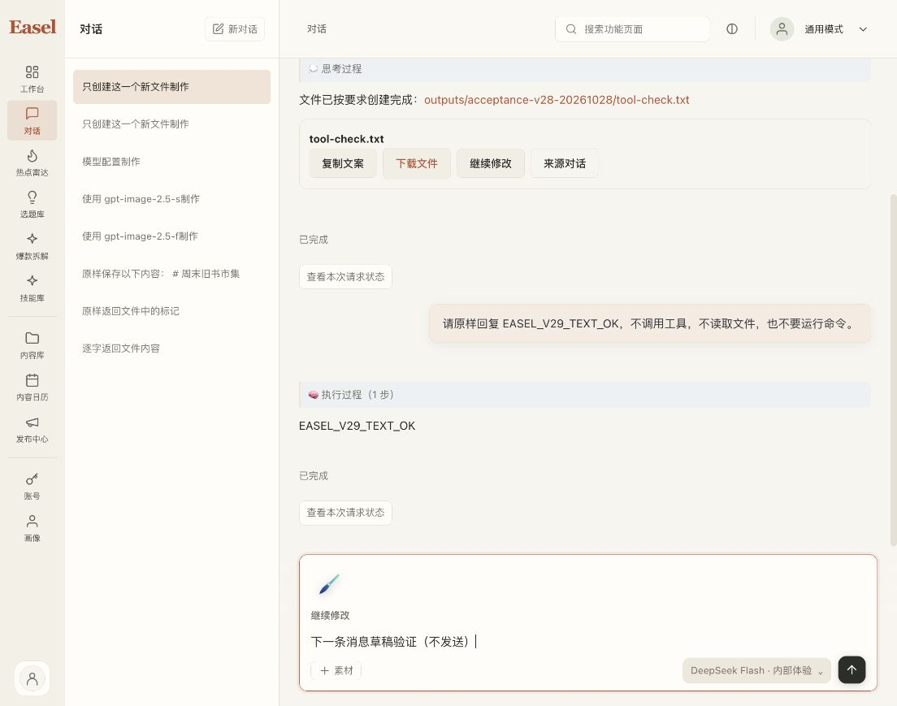
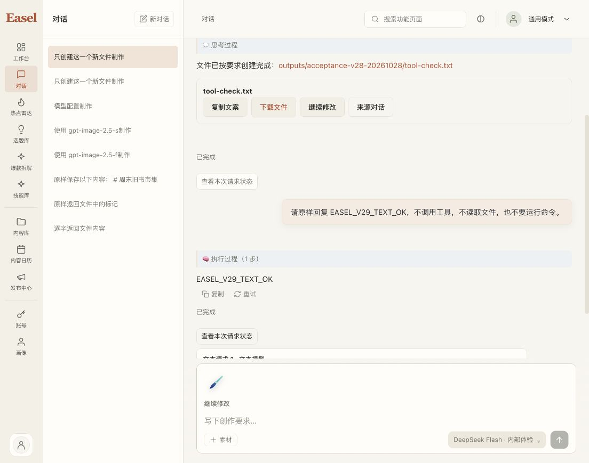

# macOS v29 连续输入与真实验收

v29 已在原 `http://127.0.0.1:17868/` 激活，登录保留。真实文本回复、扣点及任务完成后的下一条草稿就绪均通过；此前 v28 的 write_file／下载／扣点证据与当前完全相同的 Pi 运行时分开保留，不冒充本包又生成了一次文件。

## 包、回归与保全

- App：`outputs/_run/pi-portable-20261028-v29/Easel/Easel.app`。
- ZIP：同根 `Easel-Pi-macOS15-arm64.zip`，129,745,521 bytes，SHA256 `f063ee9c203c03531c05c561bd49a2357aec7e2ddcc3f75dd5807621e7eec536`。
- 来源manifest：`2e36b274862d5faaeacfb1012186ca51992bbf835869ef2d81b1a29235156842`；904公共来源仅三个前端文件相对v28变化，59构建输入全同。
- 完整15,402资源库存、ZIP CRC／App逐字、私有状态与凭据扫描通过；实际包内Python imports／PNG／Node／Pi resolve及新隔离workspace59047启动／精确停止通过，系统PATH、HOME不变。
- 本轮root完整前端回归505 passed／0 failed／0 skipped，3893.540292ms，156个输入前后全SHA一致。TypeScript／Vite／diff检查退出0。独立R2另56 passed，包含原未改反例；计数不相加。r1原500绿及独立发现的失败记录均保留，不套用到新SHA。
- root升级前备份155个保护文件，升级后全部字节相同、无新增保护文件，完整账号scope及钱包相同；原历史、自定义接口配置与workspace保留。PID97261，HTML与新包一致，升级本身没有模型调用。旧App／ZIP保留，旧启动入口备份后指向v29。

另留本机持久私有副本 `outputs/_run/private-workbench-backup-20261028/`，根目录0700且Git忽略；完整894文件、1160条目、15,509,164内容字节逐项验证，复制前后源未变，bytes／links／modes／mtimes一致。不跟随外部链接，原活动workspace未迁移，副本不包含在App／ZIP或公开源中。

Pi／Node的11,932文件与v28全字节相同，manifest仍为 `23bd3438ff8864722f359200a313686d3098f97e200310aa2c41af103f052a06`，worker仍为 `7fc068daae8e9cc9dc201252dbb412de9adb935569e0cb20e641ad6e2b193f6d`。Python代码／资源、26个wheel不变；6个真实安装RECORD仅对应未发货bin入口hash差异，metadata不改写。官方Python归档来源由构建器实际核验，历史v27 false不追改。

## 模型续用修复

此前空态到对话态、Dashboard到ChatPage重挂时丢失已验证的模型来源；显示仍有旧模型，提交状态却被新目录lease拒绝。现在App只在内存中保存经过核验的选择及source revision；同来源的新目录再次严格核验原模型／推理强度后绑定新lease，未把UI provenance加进请求体。

独立复核另发现账号／会话切换等待新目录时，旧lease曾短暂报告就绪。R2将Picker快照、就绪报告、异步结果及ChatPage发送门禁绑定session／workspace／source，首个render就遮蔽旧状态；迟到结果、卸载结果、未知来源、模型移除及effort不再支持继续拒绝。同目标有效lease的背景刷新仍保持可用，没有缓存目录、静默换模型或放宽授权。

## 真实同会话验证

在原新验收session `mvrlf6j53cn0u9`，仅提交一次全新纯文本指令，要求原样回复 `EASEL_V29_TEXT_OK`、不调用工具或文件。新turn `af5c71da-d1c6-444e-a028-2477d5af7de4` 为done／clean_end=true，回复精确相同；它不是原turn的重试。

中央execution `75a71752-3893-4b23-b2bf-56f9f2357d45` 已settled，input2766／output8，actual1395 microcredits，即0.001395点。任务前可用6.939509／已用2.050763点，任务后可用6.938114／已用2.052158点，差额与actual完全一致。issued10点、预留1.009728点、active0／pending2／上限3保持。原v27请求仍pending、actual=null、预留9728，原Flare一点评审外预留不变，既有18字节工具文件SHA不变。

任务完成后，未重新选择模型，直接输入下一份合成草稿并等待保存：DeepSeek Flash仍被选中、发送按钮可用、没有“请选择模型”阻挡。该草稿没有发送，证据保存后已清空。两次成功验收分列为v28工具2916和v29文本1395 microcredits，总4311；未把原9728未知预留计为已扣。

## 范围与仍在推进的门槛

本包仍未签名／公证，Gatekeeper、独立干净设备、原生剪贴板／IME／VoiceOver不在本轮证明中。两项既有charset_normalizer组件严格签名失败和未使用Pillow RPATH继续如实记录；没有绕过系统安全提示。

154独立Linux wheelhouse已验证，不代表中央M3／Incho生产发布。AV官方包已独立准备，但clean-env动态库加载及progress时间与真实samples不符是已实证兼容门槛；未安装到生产，也未通过放宽容差投产。恢复窗口[F1-r2私有合同](2026-10-28-restore-freeze-f1.md)已通过限定独立审查，仍无许可；W／P／D、实际只读producer与真实mixed DR尚未通过。正式支付按用户决定继续关闭；第二真实产品、签名身份等外部输入仍保留。总目标未完成，没有commit／push／merge。
